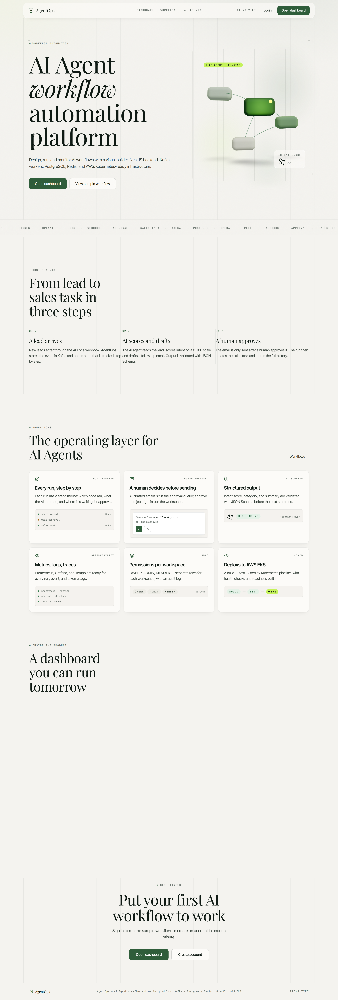
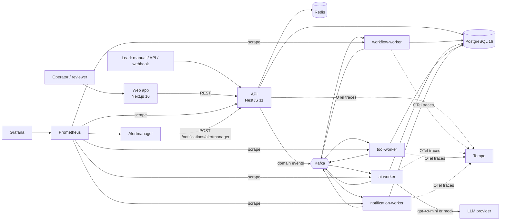
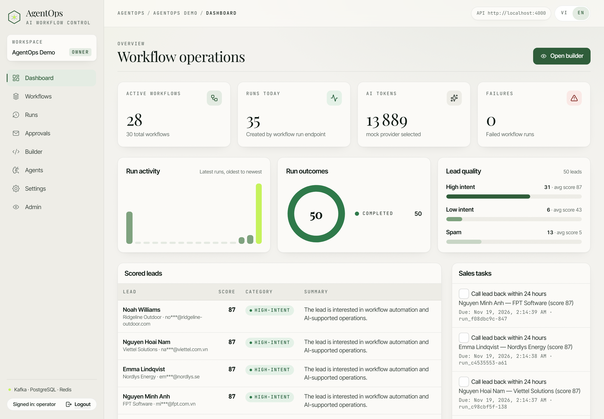
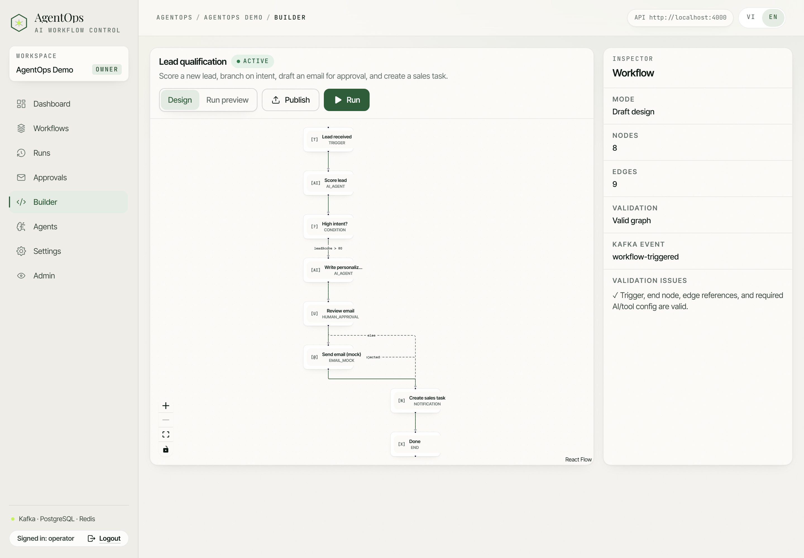
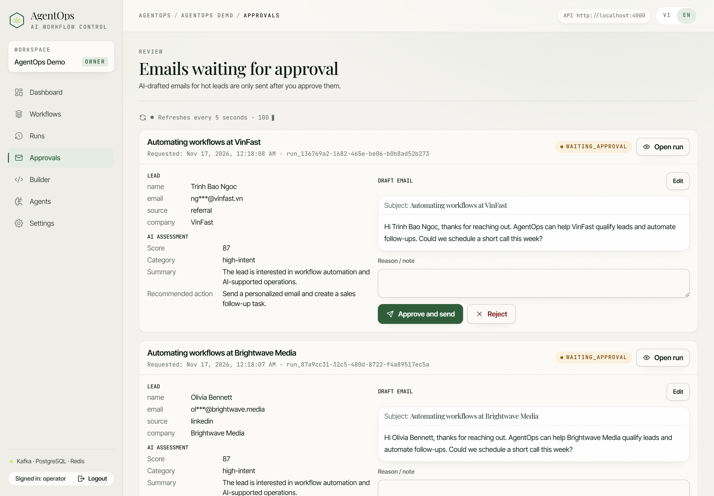
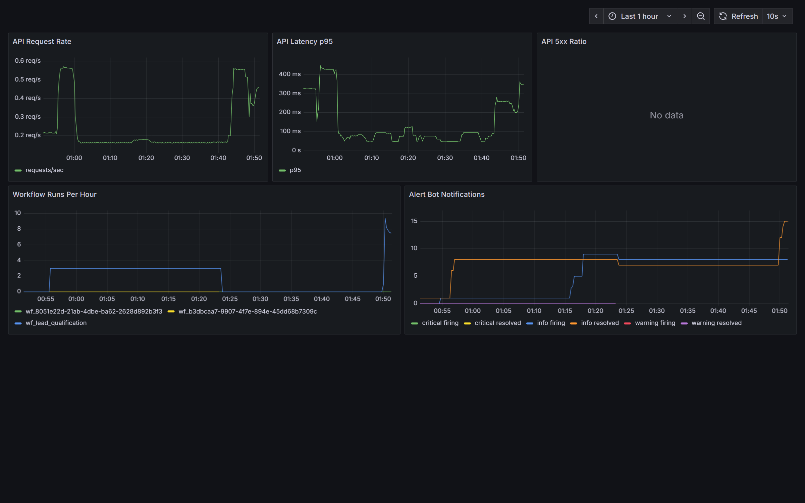

# AgentOps

**AI agent workflow automation platform.** Design a workflow graph, run it through Kafka workers, keep a human in the approval loop, and see every step of every run.

AgentOps is a portfolio-grade system built as a pnpm monorepo: a Next.js 16 dashboard, a NestJS 11 modular-monolith API, four Kafka consumers, PostgreSQL 16, Redis, and a full AWS deployment (Terraform, EKS, RDS, ElastiCache, MSK, ECR) driven by GitHub Actions. The showcase workflow qualifies an inbound lead: an AI agent scores intent and drafts a follow-up email, a condition branches on the score, a reviewer approves or rejects the email, and the run finishes with a sales task.



**Live demo (production stack):** [web](https://agentops.18-136-215-126.sslip.io) · [API health](https://api.agentops.18-136-215-126.sslip.io/health/ready)

The hosts use [sslip.io](https://sslip.io), which encodes the AWS load-balancer IP in the name. They change after every stack rebuild; update the links from the production runbook when the stack is recreated.

For the long-form system document (architecture, data model, every screen, monitoring, security, testing), read [docs/system-documentation.md](docs/system-documentation.md).

## What it does

The seeded `Lead qualification` workflow is the reference flow. A lead arrives manually, through the API, or through a webhook, then:

1. **Score** — the `ai-worker` scores intent and assigns `high-intent`, `low-intent`, or `spam`.
2. **Draft** — for a qualifying lead, the agent writes a follow-up email subject and body.
3. **Branch** — a condition node routes on `leadScore > 80`; leads below the threshold skip the email.
4. **Approve** — a human reviews the masked draft in the approval queue and approves or rejects it.
5. **Finish** — the approved email is handed to the mock sender (no real email provider is connected yet; the "sent" email is recorded as a notification) and a sales task is created. A rejected email is skipped, but the hot lead still gets the sales task; every step is recorded in the run timeline.

Workflows are graphs edited in a React Flow builder, validated and versioned on publish, and executed asynchronously through Kafka.

### Key features

| Area                      | What is implemented                                                                                                                                                                                                                                                                |
| ------------------------- | ---------------------------------------------------------------------------------------------------------------------------------------------------------------------------------------------------------------------------------------------------------------------------------- |
| Workflow engine           | Versioned graph definitions, publish validation, manual/API/webhook triggers, condition branching, per-step run records, at-least-once Kafka delivery with `ProcessedMessage` idempotency and dead-letter handling.                                                                |
| AI agent                  | OpenAI `gpt-4o-mini` (a deployment can switch mock-configured nodes to OpenAI with `AI_PROVIDER_OVERRIDE`; prod currently runs the mock because its OpenAI key expired) or a deterministic mock provider, JSON-Schema-validated output, masked PII in prompts and responses, prompt-injection guardrail, per-workspace daily call and token quotas.                                                                                   |
| Human in the loop         | Approval queue with masked payloads, approve/reject decisions, duplicate decisions return `409` (first decision wins), every decision audited.                                                                                                                                     |
| Workspaces and RBAC       | `OWNER` / `ADMIN` / `MEMBER` / `VIEWER` per workspace, `?workspaceId=` scoping on dashboard routes, active-workspace cookie (`agentops_ws`) and sidebar switcher, Google sign-in, and a personal workspace for a first-time Google user.                                           |
| Admin console and reports | Platform statistics (users, workspaces, runs, success rate, AI calls/tokens, approvals, lead categories, signup providers, daily series), account search/filter/disable/enable/grant admin, workspace list, platform audit log, CSV exports for users, workspaces, runs and usage. |
| Observability             | OpenTelemetry traces to Tempo, Prometheus metrics from the API and all four workers, 17 alert rules in 5 groups, Alertmanager to an API webhook that stores alerts in PostgreSQL, five Grafana dashboards; in production the monitoring stack keeps its data on encrypted `gp3` EBS volumes.                                                                                                          |
| CI/CD and AWS             | PR checks (quality, integration, security, infra, images), image builds with Trivy gates, push-to-main CD to EKS with migration job, smoke test and automatic rollback, manual redeploy by image tag.                                                                              |
| Design and motion         | Moss Atelier design system, WebGL hero sculpture, 3D tilt and pointer-spotlight cards, magnetic CTAs, scroll parallax and page transitions, all disabled for `prefers-reduced-motion` and touch devices. See [design/design-brief.md](design/design-brief.md).                     |

## Architecture

The backend is a modular monolith plus Kafka workers, not a fleet of microservices. Users, workspaces, workflow versions, permissions, runs and audit logs share one domain model and one database transaction boundary, so they stay in one NestJS application. Asynchronous work is split by execution domain so each worker can scale, retry and fail independently.



| Service                                     | Responsibility                                                                                                                                                                                                                                                |
| ------------------------------------------- | ------------------------------------------------------------------------------------------------------------------------------------------------------------------------------------------------------------------------------------------------------------- |
| `apps/web`                                  | Next.js App Router UI: landing page, split-screen auth, workspace dashboard, workflow list and React Flow builder, run list and step timeline, approval queue, AI console, settings, `/admin` console.                                                        |
| `apps/api`                                  | NestJS modular monolith: cookie JWT auth and refresh rotation, Google OAuth, workspaces and RBAC, workflow CRUD/versions/publish, run lifecycle, approvals, dashboard aggregates, admin module, CSV reports, signed webhook endpoints that start runs, workspace audit log, domain-event outbox to Kafka. |
| `apps/workflow-worker`                      | Walks the graph, evaluates conditions, requests AI and tool work, pauses at human approvals, and closes the run.                                                                                                                                              |
| `apps/ai-worker`                            | Executes AI Agent nodes (lead scoring, email drafting), validates structured output, records token usage and enforces quotas, moves failed messages to the dead-letter topic.                                                                                 |
| `apps/tool-worker`                          | Executes sales-task/CRM tools and mock outbound actions.                                                                                                                                                                                                      |
| `apps/notification-worker`                  | Creates notifications and sends the mock email.                                                                                                                                                                                                               |
| PostgreSQL                                  | System of record: users, workspaces, memberships, workflow versions, runs, steps, approvals, AI/tool results, usage, audit log, outbox events.                                                                                                                |
| Redis                                       | Health/readiness and status/cache data for the API.                                                                                                                                                                                                           |
| Kafka                                       | Event backbone for execution: `workflow-triggered`, `agent-task-requested`, `agent-task-completed`, `tool-call-requested`, `tool-call-completed`, `notification-requested`, `human-approval-decided`, plus step events and dead-letter handling.              |
| Prometheus / Alertmanager / Grafana / Tempo | Metrics collection, alert routing to the API, dashboards and distributed traces.                                                                                                                                                                              |

## Screenshots

| Dashboard                                      | Workflow builder                                    |
| ---------------------------------------------- | --------------------------------------------------- |
|  |  |

| Approval queue                                 | Grafana overview                                                  |
| ---------------------------------------------- | ----------------------------------------------------------------- |
|  |  |

More application screens are in `docs/images/app/`; production monitoring evidence is in `docs/images/portfolio/` and [docs/evidence/prod-verification.md](docs/evidence/prod-verification.md).

## Tech stack

| Layer                | Technology                                                                                                                                                                                                |
| -------------------- | --------------------------------------------------------------------------------------------------------------------------------------------------------------------------------------------------------- |
| Monorepo             | pnpm 11.5.2 workspaces, Turborepo, Node 22                                                                                                                                                                |
| Web                  | Next.js 16.4 (App Router), React 19.2, Tailwind CSS 4.3, motion 14.5, three.js 0.164 + React Three Fiber 9 + drei 10, `@xyflow/react` 12, zod 4, Vitest 4, Playwright 1.60                                |
| API                  | NestJS 11, Prisma 7.10, PostgreSQL 16, Redis (ioredis 5), Kafka (kafkajs 2.2.4), JWT in HttpOnly cookies with argon2 hashes, `@nestjs/throttler`, Prometheus metrics, OpenTelemetry SDK 0.218             |
| Workers              | Four Node.js deployables, Kafka consumers, shared events/observability packages                                                                                                                           |
| Shared packages      | `config` (zod env), `database` (Prisma schema, migrations, seeds), `events` (topics, envelopes, idempotency), `observability` (OTel, metrics), `shared` (contracts, RBAC), `ui`                           |
| Local infrastructure | Docker Compose: PostgreSQL 16, Redis 7, Apache Kafka 4.3 (KRaft), Prometheus, Alertmanager, Grafana, Tempo                                                                                                |
| Production           | Terraform, AWS VPC, EKS 1.31, RDS PostgreSQL, ElastiCache Redis, MSK Kafka 3.9.x, ECR, Secrets Manager, IAM with GitHub OIDC, Kubernetes (kustomize), KEDA, ingress-nginx, cert-manager, External Secrets |

## Quick start

Prerequisites: Node.js 22, pnpm 11.5.2 (or another 11.x; the repo pins 11.5.2), Docker Desktop running, and ports 3000, 4000, 4101-4104, 55432, 6379, 9094, 9090, 9093, 3001, 3200 free.

1. Install dependencies and create the local env file.

   ```bash
   pnpm install
   cp .env.example .env
   ```

   On PowerShell: `Copy-Item .env.example .env`.

2. Start the local infrastructure and prepare the database and Kafka.

   ```bash
   pnpm local:up
   ```

   This is `pnpm compose:up` followed by `pnpm local:setup` (Prisma migrations, required seed, demo seed, Kafka topic bootstrap). To start only the mandatory services: `docker compose up -d postgres redis kafka` and then `pnpm local:setup`.

3. Start the apps on the host.

   ```bash
   pnpm dev
   ```

   `pnpm dev` builds the shared packages and runs web, API and all four workers in watch mode. Or run everything in containers with `pnpm local:docker` (builds seven images and runs the same migrations, seeds and topic bootstrap in a setup container); reset that stack with `pnpm compose:apps:reset`.

4. Open `http://localhost:3000`, sign in with any `@agentops.local` email (for example `operator@agentops.local`) and `password123`. Local demo login is enabled only when `APP_ENV=local` or `DEMO_LOGIN_ENABLED=true`; the account and workspace membership are created on first login. This is a local convenience, not a production login path.

5. Run the seeded `Lead qualification` workflow, then approve the drafted email in `/approvals`. The local operator account in the Docker stack is a platform admin, so `/admin` is available.

| Item           | URL / value                                                               |
| -------------- | ------------------------------------------------------------------------- |
| Web            | `http://localhost:3000`                                                   |
| API            | `http://localhost:4000`                                                   |
| Swagger        | `http://localhost:4000/docs`                                              |
| Health         | `http://localhost:4000/health/live`, `http://localhost:4000/health/ready` |
| API metrics    | `http://localhost:4000/metrics`                                           |
| Worker metrics | `http://localhost:4101/metrics` to `http://localhost:4104/metrics`        |
| Grafana        | `http://localhost:3001` (`agentops` / `agentops`)                         |
| Prometheus     | `http://localhost:9090`                                                   |
| Alertmanager   | `http://localhost:9093`                                                   |
| Tempo          | `http://localhost:3200`                                                   |
| PostgreSQL     | `localhost:55432` (`agentops` / `agentops`, database `agentops`)          |
| Redis          | `localhost:6379`                                                          |
| Kafka          | `localhost:9094` (host listener)                                          |

More commands and troubleshooting: [docs/local-runbook.md](docs/local-runbook.md).

## Testing

| Check                                 | Command                                                                     | Current result (2026-11-18)                             |
| ------------------------------------- | --------------------------------------------------------------------------- | ------------------------------------------------------- |
| All unit tests                        | `pnpm test`                                                                 | Web 117, API 237, workers and packages 121              |
| Integration (real Kafka + PostgreSQL) | `pnpm test:integration`                                                     | 10 / 10                                                 |
| Playwright end-to-end                 | `pnpm test:e2e`                                                             | 24 scenarios, also run by the `e2e` PR job              |
| Lint / typecheck                      | `pnpm lint`, `pnpm typecheck`                                               | tsc-based lint and strict typecheck across the monorepo |
| Lead golden set                       | `pnpm eval:leads`                                                           | Runs in PR checks                                       |
| Infra checks                          | `pnpm docker:lint`, `pnpm k8s:validate`, `pnpm tf:validate`, `pnpm ci:lint` | Used by the Infra PR job                                |

The e2e suite covers the lead flow, navigation/auth, pipeline creation through the API, the admin console, workspace isolation, and security cases (401s, CSRF Origin check, disabled accounts, self-change refused). Test scenarios and results are documented in [docs/test-scenarios.md](docs/test-scenarios.md).

## Deployment

Production runs on AWS `ap-southeast-1`: Terraform creates 54 resources (VPC, EKS 1.31 with three `t3.medium` nodes, RDS PostgreSQL `db.t4g.micro`, ElastiCache Redis with TLS, MSK Kafka 3.9.x with two brokers, seven ECR repositories, Secrets Manager and IAM roles including the GitHub OIDC CI role). Cluster add-ons are ingress-nginx (NLB), cert-manager (Let's Encrypt), External Secrets, KEDA and metrics-server. The VPC CNI runs with NetworkPolicy enforcement on, the EBS CSI driver provides persistent volumes for monitoring, and Terraform state lives in an encrypted S3 bucket with a DynamoDB lock table. The API autoscales 2-6 pods; each worker scales 1-6 on Kafka lag.

`.github/workflows/deploy-prod.yml` runs on push to `main`: it builds and pushes seven images tagged with the commit id, then `scripts/k8s-deploy.sh` runs the migration Job, rolls out every Deployment, smoke-tests `/health/ready` and `/health/live`, and rolls back on failure. The workflow uses the `production` environment, whose OIDC role is the only one it trusts. The stack is intentionally short-lived; each rebuild changes the sslip.io host and costs about USD 0.5/hour while running.

Bring-up, teardown and the problems found on the way: [docs/production-runbook-aws.md](docs/production-runbook-aws.md). The production verification report (27/27 checks passed) is [docs/evidence/prod-verification.md](docs/evidence/prod-verification.md). Evidence for the 2026-11-18 hardening round (webhook run on prod, NetworkPolicy probe, EBS volumes, S3 state, capacity fix) is in [docs/evidence/hardening-2026-11-18.md](docs/evidence/hardening-2026-11-18.md).

## Documentation

| Document                                                         | Contents                                                                                                 |
| ---------------------------------------------------------------- | -------------------------------------------------------------------------------------------------------- |
| [docs/system-documentation.md](docs/system-documentation.md)     | Complete system reference: architecture, data model, screens, deployment, monitoring, security, testing. |
| [docs/architecture.md](docs/architecture.md)                     | Design decisions and why the system is a modular monolith plus workers.                                  |
| [docs/api.md](docs/api.md)                                       | REST API surface and auth/session behavior.                                                              |
| [docs/database.md](docs/database.md)                             | Core data model and persistence rules.                                                                   |
| [docs/kafka-topics.md](docs/kafka-topics.md)                     | Topics, event envelope and delivery constraints.                                                         |
| [docs/workflow-engine.md](docs/workflow-engine.md)               | Graph rules, execution lifecycle, retries and idempotency.                                               |
| [docs/ai-agent.md](docs/ai-agent.md)                             | AI Agent node behavior, prompts, schemas and safety.                                                     |
| [docs/security.md](docs/security.md)                             | Implemented security controls and known gaps.                                                            |
| [docs/local-runbook.md](docs/local-runbook.md)                   | Local setup, start commands, test commands and smoke tests.                                              |
| [docs/production-runbook-aws.md](docs/production-runbook-aws.md) | AWS EKS bring-up, access, teardown and operational notes.                                                |
| [docs/deployment.md](docs/deployment.md)                         | Docker, Kubernetes, Terraform and CI/CD plan.                                                            |
| [docs/test-scenarios.md](docs/test-scenarios.md)                 | End-to-end scenarios and latest results.                                                                 |
| [docs/technology-decisions.md](docs/technology-decisions.md)     | Confirmed stack, version notes and Prisma 7 specifics.                                                   |
| [docs/roadmap.md](docs/roadmap.md)                               | Delivered scope and next phases.                                                                         |
| [design/design-brief.md](design/design-brief.md)                 | Moss Atelier design direction, tokens, typography and motion.                                            |

### Repository layout

```txt
apps/
  web/                  Next.js landing page, dashboard, builder, approvals, admin
  api/                  NestJS modular monolith
  workflow-worker/      Graph execution and branching
  ai-worker/            AI Agent nodes and structured output
  tool-worker/          Sales task and CRM tools
  notification-worker/  Notifications and mock email
packages/
  config/               Typed environment configuration
  database/             Prisma schema, migrations, seeds
  events/               Kafka topics, envelopes, idempotency
  observability/        OpenTelemetry and metrics helpers
  shared/               Contracts, workflow types, RBAC
  ui/                   Shared UI primitives
infrastructure/
  docker/               Dockerfiles for api, web, tools and workers
  k8s/                  Kustomize base, overlays, monitoring, migration job
  terraform/            AWS modules and bootstrap/dev/prod environments
  observability/        Prometheus rules, Grafana dashboards, Tempo, Alertmanager
scripts/                Compose, deploy, load, verification and lint helpers
docs/                   Product, architecture, operations and evidence
design/                 Design brief, options page and template gallery
```

## Project status and license

The product, the local stack, the test suites, the CI/CD pipeline and the AWS production deployment are in place. Remaining ideas live in [docs/roadmap.md](docs/roadmap.md): live run status over SSE/WebSocket, retry and dead-letter UI, audit-log UI, billing mock and a template marketplace.

Known limitations (email delivery is a mock, no custom domain, short-lived AWS stack) are listed in [docs/security.md](docs/security.md#known-architectural-gaps).

License: [MIT](LICENSE).
