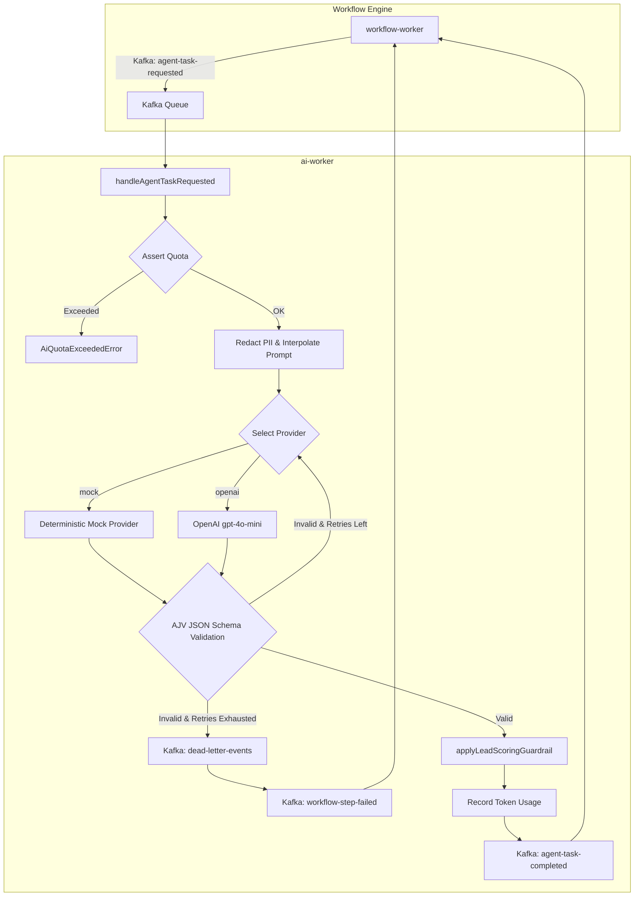

# AI Agent Node Architecture

In AgentOps, AI agents operate as asynchronous graph nodes (`AI_AGENT`), rather than interactive chatbots. Nodes ingest structured inputs, perform prompt interpolation with automated data redaction, invoke language models, validate outputs against strict JSON Schemas, and emit typed events over Kafka.



---

## 1. Execution Lifecycle

AI node execution is completely decoupled from HTTP request cycles:

1. **Request Ingestion:** When a workflow run advances to an `AI_AGENT` node, `workflow-worker` publishes an `agent-task-requested` event to Kafka carrying node configurations, inputs, and trace context.
2. **Quota Assertion:** `ai-worker` verifies workspace quota limits via `PrismaAiUsageGuard.assertWithinQuota(workspaceId)`.
3. **Data Sanitization:** Contact fields and credentials in the input payload are masked before entering the prompt template.
4. **Model Execution:** The selected provider executes the rendered prompt.
5. **Schema Validation:** The output is parsed and verified against the node's configured JSON Schema using AJV.
6. **Retries & Error Handling:** Outputs failing schema validation are retried up to `retryLimit`. If retries are exhausted, the event is dead-lettered and `workflow-step-failed` is emitted.
7. **Completion:** On success, token usage is recorded against workspace quotas and `agent-task-completed` is published to Kafka.

---

## 2. Model Providers

AgentOps supports multiple model backends configured via `modelProvider`:

| Provider | Model Identifier | Execution Mode | Network Access | Use Case |
| --- | --- | --- | --- | --- |
| `mock` (default) | `mock-lead-scorer` | In-process rule engine | None (offline) | Local testing, CI integration tests, deterministic golden-set verification. |
| `openai` | `gpt-4o-mini` (or configurable) | OpenAI Responses API | Outbound HTTPS | Production lead scoring, email drafting, real LLM inference with strict JSON Schema. |
| `gemini` | `gemini-1.5-flash` | Provider interface abstraction | Outbound HTTPS | Planned secondary multimodal/text provider. |

### Provider Configuration
To switch a workflow node to OpenAI:
1. Ensure `OPENAI_API_KEY` is present in the environment (or AWS Secrets Manager).
2. Configure the node JSON:
   ```json
   {
     "modelProvider": "openai",
     "modelName": "gpt-4o-mini",
     "temperature": 0.2,
     "maxTokens": 1000,
     "retryLimit": 1
   }
   ```

---

## 3. Node Configuration Schema

The node contract is defined in `packages/shared/src/ai.ts` by `aiAgentNodeConfigSchema`:

```typescript
export const aiAgentNodeConfigSchema = z.object({
  modelProvider: z.enum(["openai", "gemini", "mock"]).default("mock"),
  modelName: z.string().default("mock-lead-scorer"),
  systemPrompt: z.string().min(1).default("You are an operations assistant."),
  userPromptTemplate: z.string().min(1).default("Analyze this input and return structured JSON."),
  inputMapping: z.record(z.string(), z.string()).default({}),
  outputSchema: z.record(z.string(), z.unknown()).default(defaultLeadScoringOutputSchema),
  temperature: z.number().min(0).max(2).default(0.2),
  maxTokens: z.number().int().positive().max(8000).default(1000),
  retryLimit: z.number().int().min(0).max(3).default(1),
  requireHumanApproval: z.boolean().default(false),
  savePromptAndOutput: z.boolean().default(false)
});
```

---

## 4. Showcase Prompts & JSON Schemas

The showcase lead qualification workflow utilizes two distinct AI nodes:

### Node 1: Lead Qualification (`ai-1`)
- **System Prompt:**
  ```text
  You are a sales operations assistant that qualifies inbound leads. Classify each lead into exactly one category: high-intent, low-intent, or spam. Use high-intent when the lead expresses a concrete need for automation, names a real company, and makes a specific request. Use low-intent when the message is vague, exploratory, or the sender is merely curious. Use spam when the message is irrelevant, gibberish, or purely promotional. Return only JSON that matches the provided output schema.
  ```
- **User Prompt Template:**
  ```text
  Qualify the following lead.
  Name: {{name}}
  Company: {{company}}
  Email: {{email}}
  Message: {{message}}
  Source: {{source}}
  Return a JSON object with leadScore (0-100), category (high-intent | low-intent | spam), summary, recommendedAction, and confidence (0-1).
  ```
- **Output Schema:**
  ```json
  {
    "type": "object",
    "additionalProperties": false,
    "required": ["leadScore", "category", "summary", "recommendedAction", "confidence"],
    "properties": {
      "leadScore": { "type": "number", "minimum": 0, "maximum": 100 },
      "category": { "type": "string", "enum": ["high-intent", "low-intent", "spam"] },
      "summary": { "type": "string", "minLength": 1 },
      "recommendedAction": { "type": "string", "minLength": 1 },
      "confidence": { "type": "number", "minimum": 0, "maximum": 1 }
    }
  }
  ```

### Node 2: Follow-up Email Drafter (`ai-2`)
- **System Prompt:**
  ```text
  You are a sales operations assistant that writes concise, personalized follow-up emails to inbound leads. Return only JSON that matches the provided output schema with a subject and a body. Keep the tone professional, specific, and focused on the recommended next action.
  ```
- **User Prompt Template:**
  ```text
  Write a follow-up email for the following lead.
  Name: {{name}}
  Company: {{company}}
  Summary: {{summary}}
  Recommended action: {{recommendedAction}}
  Return a JSON object with subject and body.
  ```
- **Output Schema:**
  ```json
  {
    "type": "object",
    "additionalProperties": false,
    "required": ["subject", "body"],
    "properties": {
      "subject": { "type": "string", "minLength": 1 },
      "body": { "type": "string", "minLength": 1 }
    }
  }
  ```

---

## 5. Input Sanitization & Guardrails

### PII Redaction
Before variables are interpolated into `{{variable}}` slots in prompt templates, sensitive data is masked:
- **Email:** Masked to preserve domain context while hiding identity (`jane.doe@acme.com` -> `ja***@acme.com`).
- **Phone Numbers:** Replaced with `[PHONE_REDACTED]`.
- **API Keys / Tokens:** Patterns matching credentials (`sk_...`, `Bearer ...`) are replaced with `[REDACTED]`.

### Prompt Injection Detection
The engine applies `applyLeadScoringGuardrail` to inbound lead content. If adversarial attempts are identified (e.g., instructions attempting to ignore system boundaries or override score variables):
- The injection marker is logged.
- The lead category is forced to `spam` or penalized, preventing unearned progression into automated follow-up sequences.

---

## 6. Output Validation, Retries & Dead Letters

1. **AJV Validation:** Outputs are verified with `additionalProperties: false`. If a model returns extra keys, malformed markdown fences, or missing attributes, validation fails.
2. **Retries:** The node retries execution up to `retryLimit` times (default: 1; max: 3). Each attempt increments token counters.
3. **Dead-Letter Handling:**
   - If all retries fail, `ai-worker` throws `AiOutputValidationError`.
   - The message outcome is recorded as `dead_lettered`.
   - The event is forwarded to the `dead-letter-events` Kafka topic.
   - An asynchronous `workflow-step-failed` event is emitted, allowing `workflow-worker` to terminate the run cleanly in `FAILED` status without deadlocking.

---

## 7. Daily Quota Enforcement

Quotas are tracked per workspace in the `UsageRecord` database table:

- **Limits:**
  - `AI_DAILY_CALL_LIMIT`: Default 100 calls per 24-hour UTC window.
  - `AI_DAILY_TOKEN_LIMIT`: Default 200,000 tokens (input + output) per 24-hour UTC window.
- **Enforcement:**
  - `PrismaAiUsageGuard.assertWithinQuota(workspaceId)` is invoked before invoking any model provider.
  - If exceeded, execution raises `AiQuotaExceededError`.
  - Emits Prometheus metric `agentops_ai_calls_total{status="quota_exceeded"}`.
  - Sandbox endpoints (`POST /ai/test-agent`, `POST /ai/evaluate-agent`) return `429 Too Many Requests`.

---

## 8. Golden-Set Evaluation Suite

AgentOps includes an automated evaluation harness to detect prompt drift, regression in classification accuracy, and token cost escalation:

```bash
pnpm eval:leads
```

- **Harness File:** `apps/ai-worker/src/evaluate.ts`
- **Dataset:** `leadEvaluationCases` in `packages/shared/src/ai.ts` containing 24 labeled inbound lead scenarios:
  - 12 High-Intent leads (enterprise requests, explicit automation requirements).
  - 8 Low-Intent leads (exploratory, student queries, vague interest).
  - 4 Spam / Injection leads (cryptocurrency pitches, prompt override attempts).
- **Report Metrics:**
  - Overall accuracy (`passRate`).
  - Hot-lead miss rate (false negatives where high-intent was classified as low-intent or spam).
  - Total token consumption and estimated cost in USD via `estimateAiCostUsd`.
- **CI Enforcement:** Executed automatically during PR checks (`ci.yml`); pull requests that regress golden-set accuracy fail build verification.
