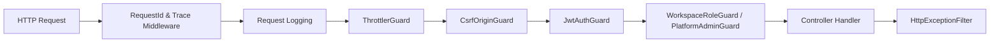

# REST API Specification

The AgentOps API is implemented in `apps/api` as a NestJS 11 modular monolith. It provides a synchronous control plane for workspace configuration, workflow definitions, run lifecycle inspection, approval decisions, and platform administration, delegating execution asynchronously to Kafka workers.

## Architectural Boundaries & Global Middleware

The API is mounted at the root path (no global `/api/v1` prefix). Incoming requests traverse a standardized pipeline before reaching controller handlers:



### 1. Request Identification & Tracing
- `RequestIdMiddleware` extracts the incoming `x-request-id` header or generates a random UUID. The resulting ID is echoed in the response header and attached to execution logs.
- W3C `traceparent` headers are parsed into OpenTelemetry context.
- **Trace root span fix:** When an incoming request lacks a `traceparent` header, the middleware initializes an OpenTelemetry SERVER span with `root: true`. It does not synthesize a missing parent span ID, ensuring traces in Tempo contain an authentic root span.

### 2. Rate Limiting (@nestjs/throttler)
- **Global API Rate Limit:** Governed by `API_RATE_LIMIT_PER_MINUTE` (default: 120 requests per minute per client IP, 60s TTL).
- **Auth Endpoint Rate Limit:** Strict limit of `AUTH_RATE_LIMIT_PER_MINUTE` (default: 10 requests per minute per client IP) applied to `/auth/register`, `/auth/login`, and `/auth/refresh`.
- **Exemptions:** Endpoints decorated with `@SkipThrottle()` (`/health/live`, `/health/ready`, `/metrics`) are unthrottled.

### 3. CSRF Protection (CsrfOriginGuard)
- Applies to all state-changing HTTP methods (`POST`, `PUT`, `PATCH`, `DELETE`).
- Safe HTTP methods (`GET`, `HEAD`, `OPTIONS`) pass through automatically.
- Direct API clients presenting a Bearer token (`Authorization: Bearer <token>`) bypass the check.
- Requests carrying session cookies or targeting `/auth/*` must include an `Origin` (or `Referer`) header matching `WEB_APP_URL` (default: `http://localhost:3000`).
- If cookies are present but the `Origin` header is absent, the request is rejected with `403 Forbidden` (`Cross-site request blocked: missing Origin header`).
- If the `Origin` does not match `WEB_APP_URL`, the request is rejected with `403 Forbidden` (`Cross-site request blocked: origin not allowed`).
- Cookie-less public requests (e.g., inbound webhooks) are exempt.

### 4. Authentication (JwtAuthGuard)
- Enabled globally on all routes unless marked with `@Public()`.
- Accepts access tokens from either `Authorization: Bearer <token>` or the HttpOnly `agentops_access` cookie.
- **Disabled Account Enforcement:** On every authenticated request, a database lookup evaluates `User.disabledAt`. If disabled, the request is immediately terminated with `403 Forbidden` (`This account has been disabled`), invalidating existing 15-minute access tokens without waiting for token expiration.

### 5. Standardized Error Format (HttpExceptionFilter)
All exceptions are formatted consistently, including the correlation `requestId`:

```json
{
  "statusCode": 400,
  "error": "BadRequestException",
  "message": "Missing workspaceId query parameter",
  "details": {},
  "requestId": "a5d8f340-c752-4a0b-9993-9c8e0302b11b",
  "path": "/dashboard/overview",
  "timestamp": "2026-11-18T02:37:08.000Z"
}
```

---

## Authentication & Session Management

Session tokens are distributed using HttpOnly cookies to defend against XSS-based credential extraction:

| Cookie Name | Token Type | Expiration | Path | Attributes |
| --- | --- | --- | --- | --- |
| `agentops_access` | Signed JWT | 15 minutes | `/` | `HttpOnly`, `SameSite=Lax`, `Secure` (prod) |
| `agentops_refresh` | Opaque Token Hash | 30 days | `/auth` | `HttpOnly`, `SameSite=Lax`, `Secure` (prod) |
| `agentops_session_hint` | Boolean Flag | 30 days | `/` | `SameSite=Lax`, Readable by client JS |
| `agentops_ws` | Workspace ID | 30 days | `/` | Active workspace reference for web sidebar |

### `GET /auth/me` Response Contract
Returns the authenticated profile, platform administrative status, and workspace memberships:

```json
{
  "id": "user_2a6fbce01c904e57b981",
  "email": "alex@example.com",
  "name": "Alex Mercer",
  "avatarUrl": "https://lh3.googleusercontent.com/a/photo",
  "provider": "google",
  "createdAt": "2026-11-17T10:15:30.000Z",
  "isPlatformAdmin": false,
  "workspaces": [
    {
      "id": "ws_d8a7c6e5",
      "name": "Alex's workspace",
      "slug": "alexs-workspace",
      "role": "OWNER"
    },
    {
      "id": "ws_demo",
      "name": "Demo workspace",
      "slug": "demo",
      "role": "VIEWER"
    }
  ]
}
```

### Google OAuth 2.0 Endpoints
- `GET /auth/google?redirectTo=`: Initiates server-side authorization-code flow. Generates a state token cryptographically signed with `JWT_ACCESS_SECRET` containing the target redirect URL. Redirects the browser to Google's consent screen.
- `GET /auth/google/callback?code=&state=&error=`: Validates state signature, exchanges code for an ID token, and upserts the user in PostgreSQL. On first login:
  1. Creates a personal workspace owned by the user (role: `OWNER`).
  2. If `DEMO_WORKSPACE_JOIN_ROLE` is configured (production sets `VIEWER`), grants the user read access to `ws_demo`.
  3. Sets `agentops_access` and `agentops_refresh` cookies and redirects to `/auth/callback#user=<base64url>&redirectTo=<path>`.

---

## Workspace Isolation Rule

Multi-tenant data isolation is enforced across all `/dashboard/*` endpoints via `WorkspaceRoleGuard` using the `workspaceQuery` scope:

1. **Mandatory Query Parameter:** Every call must supply `?workspaceId=<id>`. Omission triggers `400 Bad Request`.
2. **Membership & Role Check:** The caller must possess a membership record in PostgreSQL for the specified workspace with at least role `VIEWER`. Non-members or unauthorized roles receive `403 Forbidden`.
3. **Strict Scoping:** All metrics, run lists, leads, and sales tasks returned by the controller are constrained exclusively to the target `workspaceId`.
4. **Task Updates:** Modifying a sales task (`PATCH /dashboard/sales-tasks/:id?workspaceId=`) requires role `MEMBER` or higher.

---

## Platform Administration (`/admin`)

Every route under `/admin` is guarded by `PlatformAdminGuard`, checking `User.isPlatformAdmin === true` in PostgreSQL:

- **Admin Bootstrapping:** Configured via `PLATFORM_ADMIN_EMAILS` (comma-separated list stored in AWS Secrets Manager). On sign-in, matching emails automatically receive `isPlatformAdmin = true`.
- **Self-Modification Guard:** Administrators cannot disable their own account or revoke their own admin flag (`400 Bad Request`).
- **Instant Revocation:** When an account is disabled via `PATCH /admin/users/:id`, all associated refresh tokens are revoked in PostgreSQL, and active sessions fail on their subsequent request.
- **Audit Logging:** Every admin update is recorded in `AuditLog` with `workspaceId = null` and the acting admin's `userId`.
- **CSV Export Security:** Reports emitted by `GET /admin/reports/:file` include a UTF-8 Byte Order Mark (`\uFEFF`) and sanitize potential formula-injection prefixes (`=`, `+`, `-`, `@`, `\t`, `\r`).

---

## Route Reference Catalog

### 1. Health & System Metrics

| Method | Path | Auth / Role | Rate Limit | Purpose |
| --- | --- | --- | --- | --- |
| `GET` | `/health/live` | Public | Exempt | Liveness probe (`api: up`). |
| `GET` | `/health/ready` | Public | Exempt | Readiness probe checking PostgreSQL, Redis, and Kafka pings. |
| `GET` | `/metrics` | Public | Exempt | Prometheus metrics exposition (HTTP rates, DB gauges, Kafka lag). |

### 2. Authentication

| Method | Path | Auth / Role | Rate Limit | Purpose |
| --- | --- | --- | --- | --- |
| `POST` | `/auth/register` | Public | 10 / min | Register new user account; issues session cookies and personal workspace. |
| `POST` | `/auth/login` | Public | 10 / min | Authenticate credentials via argon2; issues session cookies. |
| `POST` | `/auth/refresh` | Public | 10 / min | Rotate refresh token; re-issues access and refresh tokens. |
| `POST` | `/auth/logout` | Public | Default | Revoke active refresh token and clear authentication cookies. |
| `GET` | `/auth/me` | Authenticated | Default | Return current profile, admin flag, and workspace membership list. |
| `GET` | `/auth/google` | Public | Default | Initiate Google OAuth 2.0 authorization-code redirect. |
| `GET` | `/auth/google/callback` | Public | Default | Complete Google OAuth flow, provision demo/personal workspace, set cookies. |

### 3. Workspaces

| Method | Path | Auth / Role | Rate Limit | Purpose |
| --- | --- | --- | --- | --- |
| `GET` | `/workspaces` | Authenticated | Default | List all workspaces where caller holds membership. |
| `POST` | `/workspaces` | Authenticated | Default | Create a new workspace (caller assigned `OWNER`). |
| `GET` | `/workspaces/:id` | VIEWER | Default | Retrieve workspace details and subscription plan. |
| `PATCH` | `/workspaces/:id` | ADMIN | Default | Update workspace name or slug. |
| `POST` | `/workspaces/:id/invite` | ADMIN | Default | Invite user to workspace by email and role. |
| `GET` | `/workspaces/:id/members` | VIEWER | Default | List workspace members and assigned roles. |
| `PATCH` | `/workspaces/:id/members/:memberId/role` | OWNER | Default | Update assigned workspace role of a member. |

### 4. Workflows

| Method | Path | Auth / Role | Rate Limit | Purpose |
| --- | --- | --- | --- | --- |
| `GET` | `/workflows` | Authenticated | Default | List workflows (`?workspaceId=`, `?includeArchived=true`). |
| `POST` | `/workflows` | MEMBER | Default | Create workflow draft with nodes and edges. |
| `GET` | `/workflows/:id` | VIEWER | Default | Retrieve workflow graph definition. |
| `PATCH` | `/workflows/:id` | MEMBER | Default | Update workflow graph structure or configuration. |
| `DELETE` | `/workflows/:id` | ADMIN | Default | Archive or remove workflow. |
| `POST` | `/workflows/:id/publish` | ADMIN | Default | Validate graph structure and snapshot immutable `WorkflowVersion`. |
| `POST` | `/workflows/:id/run` | MEMBER | Default | Trigger workflow run; persists run record and emits `workflow-triggered`. |
| `GET` | `/workflows/:id/runs` | VIEWER | Default | List historical runs associated with the workflow. |

### 5. Workflow Runs & Approvals

| Method | Path | Auth / Role | Rate Limit | Purpose |
| --- | --- | --- | --- | --- |
| `GET` | `/workflow-runs/approvals` | Authenticated | Default | List pending human approvals (`?workspaceId=`, `?status=`). |
| `GET` | `/workflow-runs/:id` | VIEWER | Default | Retrieve workflow run execution status and timings. |
| `GET` | `/workflow-runs/:id/steps` | VIEWER | Default | Retrieve step execution timeline and masked node inputs/outputs. |
| `GET` | `/workflow-runs/:id/stream` | VIEWER | Default | Server-Sent Events stream for live execution updates (`snapshot`, `ping`). |
| `POST` | `/workflow-runs/:id/steps/:stepId/approval` | MEMBER | Default | Submit review decision (`approve` / `reject`). Idempotent (409 on re-decision). |

### 6. Dashboard (Workspace-Isolated)

| Method | Path | Auth / Role | Rate Limit | Purpose |
| --- | --- | --- | --- | --- |
| `GET` | `/dashboard/overview` | VIEWER | Default | Aggregate statistics (runs, success rate, AI tokens, leads, pending tasks). |
| `GET` | `/dashboard/workflow-runs` | VIEWER | Default | Paged runs list (`X-Total-Count` header returned). |
| `GET` | `/dashboard/workflow-runs/count` | VIEWER | Default | Count matching runs for frontend clients unable to read custom headers. |
| `GET` | `/dashboard/usage` | VIEWER | Default | Workspace AI call and token consumption vs daily limits. |
| `GET` | `/dashboard/leads` | VIEWER | Default | Scored lead records with masked contact details and intent classification. |
| `GET` | `/dashboard/sales-tasks` | VIEWER | Default | Follow-up tasks generated by workflow notification nodes. |
| `PATCH` | `/dashboard/sales-tasks/:id` | MEMBER | Default | Update task completion status (`OPEN` / `DONE`). |
| `GET` | `/dashboard/errors` | VIEWER | Default | Recent step execution failures and system errors. |
| `GET` | `/dashboard/recent-activity` | VIEWER | Default | Chronological audit and execution activity stream. |
| `GET` | `/dashboard/readiness` | VIEWER | Default | Operational readiness checklist across AI, Kafka, OTel, and database. |

### 7. Platform Admin Console

| Method | Path | Auth / Role | Rate Limit | Purpose |
| --- | --- | --- | --- | --- |
| `GET` | `/admin/overview` | Platform Admin | Default | Platform metrics, daily series (7/30/90 days), top workspaces, provider distribution. |
| `GET` | `/admin/users` | Platform Admin | Default | Paged accounts (`?q=`, `?status=all\|active\|disabled\|admin`, `?page=`, `?pageSize=`). |
| `GET` | `/admin/users/:id` | Platform Admin | Default | User account inspection including all workspace memberships. |
| `PATCH` | `/admin/users/:id` | Platform Admin | Default | Toggle account status (`disabled`, `isPlatformAdmin`). Self-modification blocked. |
| `GET` | `/admin/workspaces` | Platform Admin | Default | Paged platform workspaces with member counts, runs, and AI token consumption. |
| `GET` | `/admin/audit` | Platform Admin | Default | Global platform audit trail, newest first (`?action=`, `?page=`, `?pageSize=`). |
| `GET` | `/admin/reports/:file` | Platform Admin | Default | Download CSV reports (`users.csv`, `workspaces.csv`, `runs.csv`, `usage.csv`). |

### 8. AI Services & Sandbox

| Method | Path | Auth / Role | Rate Limit | Purpose |
| --- | --- | --- | --- | --- |
| `POST` | `/ai/test-agent` | Authenticated | Default | Sandbox execution testing prompt rendering, PII masking, and validation. |
| `POST` | `/ai/evaluate-agent` | Authenticated | Default | Execute deterministic evaluation against the 24-lead golden set. |
| `GET` | `/ai/providers` | Authenticated | Default | Return available model providers (`mock`, `openai`, `gemini`). |
| `GET` | `/ai/tasks/:id` | Authenticated, `VIEWER` of the task's workspace | Default | Stored `AiTaskResult`: provider, model, tokens, output or error (404 unknown, 403 not a member). |
| `GET` | `/ai/usage` | Authenticated | Default | Global AI consumption totals (calls, tokens, limits). |

### 9. Webhooks & Ingest

| Method | Path | Auth / Role | Rate Limit | Purpose |
| --- | --- | --- | --- | --- |
| `POST` | `/webhooks/:id` | Public (`x-agentops-webhook-secret`) | Default | Trigger the endpoint's workflow with the JSON body (`202 { runId, status }`). |
| `GET` | `/webhooks?workspaceId=` | Authenticated, `VIEWER` | Default | List endpoints of the workspace without secrets. |
| `POST` | `/webhooks` | Authenticated, `ADMIN` of the workflow's workspace | Default | Register an endpoint for `{ workflowId }`; the secret is returned once. |
| `DELETE` | `/webhooks/:id` | Authenticated, `ADMIN` of the endpoint's workspace | Default | Deactivate a webhook endpoint. |

### 10. Notifications & Alert Bot

| Method | Path | Auth / Role | Rate Limit | Purpose |
| --- | --- | --- | --- | --- |
| `GET` | `/notifications` | Platform admin | Default | Latest 100 platform notifications (stored Alertmanager alerts), newest first. |
| `POST` | `/notifications/mark-all-read` | Platform admin | Default | Mark unread platform notifications as read. |
| `POST` | `/notifications/alertmanager` | Public (Token) | Default | Webhook receiver for Prometheus Alertmanager; verifies `ALERTMANAGER_WEBHOOK_TOKEN`. |

### 11. Platform Audit

| Method | Path | Auth / Role | Rate Limit | Purpose |
| --- | --- | --- | --- | --- |
| `GET` | `/audit-logs?workspaceId=&page=&pageSize=&action=` | Authenticated, `ADMIN` | Default | Workspace audit trail, newest first, paged (max 100), with actor email. |
