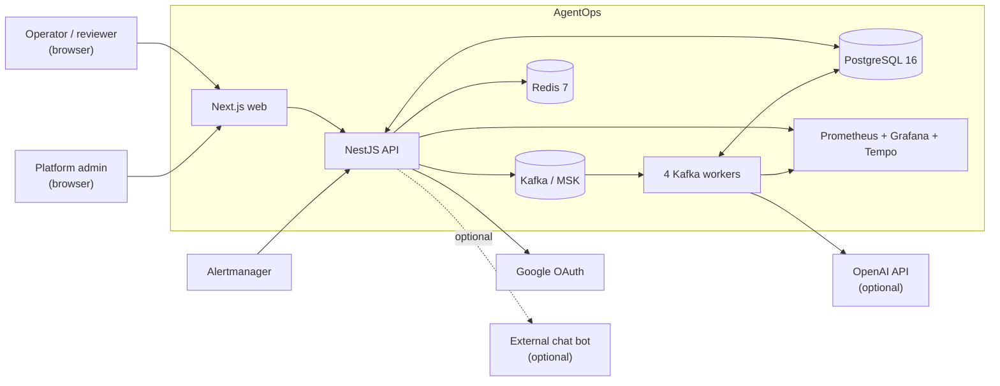
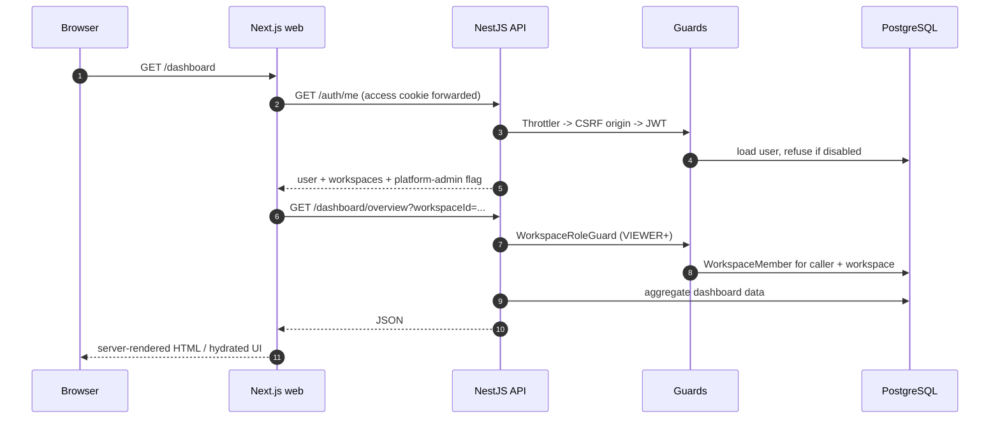
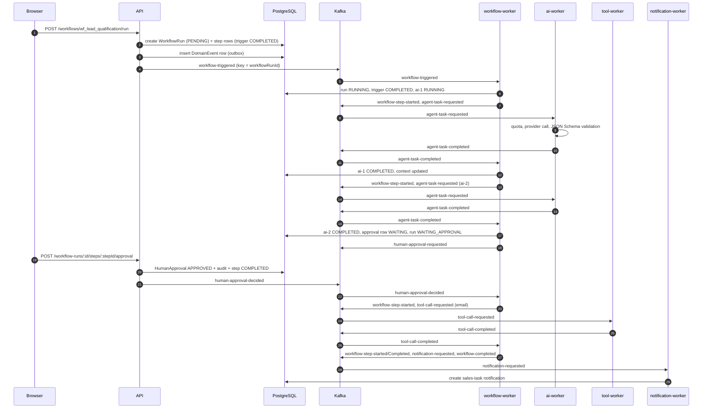
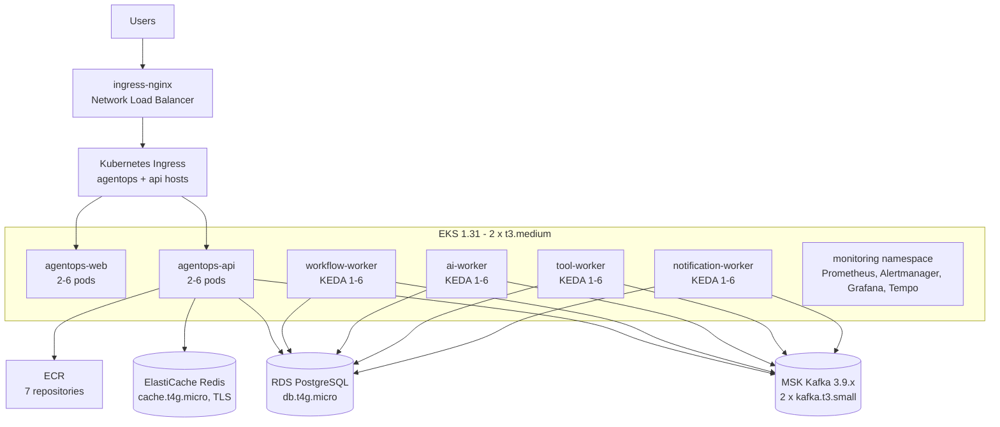

# Architecture

AgentOps is a multi-tenant workflow automation platform for AI-assisted lead qualification. A user draws a workflow in the browser, publishes an immutable version, and starts a run. The API persists the run and emits an event; four Kafka workers execute the graph asynchronously, calling mock tools or an AI provider, pausing for a human approval when the graph requires one, and recording every step.

The architecture is deliberately split between a synchronous HTTP control plane and an asynchronous execution plane:

- **Control plane:** Next.js web app and NestJS API. It owns authentication, workspace isolation, workflow definitions, versions, run creation, approvals, dashboards, and the admin console.
- **Execution plane:** Kafka and four workers. It owns graph traversal, AI calls, tool calls, notifications, retries, and dead letters.
- **System of record:** PostgreSQL. Kafka is transport, not the source of truth. Run and step state is always read from PostgreSQL, including by the live run stream.
- **Observability plane:** Prometheus, Alertmanager, Grafana, and Tempo, fed by the API and workers.

## System context

Redis is currently a readiness dependency only: the API pings it on `/health/ready`, but sessions, rate limits, and run state are not stored there. The only runtime cache is in-process.

## Containers

| Container | Runtime | Responsibility | Scaling |
| --- | --- | --- | --- |
| Web | Next.js 16 App Router, React 19 | Server-rendered UI, cookie forwarding, dashboard and builder | HPA on CPU, 2-6 replicas in prod |
| API | NestJS 11 on Node.js | Auth, RBAC, workflows, versions, runs, approvals, dashboards, admin, metrics | HPA on CPU, 2-6 replicas in prod |
| workflow-worker | Node.js + KafkaJS | Consumes run events, advances the graph, persists run/step state, emits task requests | KEDA on consumer lag, 1-6 |
| ai-worker | Node.js + KafkaJS | Calls the AI provider, validates JSON against the node schema, enforces quota | KEDA on lag, 1-6 |
| tool-worker | Node.js + KafkaJS | Executes mock tools: webhook, HTTP request, email | KEDA on lag, 1-6 |
| notification-worker | Node.js + KafkaJS | Creates sales-task notifications | KEDA on lag, 1-6 |
| PostgreSQL | Managed RDS in prod | Users, workspaces, definitions, versions, runs, steps, approvals, outbox, idempotency | Single writer class instance |
| Kafka | MSK in prod | 14 topics, 4 consumer groups, per-run ordering | 2 brokers, 6 partitions per topic |
| Redis | ElastiCache in prod | Readiness probe only | Single node |
| Observability | Prometheus, Alertmanager, Grafana, Tempo | Metrics, alerts, dashboards, traces | One replica each in `monitoring` |

The API is stateless for horizontal scaling, with two exceptions: Prometheus counters live in process (and reset on restart), and the in-app alert notification list is an in-memory array per replica. Neither is used for correctness.

## Repository layout

| Path | Contents |
| --- | --- |
| `apps/web` | Next.js app: landing, auth, dashboard, workflow list, builder, runs, run detail, approvals, agents, settings, admin UI |
| `apps/api` | NestJS modules: `auth`, `workspaces`, `workflows`, `workflow-runs`, `webhooks`, `ai`, `dashboard`, `audit`, `admin`, `notifications`, `health`, `metrics` |
| `apps/workflow-worker` | Kafka consumer group `agentops.workflow-worker`, graph executor, Prisma run-state store |
| `apps/ai-worker` | Consumer `agentops.ai-worker`, provider adapter, schema repair/retry, daily quota |
| `apps/tool-worker` | Consumer `agentops.tool-worker`, mock tool handlers |
| `apps/notification-worker` | Consumer `agentops.notification-worker`, notification creation |
| `packages/shared` | Zod schemas for workflow definitions, runs, approvals, AI config, RBAC, sample lead workflow |
| `packages/events` | Topic names, event envelope, payload schemas, consumer wrapper, Kafka runner, topic bootstrap |
| `packages/database` | Prisma schema, client factory, migrations, seed scripts |
| `packages/observability` | Metric primitives, AI/business/worker metrics, OpenTelemetry setup, Kafka instrumentation |
| `packages/config` | Environment parsing and Kafka broker parsing |
| `packages/ui` | Shared React components |
| `infrastructure/docker` | API, web, and worker Dockerfiles |
| `infrastructure/k8s` | Kustomize base, prod overlay, KEDA component, monitoring manifests |
| `infrastructure/terraform` | VPC, ECR, app secrets, EKS, RDS, ElastiCache, MSK, GitHub OIDC modules |
| `infrastructure/observability` | Prometheus rules and config, Alertmanager, Tempo, Grafana provisioning and dashboards |
| `scripts` | Local setup, topic bootstrap, load generation, prod verification, screenshots |
| `docs` | System documentation and runbooks |

## Control-plane request path

Key details:

- Global guards are `ThrottlerGuard`, `CsrfOriginGuard`, and `JwtAuthGuard`, in that order (`apps/api/src/app.module.ts`). Workspace and platform-admin guards are applied per controller.
- Authentication uses HttpOnly access and refresh cookies, plus a Bearer token for API clients. Passwords are hashed with argon2. Google OAuth uses a signed `state` value.
- The JWT guard performs one database lookup per request. A disabled account is refused immediately, even if its JWT is still valid.
- `RequestIdMiddleware` accepts `x-request-id` and `traceparent`, starts the request span, and returns `x-request-id` and `traceparent` on the response. `RequestLoggingMiddleware` records HTTP metrics.
- Workspace role is always read from `WorkspaceMember`. The legacy `x-workspace-role` header is ignored.
- The dashboard API endpoints (`GET /dashboard/*`) require `workspaceId` as a query parameter and at least `VIEWER`. The web app chooses the active workspace from the `agentops_ws` cookie via `GET /auth/me`; it does not send a role header.

## Event-driven execution path

The browser does not need a WebSocket. `GET /workflow-runs/:id/stream` is an SSE endpoint that polls PostgreSQL once per second, sends a snapshot only when a status or `finishedAt` changes, sends a heartbeat every 15 seconds, and ends when the run reaches a terminal status or after 30 minutes. This works identically behind any number of API replicas.

The full graph semantics, approval rules, and status transitions are in [workflow-engine.md](workflow-engine.md). Topic and envelope details are in [kafka-topics.md](kafka-topics.md).

## Data and consistency model

| Concern | Decision |
| --- | --- |
| Source of truth | PostgreSQL. Kafka carries commands and facts; it does not hold authoritative run state |
| Event publication | Transactional-ish outbox: `DomainEvent` is inserted before the Kafka send, then marked `kafkaPublishedAt`. A relay re-sends unpublished rows every 30 s |
| Delivery | At least once. Consumers commit offsets after processing |
| Idempotency | One `ProcessedMessage` row per `(consumerGroup, workflowRunId:nodeId:eventType)`. A redelivery is a no-op |
| Ordering | Kafka message key is `workflowRunId`, so events for one run stay in one partition and arrive in order |
| Retries | Up to 3 attempts per message, exponential backoff (200 ms, 400 ms). `NonRetryableError` skips retries |
| Exhaustion | A dead letter is published to `dead-letter-events`; node messages also emit `workflow-step-failed`, which fails the run |
| Version pinning | A run stores `workflowVersionId`; later edits and publications do not change an in-flight run |
| Step persistence | The worker applies a whole execution plan (run update, step upserts, approvals) in one Prisma transaction |
| Live view | SSE polls PostgreSQL; no cross-replica pub/sub is required |

What this buys: an API pod can die after writing the run and the event can still be published by another pod's relay; a worker can be killed mid-message and the message is redelivered; a duplicate delivery cannot advance a node twice. What it does not provide: exactly-once side effects. A mock tool or AI call may run again if the process dies after the external call but before the offset commit. Tool handlers are deterministic mocks today, so this is acceptable; a real side-effecting tool would need an outbox or provider idempotency key.

## Tenant isolation and authorization

Every durable business row carries a workspace scope, directly or through its run. Isolation is enforced at the query layer, not just in the UI.

| Role | Rank | Typical abilities |
| --- | --- | --- |
| `OWNER` | 3 | Everything an admin can do; workspace ownership |
| `ADMIN` | 2 | Publish and delete workflows, manage members and roles |
| `MEMBER` | 1 | Create/edit workflows, start runs, decide approvals |
| `VIEWER` | 0 | Read workflows, runs, dashboards, approvals |

- `WorkspaceRoleGuard` resolves the workspace from the route parameter, the body, or `?workspaceId=` depending on `@WorkspaceScope`, then looks up the caller's `WorkspaceMember` row.
- List endpoints filter by the caller's memberships; a missing membership returns `403`, and an unknown object is treated as `404` to avoid leaking existence.
- The seeded `ws_demo` workspace can be joined by new accounts with `DEMO_WORKSPACE_JOIN_ROLE` (`VIEWER` in prod, `MEMBER` locally), so a new sign-in is not an empty product.
- `x-workspace-role` is ignored. There is no client-supplied role escalation path.

### Platform administration

Platform administration is separate from workspace roles:

- `User.isPlatformAdmin`, `disabledAt`, and `lastLoginAt` were added by migration `20261118000000_platform_admin`.
- `PlatformAdminGuard` runs after the JWT guard and re-reads the flag from the database on every request. Demotion takes effect immediately.
- `PLATFORM_ADMIN_EMAILS` bootstraps the flag on sign-in. The bootstrap never removes the flag; admins demote each other in the console.
- An admin cannot change their own admin/disabled state. Disabling a user revokes that user's refresh tokens.
- Admin actions write `AuditLog` rows with `workspaceId = null` and actions `admin.user.disabled`, `admin.user.enabled`, `admin.user.admin_granted`, `admin.user.admin_revoked`.
- Admin CSV reports are generated on demand with `Cache-Control: no-store`.

## Web application

The web app is a Next.js App Router application. It has two API URLs: a public URL used by the browser and an internal URL used by server components (`API_INTERNAL_URL`, e.g. `http://api:4000` in Docker). Server-side calls forward the access cookie; browser calls rely on the HttpOnly cookie and same-origin/CORS rules.

| Area | Main routes |
| --- | --- |
| Landing | `/[locale]` with a 3D hero (Three.js / React Three Fiber) |
| Auth | `/[locale]/login`, `/[locale]/register`, Google callback |
| Dashboard | `/[locale]/dashboard` |
| Workflows | list, `/[locale]/workflows/[id]` builder (React Flow 12) |
| Runs | `/[locale]/runs`, `/[locale]/runs/[id]` with live SSE status |
| Approvals | `/[locale]/approvals` |
| Agents | `/[locale]/agents` (AI configuration and evaluation) |
| Settings | `/[locale]/settings` |
| Admin | `/[locale]/admin` (users, workspaces, audit, reports) |

The UI is bilingual (English and Vietnamese) through `apps/web/src/lib/i18n.ts`, and uses Tailwind CSS 4 with shared components from `packages/ui`. The builder edits the same Zod-validated definition the API stores, so client and server validation are aligned.

## Deployment topology

### Local

`docker compose up -d` starts PostgreSQL (`55432`), Redis (`6379`), Kafka (`9094`), Prometheus (`9090`), Alertmanager (`9093`), Grafana (`3001`), and Tempo (`3200`/`4317`/`4318`). The API and workers run on the host (`pnpm dev`) or in `docker-compose.apps.yml`. Local Kafka is a single-node KRaft broker (`apache/kafka:4.3.0`) with 3 partitions per topic and replication factor 1.

### Production AWS

- Terraform modules: `network`, `ecr`, `app-secrets`, `eks`, `rds`, `elasticache`, `msk`, `github-oidc`.
- Images live in seven ECR repositories: `api`, `web`, `tools`, `workflow-worker`, `ai-worker`, `tool-worker`, `notification-worker`, tagged with the release commit.
- External Secrets syncs the app secret from AWS Secrets Manager; cert-manager issues Let's Encrypt certificates; ingress-nginx is behind an NLB.
- MSK runs 2 brokers (one per subnet); topics are created by a bootstrap job with 6 partitions and replication factor 2 in prod.
- KEDA scales each worker on consumer lag (threshold 50, min 1, max 6, polling 15 s, cooldown 120 s). The API uses CPU-based HPA (70%, min 2, max 6). Workers cannot usefully exceed the partition count, which is why prod uses 6 partitions and caps at 6.
- The monitoring namespace is reachable only by port-forward; `/metrics` is not routed by the public Ingress.

The public hostnames in the current deployment are `agentops.18-136-215-126.sslip.io` and `api.agentops.18-136-215-126.sslip.io`. Terraform still carries `agentops.example.com` placeholders that the deploy pipeline patches.

## Technology stack

| Layer | Technology |
| --- | --- |
| Language | TypeScript 6.0 |
| Monorepo | pnpm workspaces 11.5, Turborepo |
| Web | Next.js 16.4 (App Router), React 19.2, Tailwind CSS 4.3, Motion 14.5, React Flow 12.11, Three.js 0.164 / React Three Fiber 9 / Drei 10, TanStack Query 5.101, Zustand 5, React Hook Form 7, Zod 4 |
| API | NestJS 11.2, Express 5, Passport JWT, argon2, Helmet, class-validator, Terminus health checks, Swagger |
| Data | PostgreSQL 16, Prisma 7.10 (`@prisma/adapter-pg`), Redis 7 (`ioredis`) |
| Messaging | Kafka via KafkaJS 2.2; local Apache Kafka 4.3.0; prod Amazon MSK 3.9.x |
| AI | OpenAI `gpt-4o-mini` or a deterministic mock provider; Ajv JSON Schema validation |
| Observability | Prometheus 3.8, Alertmanager 0.29, Grafana 12.2, Tempo 2.9, OpenTelemetry SDK |
| Deployment | Docker, Kubernetes (EKS 1.31), Kustomize, KEDA, HPA, Terraform, GitHub Actions |
| Testing | Vitest, Playwright |

## Deliberate constraints

These are current behavior, not aspirations:

- `POST /webhooks/:workflowId` is a mock ingress. It returns `{ accepted: true, mode: "mock" }` and does not create a run or publish an event. Runs start with `POST /workflows/:id/run`.
- `WEBHOOK`, `HTTP_REQUEST`, and `EMAIL_MOCK` nodes are executed by the tool worker with mock behavior. There is no real outbound HTTP or email provider yet.
- `DELAY` is a declared node type but executes inline and completes immediately; it does not wait.
- `NOTIFICATION` creates an in-app/sales-task notification; there is no email, SMS, or chat delivery.
- `WORKFLOW_AUTO_APPROVE=true` is honored only when `APP_ENV=local`. Production always waits for a reviewer.
- Redis is not used for sessions, rate limiting, or caching; only the readiness probe touches it.
- Alert notifications are in-memory per API replica, and Prometheus metrics are per process. Both are observability conveniences, not durable stores.
- Workflow validation checks trigger/end presence, unique node ids, edge references, AI schemas, webhook URLs, unreachable nodes, and `rejected` edge placement. It does not reject cycles; the executor's per-advance `visited` set prevents an immediate loop.

## Where to look

| Question | File |
| --- | --- |
| How is a run started? | `apps/api/src/modules/workflows/workflows.service.ts` |
| How is an approval decided? | `apps/api/src/modules/workflow-runs/workflow-runs.service.ts` |
| How does the graph advance? | `apps/workflow-worker/src/executor.ts` |
| How is run state persisted? | `apps/workflow-worker/src/prisma-run-state-store.ts` |
| How are duplicates suppressed? | `packages/events/src/consumer.ts`, `ProcessedMessage` in `packages/database/prisma/schema.prisma` |
| What are the topics and payloads? | `packages/events/src/topics.ts`, `packages/events/src/payloads.ts` |
| How does the UI stream a run? | `apps/api/src/modules/workflow-runs/run-stream.service.ts` |
| How is a workspace role checked? | `apps/api/src/common/rbac/workspace-role.guard.ts` |
| How does the outbox relay work? | `apps/api/src/common/domain-events/domain-events.service.ts` |
| How does production look? | [production-runbook-aws.md](production-runbook-aws.md), [observability.md](observability.md) |
