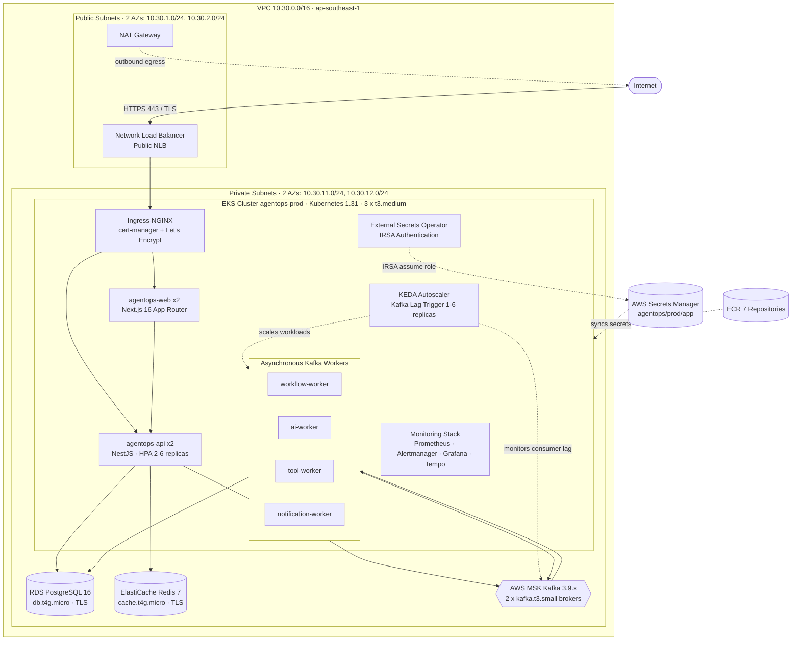

# AWS Architecture and Kubernetes Deployment

This document details the production cloud architecture for AgentOps on Amazon Web Services (AWS), covering Terraform infrastructure modules, VPC networking, Kubernetes workload deployment, autoscaling with KEDA, and zero-trust IAM/OIDC access controls.

Related documentation:
- [Production Runbook (AWS)](production-runbook-aws.md): Step-by-step bring-up, operational access, and teardown.
- [Deployment and CI/CD](deployment.md): Image build specifications, pipeline automation, and rollback flows.
- [Operations Runbook](runbook.md): Alerting rules and incident resolution procedures.

---

## 1. AWS Cloud Architecture

The production environment is deployed in AWS Region `ap-southeast-1` (Singapore) across two Availability Zones, enforcing network isolation between public ingress and private application tiers:



---

## 2. Terraform Module Hierarchy

Infrastructure as Code is organized into reusable modules and per-environment entrypoints under `infrastructure/terraform/`:

```txt
infrastructure/terraform/
  modules/
    network/        # VPC, public/private subnets, IGW, NAT Gateway, route tables
    k3s/            # Single-node EC2 instance running k3s (dev/demo track)
    eks/            # Managed EKS control plane, node groups, IAM OIDC, access entries
    rds/            # PostgreSQL 16 RDS instance, automated TLS, parameter groups
    elasticache/    # Redis 7 replication group with in-transit encryption
    msk/            # Amazon MSK Kafka cluster (3.9.x), broker subnets, security groups
    ecr/            # 7 container repositories with lifecycle policies
    app-secrets/    # AWS Secrets Manager secret container (agentops/<env>/app)
    github-oidc/    # IAM OIDC identity provider and CI deployment role
    storage/        # S3 storage primitives
  environments/
    bootstrap/      # S3 state bucket + DynamoDB lock table (once per AWS account)
    dev/            # Track A: EC2 + k3s with in-cluster data services
    prod/           # Track B: EKS + RDS + ElastiCache + MSK (54 resources)
```

### Tagging Policy
Every AWS resource provisions with standard default tags:
- `project = "agentops"`
- `env = "prod"` (or `"dev"`)
- `owner = "<owner-identifier>"`
- `managed-by = "terraform"`

### Offline Validation Pipeline (`pnpm tf:validate`)
Infrastructure code is validated without making live AWS API calls:
1. `terraform fmt -check -recursive`: Enforces canonical HCL formatting.
2. Per-environment `terraform init` and `validate` using a temporary local backend.
3. Offline planning (`offline_plan = true` with dummy credentials), verifying that planned resources conform strictly to `infrastructure/terraform/allowed-resources.json`.
4. Linting via `tflint` inside Docker.

---

## 3. Networking, Ingress, and TLS Architecture

### VPC Subnet Topology
- **VPC CIDR**: `10.30.0.0/16` in `ap-southeast-1`.
- **Public Subnets**: `10.30.1.0/24` (AZ-a) and `10.30.2.0/24` (AZ-b) hosting the AWS Network Load Balancer and NAT Gateway.
- **Private Subnets**: `10.30.11.0/24` (AZ-a) and `10.30.12.0/24` (AZ-b) hosting EKS worker nodes, RDS, ElastiCache, and MSK. Nodes maintain outbound internet egress exclusively through the NAT Gateway.

### Ingress and TLS Termination
- Traffic enters through an AWS Network Load Balancer (NLB) annotated with:
  ```yaml
  service.beta.kubernetes.io/aws-load-balancer-type: "nlb"
  ```
- **cert-manager** automates Let's Encrypt certificate issuance using HTTP-01 challenges routed via Ingress-NGINX.
- **Ingress Path Rules**:
  - `agentops.<ip>.sslip.io/`: Routes to `agentops-web` (port 3000).
  - `api.agentops.<ip>.sslip.io/`: Routes to `agentops-api` (port 4000).
  - Public access to `/metrics` is blocked at the ingress level (returns 404).

---

## 4. Kubernetes Workloads and Security Hardening

Workload manifests are structured using Kustomize (`infrastructure/k8s/`):
- `base/`: Core Deployment, Service, and ConfigMap manifests.
- `components/keda-autoscaling/`: KEDA `ScaledObject` definitions for Kafka lag scaling.
- `overlays/prod/`: Production-specific resource requests, limits, and ingress definitions.
- `jobs/db-migrate/`: One-shot database migration job executed prior to workload rollouts.
- `monitoring/`: In-cluster Prometheus, Alertmanager, Grafana, and Tempo manifests.

### Pod Security Standard
All workloads enforce strict non-root execution:
```yaml
securityContext:
  runAsNonRoot: true
  runAsUser: 1000
  readOnlyRootFilesystem: true
  allowPrivilegeEscalation: false
  capabilities:
    drop:
      - ALL
```

### Network Policies
In-cluster NetworkPolicies enforce a default-deny ingress posture:
- Pods accept traffic only from ingress-nginx or authorized peer services.
- Database access to RDS port 5432 and Kafka port 9092 is restricted to authenticated pod CIDRs.

---

## 5. Autoscaling Strategy (HPA vs. KEDA)

Load testing (1,000 leads, 20 virtual users) demonstrated an intake rate of ~30 requests/second. A single worker replica drains at ~8.2 runs/second, while three replicas drain at ~12.2 runs/second. To prevent message backlog without wasting compute, AgentOps employs dual autoscaling strategies:

| Workload | Scaling Mechanism | Scaling Metric | Replica Range | Details |
| --- | --- | --- | --- | --- |
| `agentops-api` | Kubernetes CPU HPA | CPU Utilization >= 75% | 2 to 6 | Scales based on synchronous HTTP request volume |
| `workflow-worker` | KEDA `ScaledObject` | Kafka topic lag (`workflow-triggered`, `human-approval-decided`) | 1 to 6 | `lagThreshold: 50`, `pollingInterval: 15s`, `cooldownPeriod: 120s` |
| `ai-worker` | KEDA `ScaledObject` | Kafka topic lag (`agent-task-requested`) | 1 to 6 | Scales workers dynamically as AI processing backlog accumulates |
| `tool-worker` | KEDA `ScaledObject` | Kafka topic lag (`tool-call-requested`) | 1 to 6 | Drains CRM and notification task backlog |
| `notification-worker`| KEDA `ScaledObject` | Kafka topic lag (`notification-requested`) | 1 to 6 | Drains outbound notification events |

### Partition Count Bounding
Kafka limits the number of active consumers in a consumer group to the partition count of the topic. Production topics are bootstrapped with **6 partitions** to support horizontal scaling up to 6 worker replicas:

```bash
KAFKA_BROKERS=<msk-brokers> KAFKA_TOPIC_PARTITIONS=6 KAFKA_TOPIC_ALLOW_INCREASE=true pnpm kafka:bootstrap
```

*Topic partitions are strictly additive and preserve per-key ordering (keyed by `workflowRunId`).*

---

## 6. IAM, OIDC, and Secrets Management

### GitHub Actions OIDC Authentication
AgentOps completely avoids static, long-lived AWS IAM access keys in CI/CD:
- GitHub Actions assumes an IAM role (`ci_role_arn`) via OpenTelemetry / AWS STS Web Identity federation.
- **Trust Policy**: Scoped strictly to the repository and environment:
  ```json
  "StringEquals": {
    "token.actions.githubusercontent.com:sub": "repo:sangt/agentops:environment:production"
  }
  ```

### IAM Roles for Service Accounts (IRSA)
- **External Secrets Operator** assumes an IAM role with read-only access to `agentops/prod/app` in AWS Secrets Manager.
- Application pods access zero cloud credentials; secrets are mounted as native Kubernetes Secrets (`agentops-secrets`).

---

## 7. Cost Guardrails and Optimization

| Optimization | Implementation | Financial Impact |
| --- | --- | --- |
| **Ephemeral Profile** | `ephemeral = true` flag drops deletion protections and forces ECR cleanup on teardown | Reduces idle costs to $0 when the environment is terminated |
| **Node Instance Class** | 3 x `t3.medium` burstable instances | t3.medium fits 17 pods per node; two nodes were full with add-ons and monitoring and left no room for rolling updates. About USD 0.55/hour total |
| **Data Service Sizing** | `db.t4g.micro` (Postgres) and `cache.t4g.micro` (Redis) on Graviton ARM | Provides production-accurate TLS and managed stability at lowest tier |
| **Kafka Sizing** | 2 x `kafka.t3.small` MSK brokers | Full managed Kafka functionality without enterprise multi-cluster overhead |
