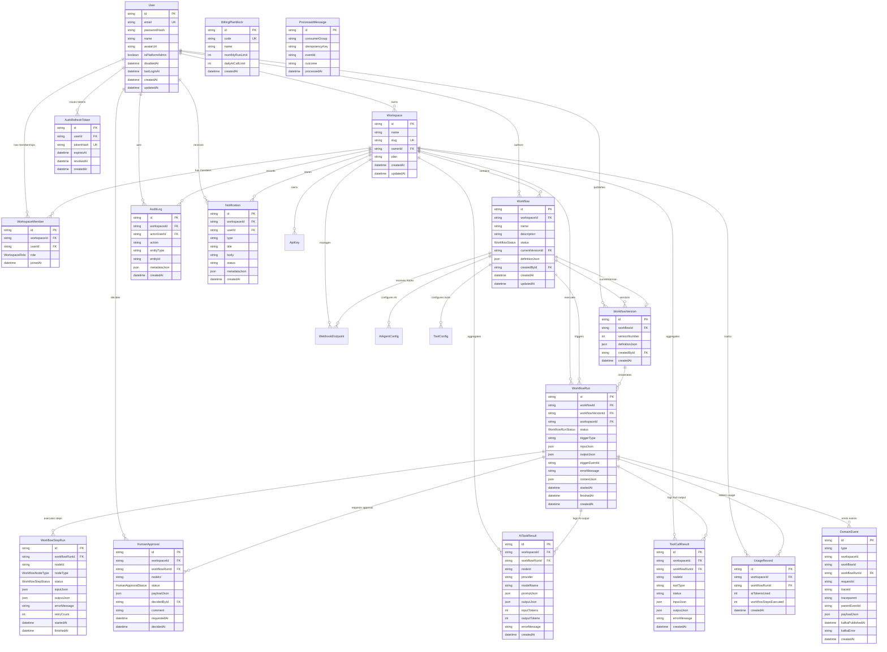

# Database Architecture & Schema Reference

PostgreSQL 16 serves as the primary relational datastore for AgentOps, managed through Prisma 7.10 with versioned migrations. The database provides strict tenant isolation across workspaces, maintains immutable snapshots of published workflow graphs, tracks step-by-step execution timelines, supports human-in-the-loop approvals, records AI token consumption, and implements an at-least-once transactional outbox for Kafka message dispatch.

The schema definition is maintained in [schema.prisma](file:///E:/AgentOps%20%E2%80%94%20AI%20Agent%20Workflow%20Automation%20Platform/packages/database/prisma/schema.prisma).

---

## Entity-Relationship Diagram



---

## Models Grouped by Domain Area

All 21 models defined in [schema.prisma](file:///E:/AgentOps%20%E2%80%94%20AI%20Agent%20Workflow%20Automation%20Platform/packages/database/prisma/schema.prisma) are detailed below, categorized by their architectural area.

### 1. Identity and Authentication

Handles user credentials, platform administrative privileges, account state flags, and persistent refresh tokens.

#### `User`
- **Purpose**: Represents registered platform operators and administrators. Tracks identity, Argon2 password hashes, profile avatars, Google sign-in accounts, platform administration rights, account suspensions, and last login timestamps.
- **Key Columns**:
  - `id` (String, PK, cuid): Unique user identifier.
  - `email` (String, Unique): User's primary email address.
  - `passwordHash` (String): Secure Argon2 password hash.
  - `name` (String): Display name of the user.
  - `avatarUrl` (String, Nullable): URL pointing to user profile photo.
  - `isPlatformAdmin` (Boolean, Default: `false`): Grants access to the platform admin console (`/admin`), platform-wide metrics, tenant search, and account management.
  - `disabledAt` (DateTime, Nullable): Timestamp set when a platform admin suspends an account. Subsequent sign-ins, token refreshes, and API calls are immediately refused.
  - `lastLoginAt` (DateTime, Nullable): Timestamp updated upon each successful login or OAuth sign-in.
  - `createdAt`, `updatedAt` (DateTime).
- **Indexes & Constraints**:
  - Primary Key: `id`.
  - Unique Constraint: `email`.

#### `AuthRefreshToken`
- **Purpose**: Persists cryptographically hashed refresh tokens used to renew JWT access tokens in HttpOnly session cookies. Supports instant revocation upon user logout or account suspension.
- **Key Columns**:
  - `id` (String, PK, cuid): Token row ID.
  - `userId` (String, FK -> `User.id` ON DELETE CASCADE): Target user ID.
  - `tokenHash` (String, Unique): SHA-256 hash of the issued refresh token secret.
  - `expiresAt` (DateTime): Token expiration date.
  - `revokedAt` (DateTime, Nullable): Revocation timestamp.
  - `createdAt` (DateTime).
- **Indexes & Constraints**:
  - Primary Key: `id`.
  - Unique Constraint: `tokenHash`.
  - Index: `[userId]` (rapid token lookup and user session teardown).

---

### 2. Workspaces and RBAC

Implements multi-tenant workspace isolation, role-based access control (RBAC), and programmatic API access.

#### `Workspace`
- **Purpose**: Core tenant boundary. All workflows, execution runs, credentials, and usage records belong strictly to one workspace.
- **Key Columns**:
  - `id` (String, PK, cuid): Workspace ID (e.g. `ws_demo`).
  - `name` (String): Human-readable workspace name.
  - `slug` (String, Unique): URL-friendly unique slug (e.g. `agentops-demo`).
  - `ownerId` (String, FK -> `User.id` ON DELETE RESTRICT): Workspace creator/owner.
  - `plan` (String, Default: `"FREE"`): Billing plan tier (`FREE`, `PRO`).
  - `createdAt`, `updatedAt` (DateTime).
- **Indexes & Constraints**:
  - Primary Key: `id`.
  - Unique Constraint: `slug`.

#### `WorkspaceMember`
- **Purpose**: Maps users to workspaces and grants specific RBAC roles (`OWNER`, `ADMIN`, `MEMBER`, `VIEWER`).
- **Key Columns**:
  - `id` (String, PK, cuid): Membership record ID.
  - `workspaceId` (String, FK -> `Workspace.id` ON DELETE CASCADE): Workspace reference.
  - `userId` (String, FK -> `User.id` ON DELETE CASCADE): Member user reference.
  - `role` (WorkspaceRole, Default: `MEMBER`): Assigned RBAC role.
  - `joinedAt` (DateTime).
- **Indexes & Constraints**:
  - Primary Key: `id`.
  - Unique Constraint: `[workspaceId, userId]` (a user cannot have duplicate memberships in the same workspace).
  - Index: `[userId]` (retrieves all workspaces a user belongs to during authentication).

#### `ApiKey`
- **Purpose**: Stores hashed workspace API keys used by external systems to trigger workflows and query statuses programmatically.
- **Key Columns**:
  - `id` (String, PK, cuid): Key record ID.
  - `workspaceId` (String, FK -> `Workspace.id` ON DELETE CASCADE): Scoped workspace.
  - `name` (String): Key descriptor (e.g. `"Production Inbound Lead Webhook"`).
  - `keyHash` (String): Cryptographic hash of the secret key.
  - `revokedAt` (DateTime, Nullable): Revocation timestamp.
  - `createdAt` (DateTime).
- **Indexes & Constraints**:
  - Primary Key: `id`.

---

### 3. Workflows and Versions

Stores visual React Flow graphs, immutable published versions, webhook triggers, and node-level configurations.

#### `Workflow`
- **Purpose**: Container for a workflow definition. Stores the editable draft definition graph (`definitionJson`), author reference, publication status, and points to the currently active published version.
- **Key Columns**:
  - `id` (String, PK, cuid): Workflow identifier.
  - `workspaceId` (String, FK -> `Workspace.id` ON DELETE CASCADE): Owning workspace.
  - `name` (String): Workflow title (e.g. `"Lead qualification"`).
  - `description` (String, Nullable): Summary of workflow purpose.
  - `status` (WorkflowStatus, Default: `DRAFT`): Workflow lifecycle state.
  - `currentVersionId` (String, Nullable, FK -> `WorkflowVersion.id` ON DELETE SET NULL): ID of the currently active published version.
  - `definitionJson` (Json): Active draft definition (React Flow nodes, edges, positions).
  - `createdById` (String, FK -> `User.id` ON DELETE RESTRICT): Creator user ID.
  - `createdAt`, `updatedAt` (DateTime).
- **Indexes & Constraints**:
  - Primary Key: `id`.
  - Index: `[workspaceId, updatedAt]` (workspace workflow listings sorted by last modification).

#### `WorkflowVersion`
- **Purpose**: Immutable snapshot created upon publishing a workflow. Execution runs must link directly to an immutable version to ensure reproducibility.
- **Key Columns**:
  - `id` (String, PK, cuid): Version identifier (e.g. `wfv_seed_lead_qualification_v1`).
  - `workflowId` (String, FK -> `Workflow.id` ON DELETE CASCADE): Parent workflow.
  - `versionNumber` (Int): Monotonically increasing version counter (1, 2, 3...).
  - `definitionJson` (Json): Frozen graph topology (nodes, edges, execution configuration).
  - `createdById` (String, FK -> `User.id` ON DELETE RESTRICT): Publisher user ID.
  - `createdAt` (DateTime).
- **Indexes & Constraints**:
  - Primary Key: `id`.
  - Unique Constraint: `[workflowId, versionNumber]`.

#### `WebhookEndpoint`
- **Purpose**: Configures inbound webhook listeners capable of ingesting external HTTP payloads and triggering workflow runs.
- **Key Columns**:
  - `id` (String, PK, cuid): Endpoint ID.
  - `workspaceId` (String, FK -> `Workspace.id` ON DELETE CASCADE): Scoped workspace.
  - `workflowId` (String, FK -> `Workflow.id` ON DELETE CASCADE): Target workflow to execute.
  - `secretHash` (String): HMAC secret hash to verify incoming webhook signatures.
  - `isActive` (Boolean, Default: `true`): Whether the endpoint accepts calls.
  - `createdAt` (DateTime).
- **Indexes & Constraints**:
  - Primary Key: `id`.

#### `AiAgentConfig`
- **Purpose**: Stores node-specific configuration for AI Agent steps in a workflow (system prompts, temperature, model selection, response schemas).
- **Key Columns**:
  - `id` (String, PK, cuid): Config record ID.
  - `workflowId` (String, FK -> `Workflow.id` ON DELETE CASCADE): Target workflow.
  - `nodeId` (String): Node identifier from the workflow definition graph (e.g. `"ai-1"`).
  - `configJson` (Json): Node configuration payload.
  - `createdAt`, `updatedAt` (DateTime).
- **Indexes & Constraints**:
  - Primary Key: `id`.
  - Unique Constraint: `[workflowId, nodeId]`.

#### `ToolConfig`
- **Purpose**: Stores node-specific configuration for tool execution steps (CRM integrations, mock email parameters, sales tasks).
- **Key Columns**:
  - `id` (String, PK, cuid): Config record ID.
  - `workflowId` (String, FK -> `Workflow.id` ON DELETE CASCADE): Target workflow.
  - `nodeId` (String): Node identifier from the workflow graph (e.g. `"email-1"`).
  - `toolType` (String): Identifier of the tool (e.g. `"email_mock"`, `"crm_lead"`).
  - `configJson` (Json): Specific integration settings and credentials.
  - `createdAt`, `updatedAt` (DateTime).
- **Indexes & Constraints**:
  - Primary Key: `id`.
  - Unique Constraint: `[workflowId, nodeId]`.

---

### 4. Runs and Steps

Maintains execution states, timelines, node outputs, and internal step contexts.

#### `WorkflowRun`
- **Purpose**: Represents an execution instance of a published workflow version. Tracks overall lifecycle status, input payloads, terminal outputs, error messages, and execution durations.
- **Key Columns**:
  - `id` (String, PK, cuid): Run ID (e.g. `run_seed_lead_qualification`).
  - `workflowId` (String, FK -> `Workflow.id` ON DELETE CASCADE): Executed workflow.
  - `workflowVersionId` (String, FK -> `WorkflowVersion.id` ON DELETE RESTRICT): Exact version executed.
  - `workspaceId` (String, FK -> `Workspace.id` ON DELETE CASCADE): Scoped workspace.
  - `status` (WorkflowRunStatus, Default: `PENDING`): Lifecycle state.
  - `triggerType` (String): Trigger mechanism (`"manual"`, `"webhook"`, `"api"`).
  - `inputJson` (Json): Initial trigger payload.
  - `outputJson` (Json, Nullable): Final terminal output payload.
  - `triggerEventId` (String, Nullable): Originating domain event ID.
  - `errorMessage` (String, Nullable): Top-level failure description if failed.
  - `contextJson` (Json, Nullable): Internal aggregated execution context (trigger input + intermediate node outputs). Kept private from unprivileged API clients.
  - `startedAt`, `finishedAt` (DateTime, Nullable).
  - `createdAt` (DateTime).
- **Indexes & Constraints**:
  - Primary Key: `id`.
  - Index: `[workspaceId, createdAt]` (workspace dashboard run lists).
  - Index: `[workflowId, createdAt]` (run history per workflow).
  - Index: `[status, createdAt]` (filtering runs by status).

#### `WorkflowStepRun`
- **Purpose**: Granular execution timeline record for each node within a run. Preserves inputs, outputs, error diagnostics, timing, and retry attempts.
- **Key Columns**:
  - `id` (String, PK, cuid): Step run ID.
  - `workflowRunId` (String, FK -> `WorkflowRun.id` ON DELETE CASCADE): Parent run ID.
  - `nodeId` (String): Node ID matching graph definition (e.g. `"ai-1"`, `"condition-1"`).
  - `nodeType` (WorkflowNodeType): Type of step executed.
  - `status` (WorkflowStepStatus, Default: `PENDING`): Execution status.
  - `inputJson` (Json, Nullable): Payload passed to this step.
  - `outputJson` (Json, Nullable): Payload returned by this step.
  - `errorMessage` (String, Nullable): Failure reason if step failed.
  - `retryCount` (Int, Default: `0`): Number of retries attempted by worker.
  - `startedAt`, `finishedAt` (DateTime, Nullable).
- **Indexes & Constraints**:
  - Primary Key: `id`.
  - Unique Constraint: `[workflowRunId, nodeId]` (guarantees one timeline entry per node per run).

---

### 5. Approvals

Implements human-in-the-loop review gates within workflow executions.

#### `HumanApproval`
- **Purpose**: Represents a human review barrier. Pauses the parent workflow run, presents a masked payload (e.g. drafted email, lead assessment) to reviewers in the approval queue, and records decision outcomes (`APPROVED` or `REJECTED`) with comments.
- **Key Columns**:
  - `id` (String, PK, cuid): Approval record ID.
  - `workspaceId` (String): Workspace scope.
  - `workflowRunId` (String, FK -> `WorkflowRun.id` ON DELETE CASCADE): Paused run ID.
  - `nodeId` (String): Graph node ID of the approval gate (e.g. `"approval-1"`).
  - `status` (HumanApprovalStatus, Default: `WAITING_APPROVAL`): Decision state.
  - `payloadJson` (Json, Nullable): Masked preview content shown to the human reviewer.
  - `decidedById` (String, Nullable, FK -> `User.id` ON DELETE SET NULL): Reviewer who decided.
  - `comment` (String, Nullable): Decision feedback or rejection reason (minimum 3 characters on rejection).
  - `requestedAt` (DateTime, Default: `now()`).
  - `decidedAt` (DateTime, Nullable).
- **Indexes & Constraints**:
  - Primary Key: `id`.
  - Unique Constraint: `[workflowRunId, nodeId]`.
  - Index: `[workspaceId, status, requestedAt]` (powers the active approval queue).

---

### 6. AI and Tool Results

Stores execution outputs, telemetry, and debugging artifacts for AI model calls and tool actions.

#### `AiTaskResult`
- **Purpose**: Persists prompt, structured JSON response, and token metrics for each AI Agent node execution. Written idempotently by `ai-worker`.
- **Key Columns**:
  - `id` (String, PK, cuid): Result ID.
  - `workspaceId` (String, FK -> `Workspace.id` ON DELETE CASCADE): Owning workspace.
  - `workflowRunId` (String, FK -> `WorkflowRun.id` ON DELETE CASCADE): Parent run.
  - `nodeId` (String): AI node ID (e.g. `"ai-1"`).
  - `provider` (String): Provider name (e.g. `"openai"`, `"mock"`).
  - `modelName` (String): Model identifier (e.g. `"gpt-4o-mini"`).
  - `promptJson` (Json, Nullable): Raw input prompts (system, user).
  - `outputJson` (Json, Nullable): Validated structured JSON response.
  - `inputTokens` (Int, Default: `0`): Prompt token count.
  - `outputTokens` (Int, Default: `0`): Completion token count.
  - `errorMessage` (String, Nullable): Error string if call failed.
  - `createdAt` (DateTime).
- **Indexes & Constraints**:
  - Primary Key: `id`.
  - Unique Constraint: `[workflowRunId, nodeId]`.
  - Index: `[workspaceId, createdAt]` (workspace AI dashboard and lead analysis).

#### `ToolCallResult`
- **Purpose**: Records the invocation status and payload details of external or mock tools (mock emails, CRM contacts, sales tasks) executed by `tool-worker`.
- **Key Columns**:
  - `id` (String, PK, cuid): Result ID.
  - `workspaceId` (String, FK -> `Workspace.id` ON DELETE CASCADE): Owning workspace.
  - `workflowRunId` (String, FK -> `WorkflowRun.id` ON DELETE CASCADE): Parent run.
  - `nodeId` (String): Tool node ID (e.g. `"email-1"`).
  - `toolType` (String): Tool identifier (e.g. `"email_mock"`, `"create_sales_task"`).
  - `status` (String): Tool execution result (e.g. `"SUCCESS"`, `"FAILED"`).
  - `inputJson` (Json, Nullable): Tool input parameters.
  - `outputJson` (Json, Nullable): Output or response payload.
  - `errorMessage` (String, Nullable): Tool execution error if failed.
  - `createdAt` (DateTime).
- **Indexes & Constraints**:
  - Primary Key: `id`.
  - Unique Constraint: `[workflowRunId, nodeId]`.

---

### 7. Notifications and Sales Tasks

Manages user notifications and operational sales action items generated by workflows.

#### `Notification`
- **Purpose**: In-app notifications and actionable sales tasks (type `"SALES_TASK"`). Created by `notification-worker` when a lead qualification completes, alerting sales reps to follow up.
- **Key Columns**:
  - `id` (String, PK, cuid): Notification ID.
  - `workspaceId` (String, FK -> `Workspace.id` ON DELETE CASCADE): Scoped workspace.
  - `userId` (String, Nullable, FK -> `User.id` ON DELETE SET NULL): Targeted user (null for workspace-wide broadcasts).
  - `type` (String): Notification category (e.g. `"SALES_TASK"`, `"SYSTEM"`, `"APPROVAL_REQUIRED"`).
  - `title` (String): Notification headline (e.g. `"Call lead back within 24 hours"`).
  - `body` (String): Message content or reason for action.
  - `status` (String, Default: `"UNREAD"`): Read state (`"UNREAD"`, `"READ"`).
  - `metadataJson` (Json, Nullable): Associated metadata (e.g. `{ workflowRunId, nodeId, dueAt }`).
  - `createdAt` (DateTime).
- **Indexes & Constraints**:
  - Primary Key: `id`.
  - Index: `[workspaceId, type, createdAt]` (queries sales task feeds and notification centers).

---

### 8. Audit

Maintains a secure, append-only compliance log of all critical workspace and platform-level operations.

#### `AuditLog`
- **Purpose**: Comprehensive audit trail recording user and administrative activities. Records both workspace-scoped actions (workflow updates, member role changes) and platform-level operations (account suspension, admin privilege grant/revoke via the admin console).
- **Key Columns**:
  - `id` (String, PK, cuid): Log entry ID.
  - `workspaceId` (String, Nullable, FK -> `Workspace.id` ON DELETE CASCADE): Associated workspace ID. **Nullable** for platform-level actions performed in the platform admin console.
  - `actorUserId` (String, Nullable, FK -> `User.id` ON DELETE SET NULL): User ID who triggered the action. Preserved even if user is deleted.
  - `action` (String): Action name (e.g. `"workflow.publish"`, `"user.disable"`, `"user.grant_admin"`).
  - `entityType` (String): Target resource type (`"workflow"`, `"user"`, `"workspace"`).
  - `entityId` (String, Nullable): Target resource ID.
  - `metadataJson` (Json, Nullable): Contextual metadata and before/after diffs.
  - `createdAt` (DateTime, Default: `now()`).
- **Indexes & Constraints**:
  - Primary Key: `id`.
  - Index: `[workspaceId, createdAt]` (workspace-level audit log inspection).
  - Index: `[createdAt]` (platform-wide audit queries in `/admin/audit`).

---

### 9. Usage and Billing

Tracks metered resource consumption for quota enforcement and mock billing plans.

#### `UsageRecord`
- **Purpose**: Records daily resource consumption (tokens and step executions) per workspace and workflow run. Used to enforce daily AI call limits and monthly run quotas.
- **Key Columns**:
  - `id` (String, PK, cuid): Usage record ID.
  - `workspaceId` (String, FK -> `Workspace.id` ON DELETE CASCADE): Scoped workspace.
  - `workflowRunId` (String, Nullable, FK -> `WorkflowRun.id` ON DELETE SET NULL): Associated run.
  - `aiTokensUsed` (Int, Default: `0`): Cumulative token count for the run.
  - `workflowStepsExecuted` (Int, Default: `0`): Number of step nodes processed.
  - `createdAt` (DateTime).
- **Indexes & Constraints**:
  - Primary Key: `id`.
  - Index: `[workspaceId, createdAt]` (daily AI quota checks and usage aggregation).

#### `BillingPlanMock`
- **Purpose**: Stores static billing tier definitions, monthly run caps, and daily AI call limits.
- **Key Columns**:
  - `id` (String, PK, cuid): Plan ID.
  - `code` (String, Unique): Plan code (`"FREE"`, `"PRO"`).
  - `name` (String): Plan title (`"Free"`, `"Pro"`).
  - `monthlyRunLimit` (Int): Allowed monthly runs (e.g. 1,000 for FREE, 20,000 for PRO).
  - `dailyAiCallLimit` (Int): Allowed daily AI calls (e.g. 100 for FREE, 2,000 for PRO).
  - `createdAt` (DateTime).
- **Indexes & Constraints**:
  - Primary Key: `id`.
  - Unique Constraint: `code`.

---

### 10. Outbox / Domain Events and Idempotency

Provides reliable asynchronous event-driven communication via Kafka with at-least-once outbox publishing and consumer deduplication.

#### `DomainEvent`
- **Purpose**: Transactional outbox table. API and worker transactions write events here atomically before Kafka dispatch. An outbox relay periodically retries events where `kafkaPublishedAt` is null. Includes OpenTelemetry trace headers to maintain end-to-end distributed tracing.
- **Key Columns**:
  - `id` (String, PK): Event ID (e.g. `evt_seed_workflow_triggered`).
  - `type` (String): Event topic/name (`"workflow-triggered"`, `"agent-task-requested"`, `"human-approval-decided"`, etc.).
  - `workspaceId` (String): Tenant workspace ID.
  - `workflowId` (String, Nullable): Associated workflow.
  - `workflowRunId` (String, FK -> `WorkflowRun.id` ON DELETE CASCADE): Associated run.
  - `requestId` (String, Nullable): HTTP request ID for correlation.
  - `traceId` (String, Nullable): W3C OpenTelemetry trace ID.
  - `traceparent` (String, Nullable): W3C OpenTelemetry traceparent header string.
  - `parentEventId` (String, Nullable): ID of upstream cause event.
  - `payloadJson` (Json): Domain event payload.
  - `kafkaPublishedAt` (DateTime, Nullable): Timestamp when Kafka broker acknowledged publication.
  - `kafkaError` (String, Nullable): Error message if publication failed.
  - `createdAt` (DateTime).
- **Indexes & Constraints**:
  - Primary Key: `id`.
  - Index: `[workspaceId, createdAt]` (workspace event history).
  - Index: `[workflowRunId, createdAt]` (run timeline event reconstruction).
  - Index: `[type, createdAt]` (topic-specific event streams).
  - Index: `[kafkaPublishedAt, createdAt]` (powers the outbox relay poll: oldest unpublished events first).

#### `ProcessedMessage`
- **Purpose**: Consumer-side idempotency log. Workers write a row before acknowledging Kafka messages to guarantee exactly-once processing semantics during retries or rebalances.
- **Key Columns**:
  - `id` (String, PK, cuid): Record ID.
  - `consumerGroup` (String): Kafka consumer group name (e.g. `"agentops.ai-worker"`).
  - `idempotencyKey` (String): Unique key composed of `workflowRunId:nodeId:eventType`.
  - `eventId` (String): Handled event ID.
  - `outcome` (String): Execution outcome (e.g. `"processed"`, `"skipped"`, `"dead_lettered"`).
  - `processedAt` (DateTime, Default: `now()`).
- **Indexes & Constraints**:
  - Primary Key: `id`.
  - Unique Constraint: `[consumerGroup, idempotencyKey]`.
  - Index: `[processedAt]` (retention cleanup of old deduplication records).

---

## Status Enums

The Prisma schema defines 6 native PostgreSQL enums:

### `WorkspaceRole`
Defines permissions within a workspace:
- `OWNER`: Full administrative and ownership control, billing management, and role assignments.
- `ADMIN`: Workspace configuration, workflow authoring/publishing, webhook setup, and user invitations.
- `MEMBER`: Workflow creation, manual run triggers, and approval queue decisions.
- `VIEWER`: Read-only access to workflows, execution timelines, and dashboard analytics.

### `WorkflowStatus`
Defines workflow lifecycle states:
- `DRAFT`: Unpublished workflow under construction.
- `ACTIVE`: Published, actively listening for triggers.
- `PAUSED`: Temporarily inactive; incoming triggers are rejected or paused.
- `ARCHIVED`: Soft-deleted / retired workflow preserved for historical execution logs.

### `WorkflowRunStatus`
Defines top-level execution run states:
- `PENDING`: Run queued and awaiting execution by worker.
- `RUNNING`: Step execution actively in progress.
- `WAITING_APPROVAL`: Execution paused awaiting a human decision on an approval gate.
- `COMPLETED`: All execution branches reached terminal nodes successfully.
- `FAILED`: Execution terminated prematurely due to unhandled errors or exhausted retries.
- `CANCELLED`: Aborted manually by an operator.

### `WorkflowStepStatus`
Defines individual step/node states:
- `PENDING`: Step scheduled, waiting for upstream dependencies.
- `RUNNING`: Step actively executing in a worker.
- `WAITING_APPROVAL`: Paused awaiting human review.
- `COMPLETED`: Step finished successfully.
- `FAILED`: Step encountered an unrecoverable failure.
- `SKIPPED`: Step bypassed due to conditional branch evaluation (e.g. low-intent lead path).

### `HumanApprovalStatus`
Defines human review states:
- `WAITING_APPROVAL`: Review requested and pending in the approval queue.
- `APPROVED`: Human operator approved the action (e.g. email drafted for sending).
- `REJECTED`: Human operator rejected the action with a mandatory comment.
- `EXPIRED`: Review period elapsed without human action.

### `WorkflowNodeType`
Defines node types supported in workflow graphs:
- `TRIGGER`: Inbound initiation node (manual, webhook, API).
- `AI_AGENT`: LLM reasoning node (scoring, text generation, JSON structured extraction).
- `CONDITION`: Decision / branching node evaluating boolean expressions on step outputs.
- `WEBHOOK`: Inbound/outbound webhook integration node.
- `HTTP_REQUEST`: External HTTP call node.
- `EMAIL_MOCK`: Simulated email delivery service.
- `DELAY`: Timer / wait delay node.
- `HUMAN_APPROVAL`: Human-in-the-loop review barrier.
- `NOTIFICATION`: Alerts and sales task generation node.
- `END`: Terminal execution sink node.

---

## Hot Queries and Supporting Indexes

The database uses composite and unique indexes optimized for high-throughput queries:

| Query Pattern | Index | Description |
| --- | --- | --- |
| Run lists per workspace | `WorkflowRun(workspaceId, createdAt)` | Dashboard and execution history sorted by time |
| Run lists per workflow | `WorkflowRun(workflowId, createdAt)` | Workflow detail history tab |
| Run status filtering | `WorkflowRun(status, createdAt)` | Filtering active, pending, or failed runs |
| Step timeline of a run | unique `WorkflowStepRun(workflowRunId, nodeId)` | Exact node lookup and timeline reconstruction |
| Outbox relay poll | `DomainEvent(kafkaPublishedAt, createdAt)` | Polls unpublished events (`kafkaPublishedAt IS NULL`), oldest first |
| Run event timeline | `DomainEvent(workflowRunId, createdAt)` | Trace and audit all events emitted during a run |
| Event type search | `DomainEvent(type, createdAt)` | Topic-specific diagnostic analysis |
| Workspace lead scoring | `AiTaskResult(workspaceId, createdAt)` | Dashboard lead cards and AI analytics |
| Approval queue | `HumanApproval(workspaceId, status, requestedAt)` | Pending approvals ordered by age |
| Sales task / alert feed | `Notification(workspaceId, type, createdAt)` | Actionable sales task lists |
| Daily AI quota meter | `UsageRecord(workspaceId, createdAt)` | Real-time verification of daily AI call allowances |
| Workspace workflows | `Workflow(workspaceId, updatedAt)` | Workflow listing sorted by last edit |
| Platform audit search | `AuditLog(createdAt)` | Global platform audit log in `/admin/audit` |
| Workspace audit search | `AuditLog(workspaceId, createdAt)` | Scoped audit trails for tenant compliance |
| User session lookup | `AuthRefreshToken(userId)` | Refresh token resolution and mass-revocation |
| User memberships | `WorkspaceMember(userId)` | Authentication hook returning all user workspaces |
| Consumer idempotency | unique `ProcessedMessage(consumerGroup, idempotencyKey)` | Prevents duplicate Kafka message processing |
| Idempotency cleanup | `ProcessedMessage(processedAt)` | Retention purging of aged deduplication markers |

---

## Referential Integrity and Cascade Rules

- **Workspace Deletion (Cascading)**: Deleting a `Workspace` cascades to all associated workflows, runs, steps, results, members, notifications, usage records, and API keys.
- **Workflow Deletion (Cascading)**: Deleting a `Workflow` cascades to its draft versions, execution runs, webhook endpoints, and node configs.
- **Run Deletion (Cascading)**: Deleting a `WorkflowRun` removes its steps, AI results, tool results, approvals, and domain events.
- **Immutable Workflow Version Protection (`RESTRICT`)**: A `WorkflowVersion` cannot be deleted while existing `WorkflowRun` rows reference it. Execution history remains reproducible.
- **Ownership Protection (`RESTRICT`)**: A `User` who owns a workspace (`Workspace.ownerId`) or created a workflow (`Workflow.createdById`) cannot be deleted without reassigning ownership.
- **Audit Preservation (`SET NULL`)**: When an actor user is removed, `AuditLog.actorUserId`, `HumanApproval.decidedById`, and `Notification.userId` are set to `NULL`, retaining immutable historical records.
- **Usage Retention (`SET NULL`)**: When a historical `WorkflowRun` is cleaned up, its `UsageRecord.workflowRunId` is set to `NULL`, ensuring tenant billing aggregates remain intact.

---

## Domain Event Outbox Pattern

To prevent dual-write inconsistencies between PostgreSQL and Kafka:
1. The API and workers execute business logic and write a `DomainEvent` row in the same database transaction.
2. The event row stores OpenTelemetry context (`traceId`, `traceparent`, `requestId`) to ensure distributed trace continuity.
3. Upon database transaction commit, the application attempts an immediate Kafka publish.
4. If successful, `kafkaPublishedAt` is set to the current timestamp. If publication fails, `kafkaError` is logged.
5. A background relay (`DomainEventsService`) scans for rows where `kafkaPublishedAt IS NULL` (indexed via `[kafkaPublishedAt, createdAt]`) and republishes them.
6. Kafka consumers use `ProcessedMessage` to ensure idempotent processing, making at-least-once delivery safe.

---

## Migrations

Schema changes are tracked as versioned migrations in [packages/database/prisma/migrations/](file:///E:/AgentOps%20%E2%80%94%20AI%20Agent%20Workflow%20Automation%20Platform/packages/database/prisma/migrations). Direct `db push` is prohibited in production and CI.

### Migration History
- `20261018000000_init`: Initial database schema defining all core models, relations, enums, primary keys, and initial unique constraints.
- `20261018120000_indexes_and_constraints`: Adds hot-query composite indexes, unique constraints for node results/configs, and cascading foreign key relations.
- `20261118000000_platform_admin`: Adds platform administration support to User (`isPlatformAdmin`, `disabledAt`, `lastLoginAt`), makes `AuditLog.workspaceId` nullable for platform-level events, and adds an index on `AuditLog.createdAt`.

### Migration Commands

```bash
# Development: create and apply a migration from schema.prisma modifications
pnpm db:migrate

# CI / Production: deploy all pending migrations without interactive prompts
pnpm db:migrate:deploy

# Verification: inspect migration application status
pnpm db:migrate:status

# Generate Prisma Client code to packages/database/src/generated/prisma
pnpm db:generate

# Visual web inspection of the database
pnpm db:studio
```

---

## Seeds

Database seeds populate reference data and local development states.

### 1. Required Reference Seed (`pnpm db:seed`)
- **Script**: [seed-required.ts](file:///E:/AgentOps%20%E2%80%94%20AI%20Agent%20Workflow%20Automation%20Platform/packages/database/scripts/seed-required.ts)
- **Environment**: Safe for all environments, including CI, staging, and production.
- **Behavior**: Idempotently upserts billing plan reference records in `BillingPlanMock`:
  - `FREE`: 1,000 monthly runs, 100 daily AI calls.
  - `PRO`: 20,000 monthly runs, 2,000 daily AI calls.

### 2. Demo Seed (`pnpm db:seed:demo`)
- **Script**: [seed-demo.ts](file:///E:/AgentOps%20%E2%80%94%20AI%20Agent%20Workflow%20Automation%20Platform/packages/database/scripts/seed-demo.ts)
- **Environment**: Local development and demo instances only.
- **Behavior**: Creates showcase records:
  - Demo user `demo@agentops.local` (`user_demo`).
  - Demo workspace `"AgentOps Demo"` (`ws_demo`, slug `"agentops-demo"`).
  - Owner membership linking `user_demo` to `ws_demo`.
  - Published showcase workflow `"Lead qualification"` (`wf_lead_qualification`, version 1 `wfv_seed_lead_qualification_v1`).
  - Completed execution run (`run_seed_lead_qualification`) with 8 step runs matching the showcase graph.
  - Domain event (`evt_seed_workflow_triggered`).
  - Usage record (128 AI tokens, 8 steps executed).

### 3. Local Reset (`pnpm db:reset`)
- **Script**: [db-reset.ts](file:///E:/AgentOps%20%E2%80%94%20AI%20Agent%20Workflow%20Automation%20Platform/packages/database/scripts/db-reset.ts)
- **Safety Guard**: Implemented via [safety.ts](file:///E:/AgentOps%20%E2%80%94%20AI%20Agent%20Workflow%20Automation%20Platform/packages/database/src/safety.ts) `assertLocalDatabase`. Fails immediately if:
  - The database hostname is not local (`localhost`, `127.0.0.1`, `::1`, `postgres`, `host.docker.internal`).
  - `APP_ENV` is set to any non-local environment (`production`, `prod`, `staging`, `dev`).
  - `NODE_ENV` equals `"production"`.
- **Action**: Runs `prisma migrate reset --force` to drop and recreate the schema, then sequentially runs `pnpm db:seed` and `pnpm db:seed:demo`.
