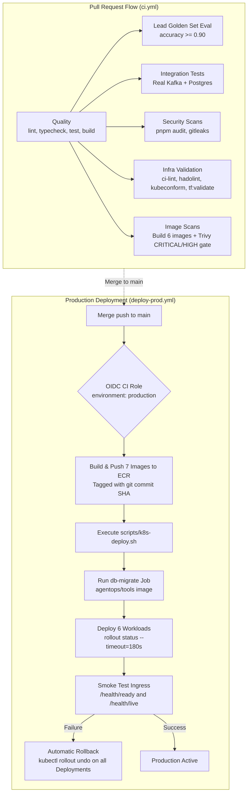

# Deployment and CI/CD Pipeline

AgentOps implements an automated, multi-environment deployment pipeline designed for containerized workloads across local development, temporary environments, and managed production Kubernetes.

Related documentation:
- [AWS Kubernetes Deployment](aws-kubernetes-deployment.md): Terraform architecture, EKS add-ons, and networking.
- [Production Runbook (AWS)](production-runbook-aws.md): Step-by-step bring-up, DNS/host change checklist, and teardown.
- [Operations Runbook](runbook.md): Incident response playbooks and operational procedures.
- [Local Runbook](local-runbook.md): Local development setup and Docker Compose instructions.

---

## 1. Environments Overview

AgentOps targets three distinct operational environments:

| Environment | Infrastructure | Purpose | Data Services | Host / Access |
| --- | --- | --- | --- | --- |
| **Local** | Docker Compose + native Node 22 | Local development, inner-loop coding, debugging | In-container PostgreSQL 16, Redis 7, Kafka 4.3 (KRaft), Prometheus, Tempo, Grafana | Web: `http://localhost:3000`<br/>API: `http://localhost:4000` |
| **Dev** | AWS EC2 (t3.medium) running k3s | Ephemeral pull request validation and feature testing | In-cluster PostgreSQL, Redis, Kafka (`components/in-cluster-data`) | Gated on demand via `deploy-dev.yml` |
| **Production** | AWS EKS 1.31 (3x t3.medium) in `ap-southeast-1` | Live production platform, showcase demo runs | Managed RDS PostgreSQL 16, ElastiCache Redis (TLS), MSK Kafka 3.9.x | Web: `https://agentops.<lb-ip-dashed>.sslip.io`<br/>API: `https://api.agentops.<lb-ip-dashed>.sslip.io` |

### Resource Naming Conventions

| Resource Type | Scope / Convention | Example |
| --- | --- | --- |
| Local container | `agentops-local-<service>` | `agentops-local-kafka`, `agentops-local-api` |
| Local volume | `agentops_local_<service>_data` | `agentops_local_postgres_data` |
| Local network | `agentops_local_net` | `agentops_local_net` |
| Local container image | `agentops/<app>:local` | `agentops/workflow-worker:local` |
| ECR repository | `<env>/<app>` | `prod/api`, `prod/ai-worker`, `prod/tools` |
| Kubernetes namespace | `agentops` (apps), `monitoring` (observability) | `agentops`, `monitoring` |

---

## 2. Container Images and Tagging

The platform packages seven distinct container images from the monorepo:

| Image Name | Source Dockerfile | Build Target / Args | Responsibility |
| --- | --- | --- | --- |
| `api` | `infrastructure/docker/api.Dockerfile` | Default runtime | NestJS modular monolith API, auth, workflow runner |
| `tools` | `infrastructure/docker/api.Dockerfile` | `target: tools` | Workspace CLI tools, Prisma migration Job, database seed |
| `web` | `infrastructure/docker/web.Dockerfile` | `NEXT_PUBLIC_API_URL` | Next.js 16 App Router UI, visual React Flow builder |
| `workflow-worker` | `infrastructure/docker/worker.Dockerfile` | `WORKER_PACKAGE=@agentops/workflow-worker` | Graph traversal, conditional branching evaluation |
| `ai-worker` | `infrastructure/docker/worker.Dockerfile` | `WORKER_PACKAGE=@agentops/ai-worker` | AI task execution, schema validation, token tracking |
| `tool-worker` | `infrastructure/docker/worker.Dockerfile` | `WORKER_PACKAGE=@agentops/tool-worker` | Tool execution (sales tasks, CRM integrations) |
| `notification-worker` | `infrastructure/docker/worker.Dockerfile` | `WORKER_PACKAGE=@agentops/notification-worker` | Mock email delivery, sales task creation, notifications |

### Image Security and Hardening

- **Base Image**: Multi-stage builds based on `node:22-alpine` using `pnpm 11.5.2`.
- **Privilege Separation**: Non-root execution under UID 1000 (`node`), with process supervision by `tini` as PID 1.
- **Vulnerability Mitigation**: Production runtime images explicitly remove the bundled `npm` and `corepack` CLIs to eliminate upstream High-severity CVEs.
- **Font Build Retries**: The `web` image build incorporates retry logic (up to 3 attempts) to accommodate Google Fonts network downloads via `next/font`.
- **Health Checks**: Containers implement built-in health checks (`/health/live` on port 4000 for API, port 9100 for workers, `/en` on port 3000 for Web).

### Tagging Strategy

- **Pull Requests**: Tagged as `agentops/<app>:pr-${{ github.sha }}` for ephemeral container validation and vulnerability scanning.
- **Production Releases**: Tagged with the immutable Git commit SHA (`<registry>/prod/<app>:${{ github.sha }}`). Re-running a deployment against the same commit verifies existence in ECR and reuses the existing digest without rebuilding.
- **Local Development**: Built and tagged with the `:local` suffix (`agentops/<app>:local`).

---

## 3. CI/CD Pipeline Architecture

Automation is driven by GitHub Actions workflows located in `.github/workflows/`:



### Workflow Descriptions

1. **`ci.yml` (PR Checks)**:
   - **Quality**: Turbo caching, ESLint, TypeScript typecheck, Vitest unit test suite, Turbo build, and lead evaluation golden set (`pnpm eval:leads`).
   - **Integration**: Starts throwaway Postgres (`:55433`) and Kafka (`:9095`) via Docker Compose profile `test`, executes full pipeline integration suite (`pnpm test:integration`).
   - **Security**: Scans production dependencies via `pnpm audit --prod --audit-level high` and scans repository history for secrets via `gitleaks`.
   - **Infra**: Validates GitHub workflows (`actionlint`), shell scripts (`shellcheck`), Dockerfiles (`hadolint`), Kubernetes manifests (`kubeconform` against Kubernetes 1.31 schemas), and Terraform offline plan (`pnpm tf:validate`).
   - **Images**: Builds container images and scans with Trivy (`trivy-action` pinned to commit `ed142fd0673e97e23eac54620cfb913e5ce36c25`), failing on unfixed CRITICAL or HIGH vulnerabilities.

2. **`deploy-prod.yml` (Production Deployment)**:
   - Triggers on direct pushes to `main` (excluding Markdown and documentation paths) or manual dispatch (`workflow_dispatch`).
   - Targets GitHub environment `production`, enforcing OIDC trust constraints (`AWS_CI_ROLE_ARN_PROD` trusts only `environment:production`).
   - Builds and pushes 7 application images tagged with the commit SHA.
   - Invokes `scripts/k8s-deploy.sh` to execute database migrations, apply Kustomize overlays, verify rollouts, and smoke test health endpoints.

3. **Gated Workflows**:
   - `deploy-dev.yml` and `terraform-plan.yml` are gated: they evaluate environment variable availability (`AWS_CI_ROLE_ARN_DEV`) and skip execution gracefully when running without dedicated dev infrastructure.

---

## 4. Kubernetes Deployment Flow (`scripts/k8s-deploy.sh`)

Production deployments are orchestrated by `scripts/k8s-deploy.sh` using Kustomize overlays:

```bash
scripts/k8s-deploy.sh <env> <tag> <registry> <api_url>
```

### Deployment Stages

1. **Manifest Preparation**: Copies `infrastructure/k8s` into an isolated temporary directory. Populates environment placeholders (`DEPLOY_WEB_HOST`, `DEPLOY_KAFKA_BROKERS`, `DEPLOY_REDIS_URL`, `DEPLOY_ACME_EMAIL`) dynamically without mutating Git-tracked files.
2. **Placeholder Assertion**: Renders the complete Kustomize manifest and asserts that no unresolved tokens (such as `REPLACE_WITH_MSK_BOOTSTRAP_BROKERS` or `000000000000`) remain. If any placeholder is found, execution aborts before making Kubernetes API calls.
3. **Database Migration Job**: Deploys `infrastructure/k8s/jobs/db-migrate` using the newly built `tools` image. Waits up to 300 seconds for job completion (`kubectl wait --for=condition=complete job/agentops-db-migrate`). If the migration fails, logs are output and the deployment halts immediately without modifying running workloads.
4. **Workload Rollout**: Records current Deployment image revisions for rollback tracking, then applies the rendered manifests. Monitors rollout progression across all six Deployments (`agentops-api`, `agentops-web`, `workflow-worker`, `ai-worker`, `tool-worker`, `notification-worker`) with a 180-second timeout per workload.
5. **Ingress Smoke Testing**: Executes automated curl probes against `$api_url/health/ready` (retried up to 10 times with 6s delays) and `$api_url/health/live`.

---

## 5. Rollback Procedures

### Automatic Rollback

If any Deployment fails to reach ready status within 180 seconds, or if the ingress health probes return non-200 responses, `scripts/k8s-deploy.sh` initiates an immediate automatic rollback:

```bash
# Executed automatically by scripts/k8s-deploy.sh upon failure
for deploy in agentops-api agentops-web workflow-worker ai-worker tool-worker notification-worker; do
  kubectl -n agentops rollout undo "deploy/$deploy"
  kubectl -n agentops rollout status "deploy/$deploy" --timeout=180s
done
```

The script exits with status code 1 and writes `ROLLED BACK` to standard error.

### Manual Application Rollback

When rolling back to an earlier stable release:

1. **Via GitHub Actions (Preferred)**:
   - Navigate to **Actions** > **Deploy prod** > **Run workflow**.
   - Input the previous known-good commit SHA into `image_tag`.
   - The workflow skips rebuilding and rolls out the verified images from ECR.

2. **Via Command Line**:
   ```bash
   # Roll back individual services:
   kubectl -n agentops rollout undo deploy/agentops-api
   kubectl -n agentops rollout undo deploy/workflow-worker
   kubectl -n agentops rollout status deploy/agentops-api
   ```

### Database Rollback Strategy

- Prisma migrations in AgentOps are strictly **forward-only**; down-migrations are not supported by the runtime engine.
- Schema changes must remain backward-compatible (expand before contract) so older application code can operate alongside newly migrated database tables.
- For destructive schema errors that have already committed data corruption, restore from the latest manual RDS snapshot (e.g., `agentops-prod-before-teardown-20261117`). Snapshot restoration is a last-resort disaster recovery operation that requires administrative authorization.
