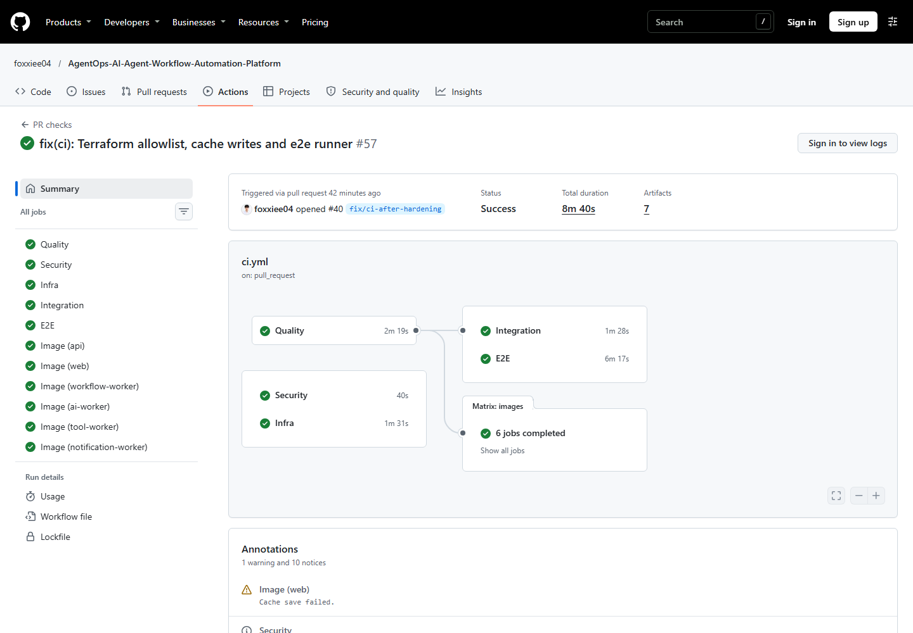
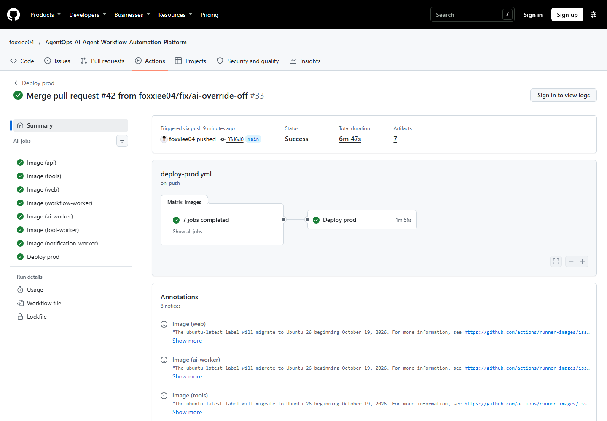
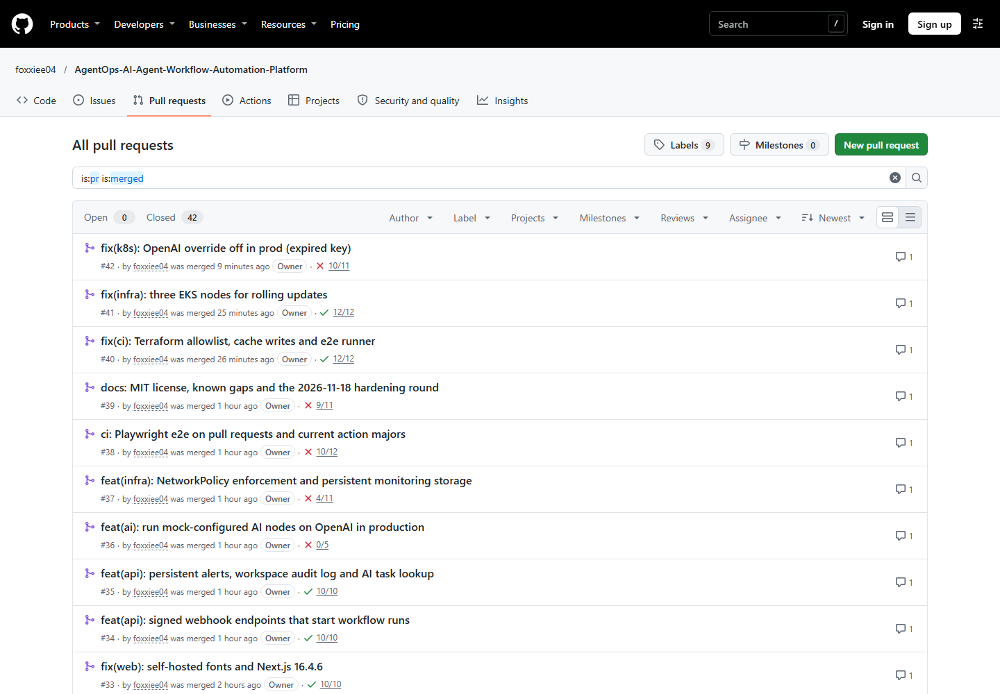

# Hardening round - evidence (2026-11-18)

This page records how each item of the 2026-11-18 hardening round was verified on the production stack
(`agentops-prod`, AWS `ap-southeast-1`). Command output is copied from the session that did the work; account-wide
identifiers are left as they appear in the repository's own docs, nothing secret is included.

| Item | Pull request | Verified by |
| --- | --- | --- |
| Signed webhook endpoints that start runs | #34 | Live call on prod: wrong secret 401, right secret 202 + run, disabled endpoint 404, audit row |
| Alerts stored in PostgreSQL, workspace audit log, AI task lookup | #35 | Unit tests (API 237/237), migration applied by CD, routes answer 401 without a session |
| Deployment switch for OpenAI | #36, #42 | Unit tests; switched off in prod because the OpenAI key expired (see below) |
| NetworkPolicy enforcement, EBS volumes for monitoring | #37 | Probe pods in two namespaces, PVCs bound to encrypted gp3 volumes |
| Playwright e2e on every pull request, current action majors | #38, #40 | PR checks run with the E2E job green |
| Three nodes for rolling updates | #41 | Deploys after the change finish without timeouts |
| Terraform state in S3 with locking | - | Remote state object, versioning, lock table, `terraform plan` reports no changes |
| Production checks | - | `scripts/verify-prod.mjs`: 27/27 ([report](prod-verification.md)) |

## 1. CI: end-to-end suite on pull requests

The `e2e` job builds the Docker Compose stack, waits for `/health/ready` and the web app, and runs the 24 Playwright
scenarios. First green run (PR #40):



Two fixes were needed before it passed: `ubuntu-latest` moved to Ubuntu 26.04, which Playwright's Chromium build does
not support yet (the job is pinned to `ubuntu-24.04`), and GitHub's cache service can refuse writes for a run whose
pull request was merged meanwhile (`cache-to ... ignore-error=true`, a cache miss no longer fails the build).

## 2. Continuous delivery after the round





## 3. Webhook trigger, end to end on production

A temporary endpoint was created inside the API pod (secret generated and hashed in the pod), called through the
public receive route on the pod's own port, then disabled:

```text
endpoint wh_verify_1795013703101 for Lead qualification (wf_lead_qualification)
wrong secret -> HTTP 401
right secret -> HTTP 202 {"runId":"run_aeb8d1f6-...","status":"PENDING"}
after deactivation -> HTTP 404
```

The audit log received a `webhook.received` row, and the run produced a trace across `agentops-api`,
`agentops-workflow-worker` and `agentops-ai-worker` (9 spans) in Tempo.

That first run **failed at the AI step**: `401 Your API key has expired`. The production OpenAI key had expired, and
since the OpenAI switch was on, every lead would have failed. The switch was turned off live (config map + AI worker
restart) and in the overlay (#42). The same check afterwards:

```text
run_fe0f8f2d-... COMPLETED
  steps: ai-1=COMPLETED, trigger-1=COMPLETED, condition-1=COMPLETED, end-1=COMPLETED,
         approval-1=SKIPPED, email-1=SKIPPED, notify-1=SKIPPED, ai-2=SKIPPED
  ai: mock/gpt-4o-mini
```

(A low-intent lead: the condition routes it straight to the end, so no approval is left waiting.)

## 4. NetworkPolicy enforcement

The `vpc-cni` add-on runs with the network policy agent:

```text
vpc-cni             v1.22.4-eksbuild.14   ACTIVE   {"enableNetworkPolicy":"true"}
aws-ebs-csi-driver  v1.68.0-eksbuild.1    ACTIVE
```

Policies in `agentops` (default deny for ingress, then explicit allows):

```text
allow-ingress-controller          app.kubernetes.io/name in (agentops-api,agentops-web)
allow-monitoring-scrape-api       app.kubernetes.io/name=agentops-api
allow-monitoring-scrape-workers   app.kubernetes.io/component=worker
allow-web-to-api                  app.kubernetes.io/name=agentops-api
default-deny-ingress              <none>
```

Probe: a throwaway curl pod calls `http://agentops-api.agentops:4000/health/live` from two namespaces.

```text
### from namespace default (no policy allows it)
000 (blocked, timed out)
### from namespace monitoring (allowed for scraping)
200
```

Before the add-on change the manifests existed but no component on EKS enforced them.

## 5. Persistent monitoring storage

```text
NAME                STATUS   CAPACITY   STORAGECLASS
alertmanager-data   Bound    1Gi        gp3
grafana-data        Bound    2Gi        gp3
prometheus-data     Bound    20Gi       gp3
tempo-data          Bound    10Gi       gp3

storageclass gp3: ebs.csi.aws.com, reclaimPolicy Delete, WaitForFirstConsumer, expansion allowed

EBS volumes (name, GiB, type, encrypted, state)
prometheus-data     20  gp3  True  in-use
grafana-data         2  gp3  True  in-use
tempo-data          10  gp3  True  in-use
alertmanager-data    1  gp3  True  in-use
```

`reclaimPolicy: Delete` is deliberate for this short-lived stack: deleting the `monitoring` namespace during teardown
removes the volumes, so nothing billable is left behind.

## 6. Capacity: three nodes

The first deploy after the round timed out. New pods were ready, but the scheduler reported
`0/2 nodes are available: 2 Too many pods` and the CNI `failed to assign an IP address`: a `t3.medium` node takes at
most 17 pods, and the EBS CSI add-on had used the last free slots, so a rolling update had nowhere to start its extra
pods. The node group went from 2 to 3 (Terraform, one in-place change), after which every deploy finished:

```text
ip-10-30-10-76    Ready   v1.31.14   17 pods allocatable
ip-10-30-11-172   Ready   v1.31.14   17 pods allocatable
ip-10-30-11-174   Ready   v1.31.14   17 pods allocatable
```

## 7. Terraform state in S3

The bootstrap stack created the state bucket and lock table; the prod state was migrated with
`terraform init -migrate-state`, and a plan against the remote state reported
`No changes. Your infrastructure matches the configuration.`

```text
s3://agentops-terraform-state-<account>-apse1/agentops/prod/terraform.tfstate   145 KB, SSE AES256, versioned
DynamoDB table agentops-terraform-locks                                         ACTIVE, PAY_PER_REQUEST
```

RDS keeps 7 days of automated backups with storage encryption; deletion protection stays off so the stack can be torn
down in one step (see [security.md](../security.md#known-architectural-gaps)).

## 8. Still open

- The production OpenAI key must be renewed in Secrets Manager before AI nodes can run on OpenAI again.
- Email delivery is a mock; the stack has no custom domain; human AWS access still uses the root account.
- A k6 load test against the full local stack was not re-run in this round (the local Docker VM ran out of memory).
