# Observability

AgentOps is a distributed, asynchronous system: one HTTP API writes to PostgreSQL and Kafka, and four workers continue a run after the request has finished. Observability therefore has to answer three separate questions:

1. Is the API healthy and fast?
2. Is every Kafka message eventually processed, and where is it stuck?
3. What happened inside a single workflow run, across process boundaries?

The stack is Prometheus, Alertmanager, Grafana, and Tempo. Metrics are produced in-process by the API and each worker; traces are exported over OTLP HTTP; alerts are delivered to the AgentOps alert bot. The same configuration runs locally in Docker Compose and in the production Kubernetes cluster.

## Signals at a glance

| Signal | Implementation | Where it lives |
| --- | --- | --- |
| Metrics | Hand-written Prometheus registries in `packages/observability` and `apps/api/src/common/metrics/api-metrics.ts` | API `:4000/metrics`, workers `:9100/metrics` (Kubernetes) or `:4101`-`:4104` (local) |
| Dashboards | 5 provisioned Grafana dashboards | `infrastructure/observability/grafana/dashboards/` and the `grafana-dashboards` ConfigMap |
| Alerts | 17 Prometheus rules in 5 groups | `infrastructure/observability/prometheus/rules/agentops-alerts.yml` |
| Alert delivery | Alertmanager webhook -> `POST /notifications/alertmanager` | `infrastructure/observability/alertmanager/alertmanager.yml`, `apps/api/src/modules/notifications/` |
| Traces | OpenTelemetry SDK -> OTLP HTTP -> Tempo | `packages/observability/src/opentelemetry.ts`, Tempo `:4318` |
| Logs | Pino JSON with `requestId`, `eventId`, `workflowRunId`, `traceId`; contact fields redacted | API and worker processes (stdout) |
| Health | `/health/live` and `/health/ready` | API, plus `/health/live` on every worker metrics server |
| Readiness verification | `scripts/verify-prod.mjs` | Run from an operator machine against the public hostnames |

There is no Loki or other log aggregation in the repository, so logs stay on stdout and are read with `kubectl logs`. Traces are the cross-service debugging tool.

## Metrics

### How the registry works

The API and each worker use the same small metric primitives (`CounterMetric`, `GaugeMetric`, `HistogramMetric`) from `packages/observability/src/metrics.ts`. A metric family is rendered as Prometheus text format. State is per process: counters reset when a pod restarts, so queries must use `rate()` or `increase()` rather than raw totals.

Known label sets are created at `0` at startup (auth providers, AI provider/model pairs, lead categories, condition branches, sales-task kinds). This makes `increase()` return a value for the first event after a restart instead of producing an empty series. Unknown label sets appear when the first event arrives.

Every histogram also produces `_bucket`, `_sum`, and `_count` series. Label values that are not supplied are normalized to `"unknown"`.

### API metrics

Exposed at `GET /metrics` on port `4000`. The endpoint is public and unthrottled at the application layer so Prometheus can scrape it, but the Ingress does not route `/metrics`; the production verification checks that the public URL returns `404`.

| Metric | Type | Labels | Meaning |
| --- | --- | --- | --- |
| `agentops_api_process_uptime_seconds` | gauge | - | API process uptime |
| `agentops_api_process_resident_memory_bytes` | gauge | - | API resident memory (`process.memoryUsage().rss`) |
| `agentops_http_requests_total` | counter | `method`, `route`, `status_code` | HTTP requests; `route` is normalized (`/wf_...` -> `/:workflowId`, UUIDs -> `:uuid`) |
| `agentops_http_request_duration_seconds` | histogram | `method`, `route`, `status_code` | Request duration; buckets 5 ms to 10 s |
| `agentops_workflow_runs_total` | counter | `workspace_id`, `workflow_id`, `trigger_type` | Runs created through `POST /workflows/:id/run` |
| `agentops_approvals_pending` | gauge | `workspace_id` | Emails waiting for a reviewer, counted from PostgreSQL on each scrape |
| `agentops_approval_decisions_total` | counter | `decision` | Reviewer decisions (`approve`, `reject`) |
| `agentops_domain_events_unpublished` | gauge | - | Outbox rows with `kafkaPublishedAt IS NULL` |
| `agentops_kafka_consumer_lag` | gauge | `group_id`, `topic`, `partition` | Consumer lag, refreshed from the Kafka admin client on each scrape |
| `agentops_kafka_topic_messages` | gauge | `topic` | Retained messages per topic; `dead-letter-events` shows dead letters |
| `agentops_auth_logins_total` | counter | `provider`, `result` | Login attempts (`password`/`google`, `success`/`failure`) |
| `agentops_auth_registrations_total` | counter | `provider` | Registrations |
| `agentops_users_total` | gauge | - | Registered users |
| `agentops_active_users` | gauge | `window` | Distinct users with a session in the window (`24h`, `7d`, `30d`) |
| `agentops_alertmanager_notifications_total` | counter | `status`, `severity` | Alerts accepted by the alert bot endpoint |

`/metrics` refreshes the database gauges (pending approvals, users, active users, unpublished events) and Kafka lag before rendering. Kafka lag is computed for the exact `(consumer group, topic)` pairs declared in `lagTargets`:

| Consumer group | Topics |
| --- | --- |
| `agentops.workflow-worker` | `workflow-triggered`, `agent-task-completed`, `tool-call-completed`, `human-approval-decided`, `workflow-step-failed` |
| `agentops.ai-worker` | `agent-task-requested` |
| `agentops.tool-worker` | `tool-call-requested` |
| `agentops.notification-worker` | `notification-requested` |

### Worker metrics

Every worker starts an HTTP server that serves `GET /health/live` and `GET /metrics`. In Kubernetes the port is `9100`; locally it is `4101` (workflow), `4102` (AI), `4103` (tool), `4104` (notification).

| Metric | Type | Labels | Meaning |
| --- | --- | --- | --- |
| `agentops_worker_process_uptime_seconds` | gauge | `worker` | Worker process uptime |
| `agentops_worker_process_resident_memory_bytes` | gauge | `worker` | Resident memory |
| `agentops_worker_messages_consumed_total` | counter | `worker`, `topic`, `group_id` | Messages consumed |
| `agentops_worker_message_duration_seconds` | histogram | `worker`, `topic`, `group_id`, `status` | Processing duration; buckets 5 ms to 30 s |
| `agentops_worker_errors_total` | counter | `worker`, `topic`, `group_id`, `error_type` | Processing errors |
| `agentops_worker_last_message_timestamp_seconds` | gauge | `worker`, `topic`, `group_id` | Unix time of the last consumed message |
| `agentops_worker_message_outcomes_total` | counter | `worker`, `topic`, `group_id`, `outcome` | `processed`, `duplicate`, `dead_lettered` |
| `agentops_worker_dead_letters_total` | counter | `worker`, `topic`, `group_id` | Messages sent to `dead-letter-events` |

`agentops_worker_message_duration_seconds{status}` records `error` for a dead-lettered message and `success` otherwise. A duplicate redelivery is recorded as a successful message with outcome `duplicate`, so the duplicates panel is the signal that idempotency is doing its job.

### AI metrics

Emitted by the AI worker and registered on its metrics server (`AiMetrics` in `packages/observability/src/worker-metrics.ts`).

| Metric | Type | Labels | Meaning |
| --- | --- | --- | --- |
| `agentops_ai_calls_total` | counter | `provider`, `model`, `status` | AI node executions by `success`, `invalid_output`, `error`, `quota_exceeded` |
| `agentops_ai_tokens_total` | counter | `provider`, `model`, `direction` | Tokens by `input`/`output` |
| `agentops_ai_estimated_cost_usd_total` | counter | `provider`, `model` | Estimated spend from the model price table (not billing data) |
| `agentops_ai_output_validation_total` | counter | `provider`, `model`, `result` | Provider responses by JSON Schema result (`valid`/`invalid`) |
| `agentops_ai_retries_total` | counter | `provider`, `model` | Extra attempts caused by invalid output |
| `agentops_ai_call_duration_seconds` | histogram | `provider`, `model` | AI node duration including retries; buckets 50 ms to 60 s |

The provider/model series are primed at `0` at startup. The default provider is the deterministic mock (`mock` / `mock-lead-scorer`); with `AI_PROVIDER=openai` the series is `openai` / `gpt-4o-mini`.

### Business metrics

Emitted by the workflow and notification workers (`BusinessMetrics`).

| Metric | Type | Labels | Meaning |
| --- | --- | --- | --- |
| `agentops_leads_scored_total` | counter | `category` | Leads scored by the AI (`high-intent`, `low-intent`, `spam`) |
| `agentops_workflow_branch_total` | counter | `node_id`, `target` | Condition decisions; lead template: `condition-1` -> `ai-2` (email path) or `end-1` (cold path) |
| `agentops_approvals_requested_total` | counter | - | Emails sent to human review |
| `agentops_sales_tasks_created_total` | counter | `kind` | Follow-up tasks created for sales (`SALES_TASK`) |

There is intentionally no `workflow_id` label on `agentops_workflow_branch_total`: the value is unbounded, and unknown label sets cannot be primed at zero.

### What is not measured

- No distributed SLO or error-budget calculation; the alert rules are threshold-based.
- No per-tenant AI cost attribution; cost is per provider/model.
- No Kafka producer request latency; the API exports outbox backlog and topic size instead.
- No log-based metrics (no Loki).
- No synthetic in-cluster probes. `verify-prod.mjs` runs from an operator machine.

## Dashboards

Five dashboards are provisioned from `infrastructure/observability/grafana/dashboards/` and mounted from the `grafana-dashboards` ConfigMap in Kubernetes. Grafana uses two provisioned data sources: Prometheus (default) and Tempo.

| Dashboard | UID | Main panels |
| --- | --- | --- |
| AgentOps Overview | `agentops-overview` | Workflow runs/hour, API request rate, API p95 latency, 5xx ratio, approvals waiting, AI cost, dead letters, active users |
| AgentOps - API and Workers (RED) | `agentops-red` | Request and message rate, error rate, duration p50/p95/p99, worker duplicates, worker errors, resident memory, last-message age |
| AgentOps - Kafka | `agentops-kafka` | Retained messages per topic, consumer lag by group/topic/partition, max lag, outbox backlog, message outcomes, dead letters, worker throughput |
| AgentOps - AI | `agentops-ai` | Calls by status, valid/invalid JSON ratio, retries, estimated cost, tokens/minute, latency p50/p95, quota rejections, leads by category |
| AgentOps - Lead flow | `agentops-business` | Leads scored, branch ratio, sales tasks, approvals waiting, leads by category, active users, cost per lead, logins |

Production Grafana, scraped by Prometheus every 15 s:

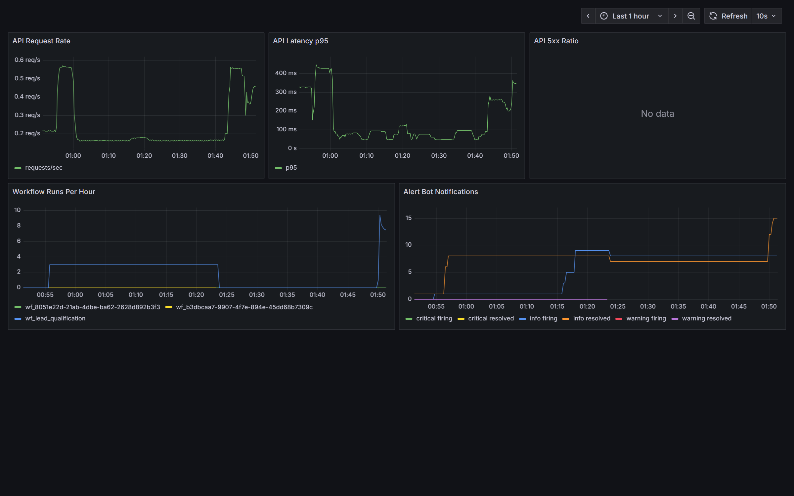

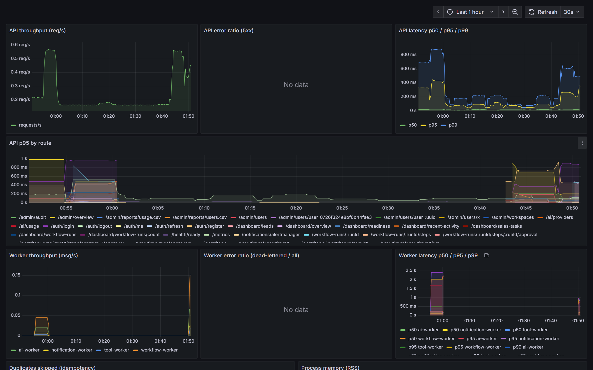

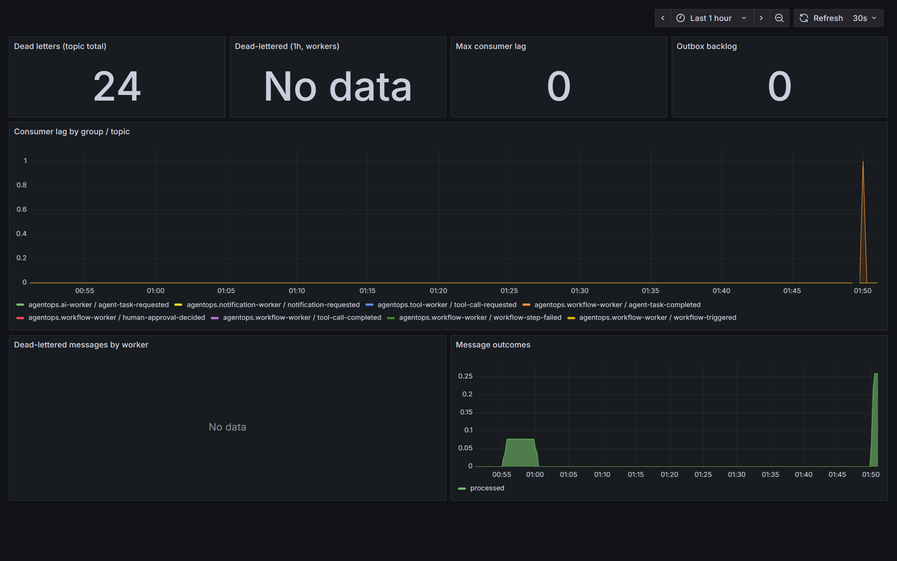

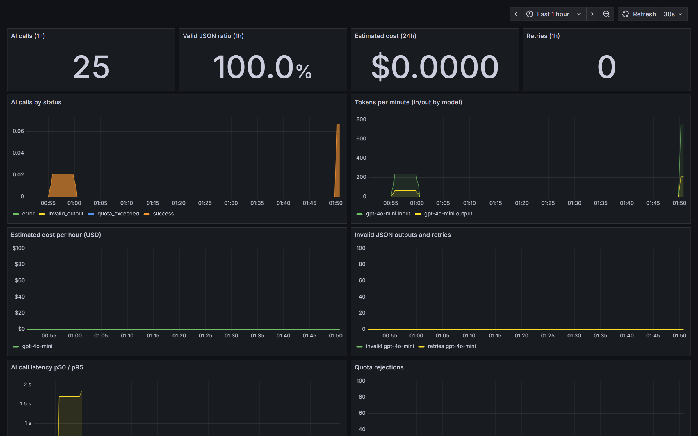

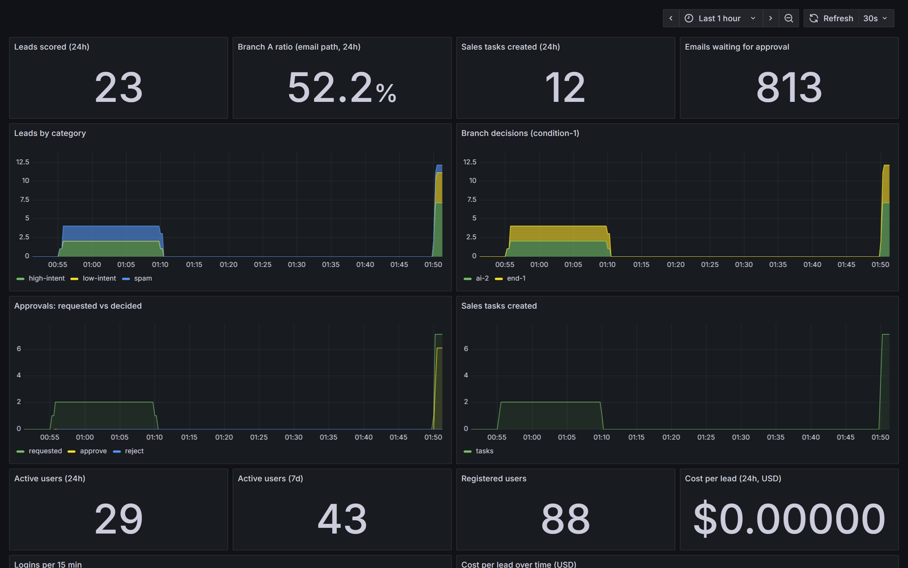

## Alert rules

Prometheus evaluates `agentops-alerts.yml` every 15 s and sends firing alerts to Alertmanager.

| Group | Alert | Condition (abridged) | For | Severity |
| --- | --- | --- | --- | --- |
| `agentops-api` | `AgentOpsApiDown` | `up{job="agentops-api"} == 0` | 1m | critical |
| `agentops-api` | `AgentOpsApiHighErrorRate` | 5xx request ratio > 5% over 5m | 5m | warning |
| `agentops-api` | `AgentOpsApiHighLatencyP95` | API p95 > 1 s over 5m | 5m | warning |
| `agentops-api` | `AgentOpsApiProcessMemoryHigh` | RSS > 400,000,000 bytes | 10m | warning |
| `agentops-alert-bot` | `AgentOpsAlertBotInactive` | `absent(agentops_alertmanager_notifications_total{job="agentops-api"})` | 10m | info |
| `agentops-workers` | `AgentOpsWorkerDown` | `up{job="agentops-workers"} == 0` per service | 2m | warning |
| `agentops-workers` | `AgentOpsWorkerErrors` | any worker error rate > 0 over 5m | 2m | warning |
| `agentops-workers` | `AgentOpsWorkerNoMessages` | last message older than 900 s | 5m | info |
| `agentops-kafka` | `AgentOpsKafkaConsumerLagHigh` | total lag per group/topic > 100 | 5m | warning |
| `agentops-pipeline` | `AgentOpsWorkerErrorRateHigh` | dead-letter ratio > 5% per worker over 5m | 5m | warning |
| `agentops-pipeline` | `AgentOpsWorkerLatencyP95High` | worker p95 handling > 10 s | 10m | warning |
| `agentops-pipeline` | `AgentOpsKafkaLagGrowing` | lag derivative > 0 and lag > 10 | 10m | warning |
| `agentops-pipeline` | `AgentOpsDeadLettersIncreasing` | any new dead letter in 10m | 0m | warning |
| `agentops-pipeline` | `AgentOpsAiQuotaExhausted` | any `status="quota_exceeded"` AI call in 10m | 0m | warning |
| `agentops-pipeline` | `AgentOpsAiInvalidJsonHigh` | invalid-output ratio > 20% over 15m | 15m | warning |
| `agentops-pipeline` | `AgentOpsOutboxBacklog` | any unpublished domain event | 5m | warning |
| `agentops-pipeline` | `AgentOpsApprovalsBacklog` | more than 20 pending approvals | 30m | info |

`AgentOpsWorkerNoMessages` and `AgentOpsAlertBotInactive` are informational by design: a quiet worker and a never-fired alert bot are not necessarily failures.

Production rule state in Prometheus:

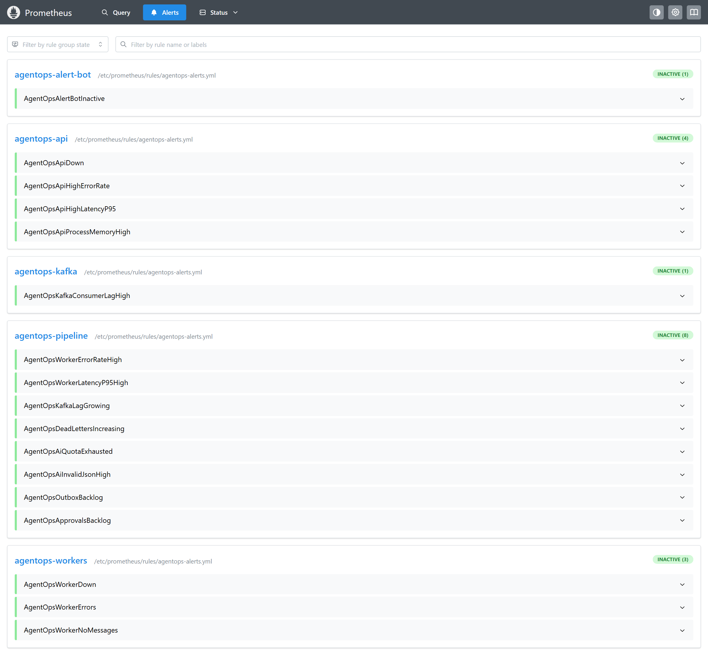

## Alert delivery

Alertmanager groups by `alertname`, `service`, and `severity`, waits 15 s before the first notification, sends updates every 2 minutes, and repeats a still-firing group every 2 hours. Resolved alerts are sent (`send_resolved: true`), and a batch is capped at 20 alerts. A `critical` alert inhibits `warning` alerts for the same `service`.

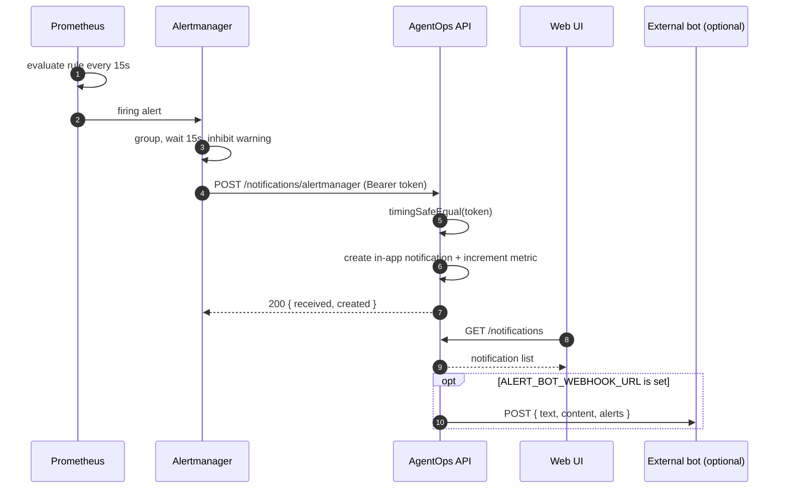

Token handling:

- Production Alertmanager reads the token from the `alertmanager-webhook` secret (`/etc/alertmanager/webhook/token`), and it must equal `ALERTMANAGER_WEBHOOK_TOKEN` on the API.
- Locally, the container posts to `http://host.docker.internal:4000/notifications/alertmanager` with no token. The API accepts a missing token only when `APP_ENV=local`; any other environment returns `401`.
- Comparison uses `crypto.timingSafeEqual` on equal-length buffers.

The in-app notification store is an in-process array (`NotificationsService`). It is not persisted to PostgreSQL, and it starts with one demo notification per process. With multiple API replicas behind the Service, a `GET /notifications` request may be served by a replica that did not receive the webhook. Treat the endpoint as a local demo surface, not a durable inbox; the durable record of an alert is in Alertmanager and the Prometheus rule state.

The production alert bot endpoint and a delivered alert:

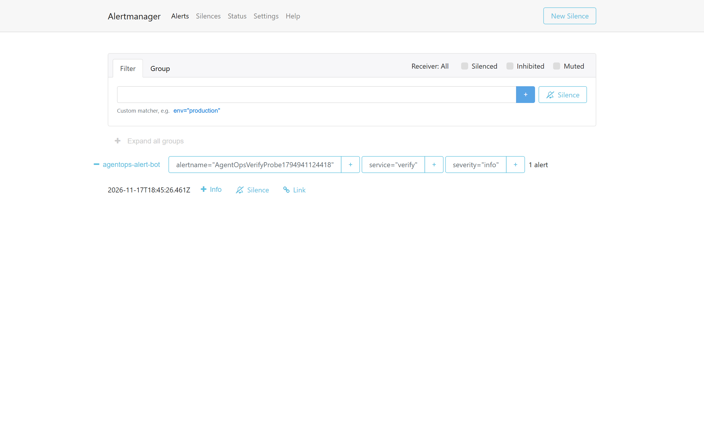

## Distributed tracing

### Setup

`initOtel()` in `packages/observability/src/opentelemetry.ts` is called at process start. It creates a `NodeSDK` with a service resource and an OTLP HTTP trace exporter. Traces are enabled with `OTEL_ENABLED=true`; the endpoint is `OTEL_EXPORTER_OTLP_TRACES_ENDPOINT`.

| Service | Local process | Kubernetes |
| --- | --- | --- |
| `agentops-api` | `apps/api` on `:4000` | Deployment `agentops-api` |
| `agentops-workflow-worker` | `apps/workflow-worker` | Deployment `workflow-worker` |
| `agentops-ai-worker` | `apps/ai-worker` | Deployment `ai-worker` |
| `agentops-tool-worker` | `apps/tool-worker` | Deployment `tool-worker` |
| `agentops-notification-worker` | `apps/notification-worker` | Deployment `notification-worker` |

Local Tempo accepts OTLP HTTP on `http://localhost:4318/v1/traces` and stores blocks on local disk for 24 hours. In Kubernetes the endpoint is `http://tempo.monitoring:4318/v1/traces`, and the production overlay sets `OTEL_ENABLED=true`.

### Propagation across HTTP and Kafka

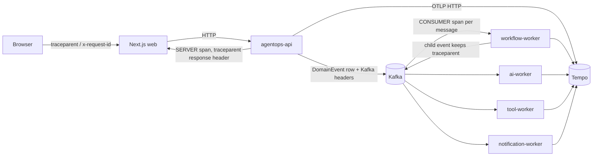

- `RequestIdMiddleware` reads `x-request-id` and `traceparent` from the incoming request, creates a SERVER span named `HTTP <METHOD> <route>`, and puts `requestId`, `traceId`, and `traceparent` into request-scoped context.
- The span is started with `root: true` when there is no valid incoming `traceparent`. It does not invent a synthetic parent, so the API is a trace root for direct calls rather than a child of a non-existent span.
- `DomainEventsService` copies the request-scoped trace context into every event it stores and publishes. When an event is written by a worker, the worker's active span is used.
- Kafka producers set the `traceparent` header (the API producer does; the shared worker publisher sets the message key and value). The envelope also carries `traceId` and `traceparent`, so the consumer can rebuild the context even if headers were dropped.
- Consumer instrumentation starts a CONSUMER span with attributes including `agentops.workflow_run_id`. The workflow worker wraps each executed step in `workflow.node <NODE_TYPE>`; the AI worker wraps provider calls in `ai.call`.
- AI spans add `gen_ai.system`, `gen_ai.request.model`, `agentops.node_id`, and `agentops.workflow_run_id`.

### Useful Tempo queries

Open Grafana Explore, select the Tempo data source, and search by TraceQL:

```traceql
{ resource.service.name = "agentops-ai-worker" }
{ span.agentops.workflow_run_id = "run_..." }
{ resource.service.name = "agentops-workflow-worker" && span.agentops.node_id = "ai-1" }
```

A full lead run normally spans `agentops-api` -> `agentops-workflow-worker` -> `agentops-ai-worker` -> `agentops-workflow-worker` -> `agentops-tool-worker` -> `agentops-workflow-worker` -> `agentops-notification-worker`. Because the run is asynchronous, the trace is not one continuous request; the shared `traceId` and `agentops.workflow_run_id` attribute are what tie the segments together.

Tempo trace search and a trace waterfall:

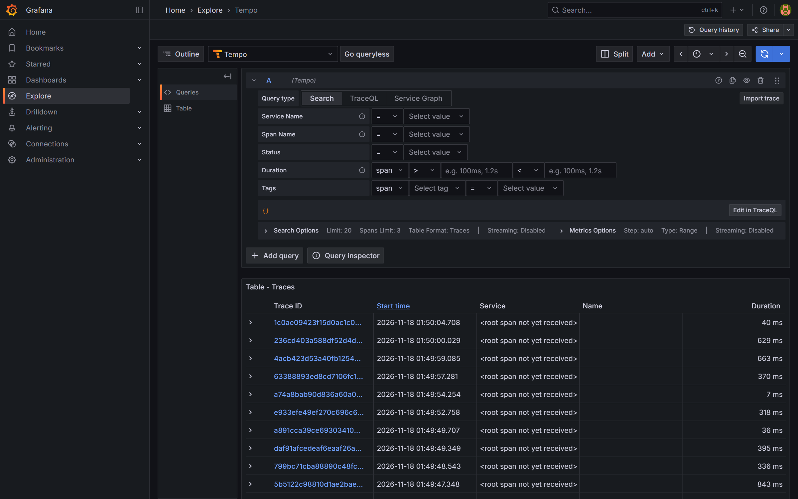

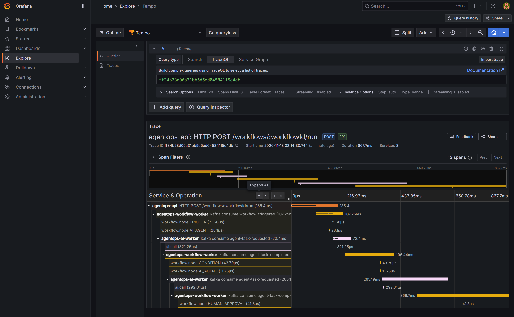

## Running the stack

### Local

`docker compose up -d` starts Prometheus, Alertmanager, Grafana, and Tempo along with PostgreSQL, Redis, and Kafka. Start the API and workers on the host (for example `pnpm dev`), then open:

| Service | URL | Credentials |
| --- | --- | --- |
| Grafana | `http://localhost:3001` | `agentops` / `agentops` |
| Prometheus | `http://localhost:9090` | none |
| Alertmanager | `http://localhost:9093` | none |
| Tempo | `http://localhost:3200` | none |
| API metrics | `http://localhost:4000/metrics` | none |
| Workflow worker metrics | `http://localhost:4101/metrics` | none |
| AI worker metrics | `http://localhost:4102/metrics` | none |
| Tool worker metrics | `http://localhost:4103/metrics` | none |
| Notification worker metrics | `http://localhost:4104/metrics` | none |

Prometheus scrapes `host.docker.internal:4000` and `:4101`-`:4104` every 15 s. If the apps run inside Docker instead, use the `docker-compose.apps.yml` service names.

Useful checks:

```bash
curl -s localhost:4000/metrics | grep '^agentops_'
curl -s localhost:9090/api/v1/targets | jq '.data.activeTargets[] | {scrapeUrl, health}'
curl -s localhost:9090/api/v1/rules | jq '.data.groups[].rules[] | {name, state}'
curl -s localhost:9093/api/v2/alerts | jq '.[].labels'
```

### Production Kubernetes

Monitoring runs in the `monitoring` namespace. It is not exposed through the Ingress; reach it with port-forwards:

```bash
kubectl -n monitoring port-forward svc/grafana 3002:3000
kubectl -n monitoring port-forward svc/prometheus 9091:9090
kubectl -n monitoring port-forward svc/alertmanager 9093:9093
kubectl -n monitoring port-forward svc/tempo 3200:3200
```

Grafana admin credentials are in the `grafana-admin` secret:

```bash
kubectl -n monitoring get secret grafana-admin -o jsonpath='{.data.user}' | base64 -d
kubectl -n monitoring get secret grafana-admin -o jsonpath='{.data.password}' | base64 -d
```

Prometheus discovers pods in the `agentops` namespace by annotation and scrapes the API on `4000` and workers on `9100`. The expected steady-state target count is 7: two API pods, four workers, and Prometheus itself. The worker `service` label is `workflow-worker`, `ai-worker`, `tool-worker`, or `notification-worker`; the API is `api`.

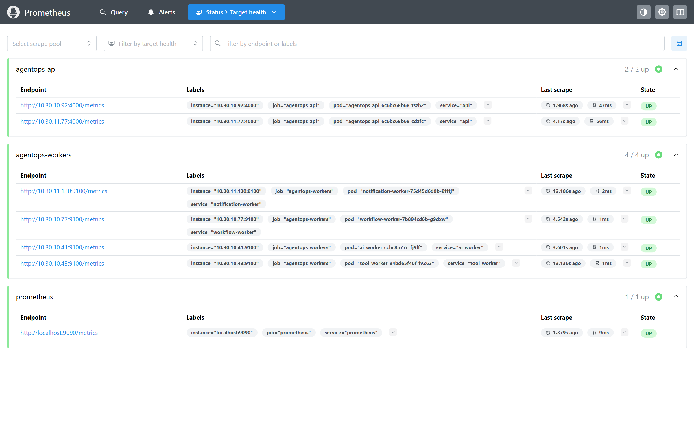

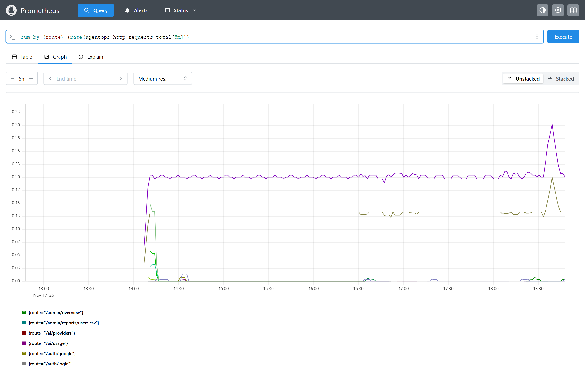

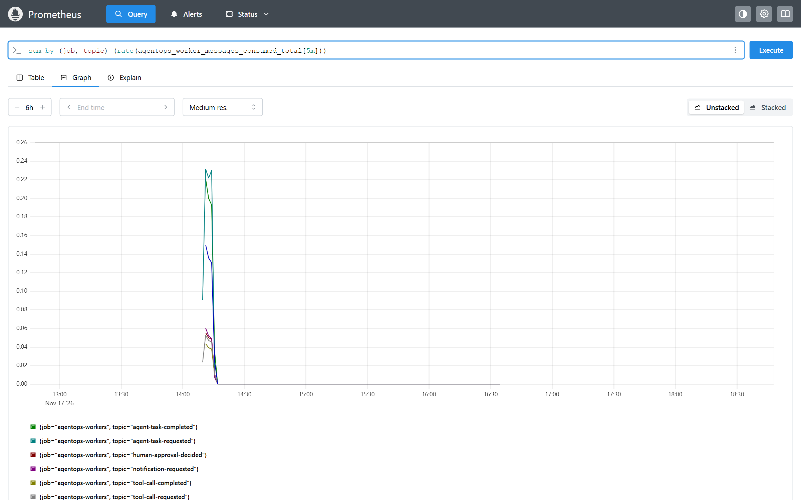

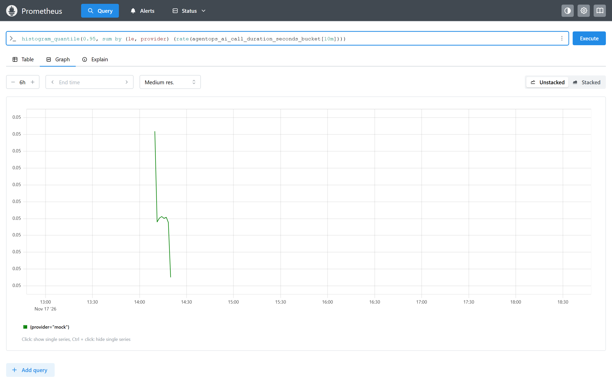

## Production verification

`scripts/verify-prod.mjs` is a read-only acceptance check. It validates DNS/TLS, public endpoints, workload readiness, autoscaling, Kafka, monitoring targets, alert rules, dashboards, and the alert-bot path. The only write is one synthetic `AgentOpsVerifyProbe` info alert sent to Alertmanager to prove delivery; use `--skip-alert` to omit it.

```bash
KUBECONFIG=<prod-kubeconfig> node scripts/verify-prod.mjs \
  --host agentops.18-136-215-126.sslip.io \
  --namespace agentops \
  --monitoring monitoring \
  > report.md
```

The latest recorded report is [docs/evidence/prod-verification.md](evidence/prod-verification.md): **27/27 checks passed** for `agentops.18-136-215-126.sslip.io` at `2026-11-17T18:46:19.000Z`. It records 2/2 API and 2/2 web replicas, 1/1 for each worker, 8 running pods with 0 restarts, HPA `agentops-api 2/6`, KEDA HPAs `1/6` for each worker, 7/7 Prometheus targets, and 27/27 alert rules loaded.

## Operating notes

- When a run is stuck, check `agentops_kafka_consumer_lag` first, then the worker's `message_outcomes_total{outcome="dead_lettered"}` and the `dead-letter-events` topic, then the trace.
- A dead letter also emits `workflow-step-failed` for messages that carry a `nodeId`; the workflow worker turns that into a failed run. The run error message is the original failure.
- A spike in `duplicate` outcomes after a restart is expected: offsets are committed after processing, and the `ProcessedMessage` table makes redelivery a no-op.
- `AgentOpsOutboxBacklog` means PostgreSQL accepted a run but Kafka did not; the relay retries every 30 s (`DOMAIN_EVENT_RELAY_INTERVAL_MS`). Do not delete outbox rows to clear the alert.
- The AI metrics include token counts and estimated cost, not provider invoices. Use the OpenAI dashboard for billing.
- Dashboards and rules are provisioned from the repository; edit the files, do not change them in the Grafana UI. A production dashboard change that is not in Git will be overwritten on the next deploy.
