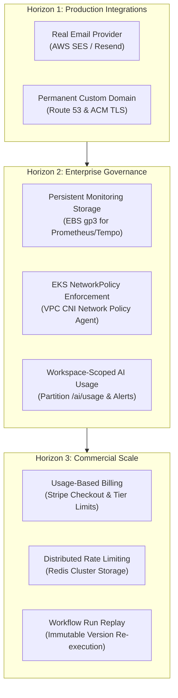

# Product Direction & Strategy

This document synthesizes external market signals from modern automation platforms (Zapier, n8n, LangSmith) with AgentOps' technical vision, tracking delivered platform capabilities and setting the product roadmap for future milestones.

---

## 1. Market Signals & Architectural Principles

### Signal 1: Run History as an Operational Primitive
*Source: Zapier Zap History*
- **Observation:** Operators need granular inspection into distributed workflow runs: trigger payload, step-by-step progression, execution latency, and error diagnostics.
- **AgentOps Delivery:** 
  - The `/runs` and `/runs/:id` views operate as first-class debugging tools.
  - Execution timelines display masked inputs/outputs, node duration, token usage, and stack traces.
  - Live status updates stream via Server-Sent Events (`GET /workflow-runs/:id/stream`) without continuous polling overhead.

### Signal 2: In-Graph Human Review
*Source: n8n Human-in-the-Loop Nodes*
- **Observation:** Autonomous AI agents cannot be trusted with irreversible outbound actions (e.g., sending emails to enterprise executives) without human oversight. Human review must reside inside the graph as an explicit node rather than an afterthought.
- **AgentOps Delivery:**
  - `HUMAN_APPROVAL` is an in-graph node type. When reached, the run transitions to `WAITING_APPROVAL` and emits an event to the reviewer queue (`/approvals`).
  - Reviewers can inspect the drafted outreach, edit copy, and approve or reject.
  - Decisions are strictly idempotent (first decision wins; subsequent calls return HTTP 409) and persist an immutable record in `AuditLog`.

### Signal 3: Standardized AI Observability
*Source: OpenTelemetry GenAI Semantic Conventions*
- **Observation:** Proprietary LLM logging creates siloed monitoring. Instrumenting AI calls with standard semantic conventions allows trace correlation across HTTP requests, messaging queues, and model inference.
- **AgentOps Delivery:**
  - Worker traces export to Grafana Tempo via OpenTelemetry SDK 0.218.
  - Spans include standard attributes: `gen_ai.system`, `gen_ai.request.model`, `gen_ai.usage.input_tokens`, `gen_ai.usage.output_tokens`, `agentops.node_id`, and `agentops.workflow_run_id`.
  - Correlation IDs (`traceparent`, `x-request-id`) travel inside Kafka `EventEnvelope` headers across all workers.

### Signal 4: Decision Trace Visibility
*Source: LangSmith Tracing & Evaluation*
- **Observation:** Debugging multi-step agent workflows requires understanding why a model took a branch.
- **AgentOps Delivery:**
  - Step logs capture rendered prompt templates, validation attempts, and retry counts.
  - Real-time Grafana AI dashboard exposes valid-to-invalid output ratios, model token velocity, and estimated spend per provider.
  - Automated 24-lead golden-set evaluation (`pnpm eval:leads`) runs in CI to verify prompt accuracy before deployment.

---

## 2. Delivered Status (as of 2026-11-18)

| Capability Area | Delivered Scope | Verification Reference |
| --- | --- | --- |
| **Visual Workflow Canvas** | React Flow 12 visual builder with drag-and-drop nodes, graph validation, and immutable publishing. | [workflow-engine.md](workflow-engine.md) |
| **Asynchronous Execution** | 4 Kafka workers (`workflow`, `ai`, `tool`, `notification`) with `ProcessedMessage` idempotency. | [kafka-topics.md](kafka-topics.md) |
| **AI Node Governance** | OpenAI `gpt-4o-mini` + deterministic mock, AJV JSON Schema validation, retry limits, PII masking, injection defense, daily workspace quotas. | [ai-agent.md](ai-agent.md) |
| **Human Review Queue** | Reviewer interface (`/approvals`), idempotent decision API, and PostgreSQL audit trail. | [system-documentation.md](system-documentation.md) |
| **Enterprise Design System** | Moss Atelier aesthetic (warm stone, moss, lime), Playfair Display serif, Inter Tight UI, client-only React Three Fiber WebGL hero sculpture. | [design/design-brief.md](../design/design-brief.md) |
| **Workspace Isolation** | Strict `?workspaceId=` query param requirement on all `/dashboard/*` routes; RBAC roles (`OWNER`, `ADMIN`, `MEMBER`, `VIEWER`). | [security.md](security.md) |
| **Google Authentication** | OAuth 2.0 authorization-code flow with signed state; automatic personal workspace creation and demo onboarding. | [api.md](api.md) |
| **Platform Administration** | `/admin` console with cross-platform analytics, 7/30/90-day series, account disablement with instant session termination, and safe CSV reports. | [api.md](api.md) |
| **AWS Production Deployment** | Terraform-provisioned AWS EKS 1.31, RDS Postgres, ElastiCache Redis, MSK Kafka, KEDA autoscaling, GitHub Actions OIDC CI/CD. | [evidence/prod-verification.md](evidence/prod-verification.md) |

---

## 3. Product Roadmap & Next Steps

To evolve AgentOps from a verified automation platform into a scalable commercial SaaS, the backlog is structured across three execution horizons:

### Horizon 1: Production Integrations
1. **Real Outbound Email Delivery:**
   - Transition `tool-worker` from mock email dispatch to **AWS SES** or **Resend**.
   - Capture bounce, delivery failure, and open webhooks to update workflow run step records.
2. **Permanent Production Domain:**
   - Replace ephemeral NLB IP addresses (`agentops.<ip>.sslip.io`) with a branded domain (e.g., `agentops.dev`).
   - Manage DNS records via Amazon Route 53 and provision managed certificates using AWS Certificate Manager.

### Horizon 2: Enterprise Governance & Infrastructure
1. **Persistent Telemetry Storage:**
   - Replace ephemeral `emptyDir` volumes in the `monitoring` namespace with AWS EBS `gp3` PersistentVolumeClaims for Prometheus, Alertmanager, Grafana, and Tempo.
2. **Active NetworkPolicy Enforcement:**
   - Deploy the Amazon VPC CNI Network Policy agent to activate Kubernetes `NetworkPolicy` ingress and egress filtering across application and database pods.
3. **Workspace-Scoped AI & Notification Endpoints:**
   - Refactor `GET /ai/usage` and `GET /notifications` to require `?workspaceId=` and enforce role permissions, completing multi-tenant isolation across all backend routes.

### Horizon 3: Commercial Scale & Orchestration
1. **Usage-Based Subscription Billing:**
   - Integrate Stripe Billing for subscription tiers (Free, Pro, Enterprise).
   - Enforce workspace quotas for monthly workflow runs, team seats, and daily AI token allowances.
2. **Distributed Rate Limiting via Redis:**
   - Back `@nestjs/throttler` with the managed ElastiCache Redis cluster to establish uniform rate limits across all autoscaled API replicas.
3. **Execution Replay & Diffs:**
   - Allow operators to trigger replays of failed runs using recorded context snapshots against published immutable versions.
