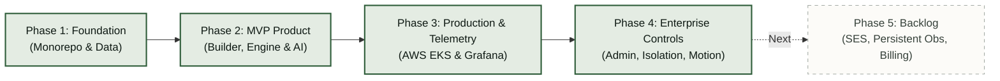

# Product & Engineering Roadmap

This document outlines the delivered capabilities of AgentOps as of **2026-11-18** and outlines the technical backlog for production expansion.

---

## Completed Milestones (Verified as of 2026-11-18)

### 1. Foundation & Monorepo Architecture
- [x] Monorepo orchestration using **pnpm 11.5.2** workspaces and **Turborepo**.
- [x] Web frontend: **Next.js 16.4** (App Router), **React 19.2**, **Tailwind CSS 4.3**, **Zod 4**.
- [x] Backend API: **NestJS 11** modular monolith, **Prisma 7.10** with PostgreSQL 16 driver adapter.
- [x] Shared package ecosystem: `@agentops/config`, `@agentops/database`, `@agentops/events`, `@agentops/observability`, `@agentops/shared`, `@agentops/ui`.
- [x] Local containerization: Multi-container Docker Compose topology (PostgreSQL, Redis 7, Kafka 3.9, Prometheus, Alertmanager, Grafana, Tempo).

### 2. Core Workflow Engine & Visual Builder
- [x] Visual graph builder implemented with **@xyflow/react 12** with real-time graph validation.
- [x] Versioning model: Drafting, graph integrity checks, and publishing immutable `WorkflowVersion` snapshots.
- [x] Showcase "Lead qualification" pipeline: Trigger (manual/webhook) -> AI intent scoring -> Condition branching -> Human approval queue -> Mock email dispatch -> Sales task creation.
- [x] Asynchronous Kafka execution bus with 4 specialized worker services (`workflow-worker`, `ai-worker`, `tool-worker`, `notification-worker`).
- [x] At-least-once delivery handling with deduplication idempotency (`ProcessedMessage` store).
- [x] Real-time execution tracking: Run timeline, step duration, token counters, and Server-Sent Events stream (`GET /workflow-runs/:id/stream`).

### 3. AI Agent Integration & Governance
- [x] Provider abstraction: Deterministic offline `mock` provider and live `openai` provider (**gpt-4o-mini**).
- [x] Structured output validation: Strict JSON Schema enforcement via **AJV** with `additionalProperties: false`.
- [x] Automated sanitization: Pre-execution regex redaction for customer emails, phone numbers, and API tokens.
- [x] Prompt injection defense: `applyLeadScoringGuardrail` detecting adversarial bypass attempts.
- [x] Resilience: Configurable `retryLimit` with token summation, routing exhausted failures to `dead-letter-events`.
- [x] Multi-tenant quotas: Per-workspace daily call (`AI_DAILY_CALL_LIMIT`) and token (`AI_DAILY_TOKEN_LIMIT`) limits.
- [x] Quality gating: 24-lead golden-set evaluation suite (`pnpm eval:leads`) integrated into PR CI checks.

### 4. Human-in-the-Loop & Operations
- [x] Dedicated review queue interface (`/approvals`) for human evaluation of AI-generated outreach.
- [x] Idempotent decision API: `POST /workflow-runs/:id/steps/:stepId/approval` (first decision wins; duplicate calls return HTTP 409).
- [x] Decision audit logging written to PostgreSQL `AuditLog`.

### 5. Production Infrastructure (AWS ap-southeast-1)
- [x] Infrastructure-as-Code: Modular **Terraform** managing 54 AWS resources.
- [x] Managed Compute: **AWS EKS 1.31** with three `t3.medium` worker nodes.
- [x] Managed Data: **AWS RDS PostgreSQL 16** (`db.t4g.micro`) and **ElastiCache Redis 7** (`cache.t4g.micro`, in-transit TLS).
- [x] Managed Messaging: **Amazon MSK** Kafka provisioned with 2 brokers.
- [x] Ingress & TLS: `ingress-nginx` with AWS Network Load Balancer (NLB), automated TLS via `cert-manager` and Let's Encrypt.
- [x] Autoscaling: Horizontal Pod Autoscaler (HPA) for API pods (2-6 replicas) and **KEDA** scaling workers (1-6 replicas) on Kafka consumer lag.
- [x] Secret Management: AWS Secrets Manager synced into cluster via External Secrets Operator and IRSA.
- [x] CI/CD Automation: GitHub Actions deployment using AWS IAM OIDC federation (no static AWS keys); automated database migrations and zero-downtime rollouts with automatic rollback.
- [x] Verification: 27/27 automated checks passing on live AWS production cluster (`scripts/verify-prod.mjs`).

### 6. Observability & Telemetry
- [x] Prometheus metrics: 7 scrape targets (API replicas, 4 workers, Prometheus itself); 17 alert rules across 5 groups.
- [x] 5 Grafana dashboards: System Overview, RED Metrics (API & Workers), Kafka Pipeline, AI Governance, and Business Lead Flow.
- [x] Alert delivery: Alertmanager webhooks routed to `/notifications/alertmanager` with constant-time token comparison.
- [x] Distributed tracing: **OpenTelemetry SDK 0.218** exporting OTLP HTTP traces to **Tempo** across API and workers, featuring corrected root span initialization.

### 7. Moss Atelier Visual Language & UX
- [x] Cohesive aesthetic: Warm stone canvas, mist wash, hairline grid, Playfair Display serif, Inter Tight UI, JetBrains Mono data labels.
- [x] Client-only WebGL hero sculpture built with **Three.js 0.164**, **React Three Fiber 9**, and **drei 10** (auto-paused offscreen with static fallback for reduced motion).
- [x] Interactive micro-interactions: 3D card tilt with pointer spotlight, magnetic CTAs, scroll progress, and view transitions.

### 8. Multi-Tenancy & Platform Administration
- [x] Workspace RBAC: Role enforcement (`OWNER`, `ADMIN`, `MEMBER`, `VIEWER`) resolved from PostgreSQL.
- [x] Workspace Isolation: All `/dashboard/*` endpoints strictly require `?workspaceId=` and `VIEWER` membership.
- [x] Google OAuth 2.0: Authorization-code flow with signed state; automatic personal workspace creation and demo onboarding via `DEMO_WORKSPACE_JOIN_ROLE`.
- [x] Platform Admin Console (`/admin`): Cross-platform metrics, 7/30/90-day time series, account management (disable/enable, grant/revoke admin), instant session revocation on disabled accounts, workspaces list, audit log, and UTF-8 BOM CSV reports with formula-injection sanitization.

### 9. Security & Supply Chain Hardening
- [x] HttpOnly `agentops_access` (15m) and `agentops_refresh` (30d) cookies; passwords hashed with argon2.
- [x] Global `CsrfOriginGuard` enforcing strict Origin verification on state-changing cookie requests.
- [x] Container image hardening: Stripped bundled `npm` and `corepack` CLIs to eliminate High/Critical CVEs; non-root user execution with read-only root filesystems.
- [x] CI supply chain gates: `pnpm audit --prod`, `gitleaks`, and `Trivy` container scanning with a CRITICAL/HIGH gate.

---

## Prioritized Engineering Backlog (Next Steps)

The following items represent the planned roadmap to progress AgentOps from a verified showcase to an enterprise-grade platform:

| Priority | Initiative | Area | Technical Scope |
| --- | --- | --- | --- |
| **P1** | **Real Email Delivery Provider** | Tooling | Replace mock email tool in `tool-worker` with AWS SES, Resend, or SendGrid integration. Add webhook handling for bounce, delivery, and open events. |
| **P1** | **Permanent Custom Domain & DNS** | Infrastructure | Replace dynamic NLB `sslip.io` hostnames with a static domain (e.g., `agentops.dev`) configured via Amazon Route 53 and ACM TLS certificates. |
| **P2** | **Persistent Monitoring Storage** | Observability | Provision AWS EBS `gp3` PersistentVolumeClaims for Prometheus, Alertmanager, Grafana, and Tempo to replace ephemeral `emptyDir` volumes and retain historical telemetry. |
| **P2** | **EKS NetworkPolicy Enforcement** | Security | Enable the Amazon VPC CNI Network Policy agent (or install Calico) on EKS to enforce default-deny and pod-to-pod ingress/egress network isolation. |
| **P2** | **Workspace-Scoped AI Usage & Alerts** | Multi-Tenancy | Update `/ai/usage` and `/notifications` endpoints to require and strictly scope data to `?workspaceId=`, matching the `/dashboard/*` isolation pattern. |
| **P2** | **Usage-Based Subscription Billing** | Monetization | Integrate Stripe Checkout and Billing Portal. Implement workspace plan limits for daily AI tokens, active workflow definitions, and team seat counts. |
| **P3** | **Distributed Rate Limiting via Redis** | Reliability | Migrate `@nestjs/throttler` storage from process memory to the managed ElastiCache Redis cluster to enforce global per-client limits across all API replicas. |
| **P3** | **Workflow Execution Replay** | Engine | Enable operators to replay failed or cancelled workflow runs from recorded step inputs against immutable version snapshots. |
| **P3** | **Reviewer Collaboration Channels** | Integrations | Push pending approval notifications to Slack, Discord, or Microsoft Teams webhooks with interactive approval and rejection action buttons. |
