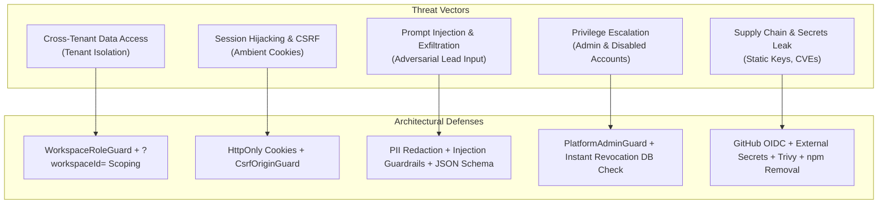

# Security Architecture & Threat Model

Security is an architectural baseline in AgentOps, integrated directly into the synchronous API control plane, asynchronous Kafka execution pipeline, and infrastructure deployment manifests.

## Threat Model Summary

| Asset / Boundary | Threat Vector | Impact | Mitigating Controls |
| --- | --- | --- | --- |
| **Workspace Tenant Boundary** | Malicious workspace member attempts to read or execute workflows in another workspace. | Cross-tenant data breach; unauthorized execution. | Global `WorkspaceRoleGuard` enforcing membership queries from PostgreSQL; mandatory `?workspaceId=` query param on all `/dashboard/*` routes. |
| **Browser Authentication** | Cross-Site Scripting (XSS) stealing tokens; Cross-Site Request Forgery (CSRF) forging state changes. | Account takeover; unauthorized approvals or workflow deletions. | `HttpOnly`, `SameSite=Lax`, `Secure` cookies for access/refresh tokens; `CsrfOriginGuard` enforcing strict Origin verification on all state-changing cookie requests. |
| **AI Ingestion Pipeline** | Adversarial prompt injection contained in inbound lead messages (`{{message}}`). | Hijacked classification; forced high-intent score; leaked system instructions. | Pre-execution regex PII masking; `applyLeadScoringGuardrail` injection detector; strict JSON Schema validation via AJV; workspace daily call/token quotas. |
| **Platform Administration** | Privilege escalation; disabled accounts retaining access; administrative self-lockout. | Unauthorized platform-wide access; persistent compromised sessions. | `PlatformAdminGuard` checking `User.isPlatformAdmin` per request; DB lookup on `User.disabledAt` terminating active JWTs instantly; self-change prevention; `AuditLog` tracking. |
| **Infrastructure & CI/CD** | Base image vulnerabilities; static AWS credential leakage; unauthorized cluster access. | Host compromise; cloud account takeover; lateral movement. | Non-root containers with read-only root filesystems; removal of bundled `npm`/`corepack` CLIs; Trivy CRITICAL/HIGH gate in CI; AWS IAM OIDC federation (no static AWS keys). |

---

## Implemented Security Controls

### 1. Authentication & Session Management
- **Password Hashing:** Passwords are hashed with argon2 using memory-hard parameters.
- **Stateless Access JWTs:** Signed using `JWT_ACCESS_SECRET` with a 15-minute expiration time.
- **Refresh Token Rotation:** 30-day refresh tokens are generated as cryptographically secure random identifiers (`rfr_...`) and stored in PostgreSQL as SHA-256 hashes (`createHash("sha256").update(secret + token)`). Token revocation occurs on explicit logout or account deactivation.
- **HttpOnly Cookie Transport:**
  - `agentops_access`: JWT, 15m lifetime, `Path=/`, `HttpOnly`, `SameSite=Lax`, `Secure` (in non-local environments).
  - `agentops_refresh`: Opaque token, 30d lifetime, `Path=/auth`, `HttpOnly`, `SameSite=Lax`, `Secure`.
  - The frontend never reads or stores authentication tokens in `localStorage` or JavaScript-accessible cookies.
- **Google OAuth 2.0:** Server-side authorization-code flow (`GET /auth/google` -> `GET /auth/google/callback`). The `state` parameter is an HMAC-SHA256 signature generated with `JWT_ACCESS_SECRET` containing the redirect target. On first sign-in:
  - Creates a dedicated personal workspace with role `OWNER`.
  - Grants read access to the demo workspace (`ws_demo`) with role `VIEWER` when `DEMO_WORKSPACE_JOIN_ROLE` is set.

### 2. Immediate Session Revocation & Disabled Accounts
- **Per-Request Database Check:** Inside `JwtAuthGuard` (via `AuthService.authenticate()`), every request executes a fast primary key lookup against `User.disabledAt`.
- If an account is flagged as disabled:
  - The request is immediately rejected with `403 Forbidden` (`This account has been disabled`).
  - Active 15-minute access JWTs become useless instantly without waiting for expiration.
  - All associated refresh tokens in `AuthRefreshToken` are updated with `revokedAt = NOW()`.

### 3. CSRF Protection (CsrfOriginGuard)
- Mounted globally between `ThrottlerGuard` and `JwtAuthGuard`.
- Inspects state-changing requests (`POST`, `PUT`, `PATCH`, `DELETE`).
- **Rules:**
  - Safe methods (`GET`, `HEAD`, `OPTIONS`) are permitted.
  - Bearer token authentication (`Authorization: Bearer <token>`) bypasses Origin checking (allowing automated API scripts and CLI tools).
  - Cookie-authenticated requests and requests targeting `/auth/*` MUST supply an `Origin` (or fallback `Referer`) matching the configured `WEB_APP_URL` origin.
  - Cookie-carrying writes with missing or mismatched Origin headers are rejected with `403 Forbidden`.

### 4. Role-Based Access Control (RBAC)
- Workspace permissions define four hierarchical tiers:
  - `OWNER`: Workspace administration, member role modifications, billing.
  - `ADMIN`: Publishing immutable workflow versions, deleting workflows, member invites.
  - `MEMBER`: Creating and updating workflows, initiating workflow runs, deciding human approvals.
  - `VIEWER`: Read-only access to dashboards, workflow graphs, and run timelines.
- Roles are verified against the PostgreSQL `WorkspaceMember` table on every request via `WorkspaceRoleGuard`. Client-supplied roles in headers or bodies are never trusted.

### 5. Workspace Isolation on Analytics & Dashboards
- All routes under `/dashboard/*` enforce strict workspace isolation:
  - Every call requires a valid `?workspaceId=<id>` query parameter (missing parameter returns `400 Bad Request`).
  - The caller must hold membership with at least `VIEWER` role (unauthorized caller returns `403 Forbidden`).
  - All returned metrics, workflow run histories, scored leads, and sales tasks are filtered strictly by that `workspaceId`.
  - `PATCH /dashboard/sales-tasks/:id?workspaceId=` requires `MEMBER` role.

### 6. Platform Administration Guardrails
- Endpoints under `/admin/*` require `User.isPlatformAdmin === true` verified by `PlatformAdminGuard`.
- Initial administrators are bootstrapped via `PLATFORM_ADMIN_EMAILS` (stored in AWS Secrets Manager).
- **Self-Modification Block:** Administrators cannot disable their own account or revoke their own admin privileges (`400 Bad Request`).
- **Audit Logging:** Every administrative action is recorded in `AuditLog` with `workspaceId = null`.
- **CSV Formula Injection Sanitization:** Exported CSV reports (`/admin/reports/*`) include a UTF-8 BOM (`\uFEFF`) and sanitize active formula prefixes (`=`, `+`, `-`, `@`, `\t`, `\r`) with single quotes.

### 7. AI Node Guardrails & Data Sanitization
- **PII Masking:** Before constructing prompts, regex transforms mask customer contact data:
  - Email: `alex.mercer@company.com` -> `al***@company.com`
  - Phone: `+1-555-0199` -> `[PHONE_REDACTED]`
  - Secrets / Keys: `ak_live_...` -> `[REDACTED]`
- **Prompt Injection Defense:** `applyLeadScoringGuardrail` evaluates inputs for injection markers, falling back to safe classifications.
- **Output Validation:** Model outputs are validated against strict JSON Schemas using AJV with `additionalProperties: false`.
- **Retries & Dead Letters:** Invalid outputs trigger up to `retryLimit` retries (default: 1). Exhausted retries route to the `dead-letter-events` Kafka topic and emit `workflow-step-failed`, failing the run cleanly.
- **Daily Workspace Quotas:** `AI_DAILY_CALL_LIMIT` (default: 100) and `AI_DAILY_TOKEN_LIMIT` (default: 200,000) are enforced per workspace, returning HTTP 429 when exhausted.

### 8. Container & Pipeline Supply Chain Security
- **Image Hardening:** Multi-stage Dockerfiles explicitly remove the bundled `npm` and `corepack` binaries from runtime images, eliminating High and Critical CVEs present in default Node.js distributions.
- **Runtime Privilege Minimization:** Pods run as non-root user `node` (UID `10001`), mount read-only root filesystems, drop all Linux capabilities (`ALL`), and prohibit privilege escalation.
- **Automated CI Security Gates:**
  - `pnpm audit --prod`: Checks production dependencies for known advisories.
  - `gitleaks`: Scans commit history for hardcoded tokens, keys, and credentials.
  - `Trivy`: Container vulnerability scanner pinned by commit SHA, failing builds on any `CRITICAL` or `HIGH` CVE.
- **Cloud IAM via GitHub OIDC:** CI/CD workflows authenticate to AWS using short-lived GitHub Actions OIDC tokens restricted to `repo:<owner>/agentops:environment:production`, eliminating static AWS access keys.

---

## Known Architectural Gaps

AgentOps maintains an honest accounting of current architectural limitations and deferred security scope:

1. **Stateless Access JWT Expiration Window:**
   While account deactivation is checked immediately in the database, explicit user logout revokes only the refresh token and clears browser cookies. An access JWT copied prior to logout remains cryptographically valid until its 15-minute expiration time. There is currently no distributed token denylist in Redis.

2. **Non-Workspace Scoped Endpoints:**
   While `/dashboard/*` endpoints strictly require and enforce `?workspaceId=`, the `/ai/usage`, `/notifications`, and `/notifications/mark-all-read` routes require valid authentication but return unscoped or process-global data.

3. **In-Memory Notification Store:**
   The `NotificationsService` maintains alert records in an in-memory process array rather than PostgreSQL. When multiple API pod replicas run behind the Service load balancer, notification state is partitioned across replicas.

4. **NetworkPolicy Enforcement Disabled on EKS:**
   Although Kubernetes `NetworkPolicy` manifests are defined in `infrastructure/k8s/base/network-policies.yaml`, packet filtering is not enforced on the AWS EKS cluster because the Amazon VPC CNI Network Policy agent (or Calico) has not been installed.

5. **Ephemeral Monitoring Storage (emptyDir):**
   In-cluster Prometheus, Alertmanager, Grafana, and Tempo pods utilize Kubernetes `emptyDir` volumes rather than persistent AWS EBS volumes (`gp3`). Telemetry history, Prometheus metrics, and Tempo traces are lost if monitoring pods restart.

6. **In-Memory Rate Limiting:**
   The `@nestjs/throttler` storage provider operates in process memory rather than coordinating across replicas via Redis. Consequently, the effective cluster-wide rate limit is multiplied by the number of active API replicas (e.g., 2 to 6 replicas).

7. **Plaintext MSK Traffic within VPC:**
   Kafka brokers provisioned via Amazon MSK communicate over plaintext listeners within the private VPC subnets. In-transit TLS between worker pods and Kafka brokers is planned but not currently enabled.

8. **Absence of Ingress WAF:**
   The public ingress-nginx controller is exposed through an AWS Network Load Balancer (NLB) without AWS WAF (Web Application Firewall) inspection for Layer 7 exploits.

9. **Broad Terraform Execution Permissions:**
   Infrastructure automation roles currently use `AdministratorAccess` without fine-grained IAM permission boundaries.
