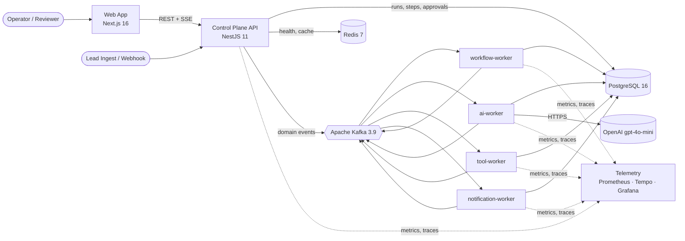
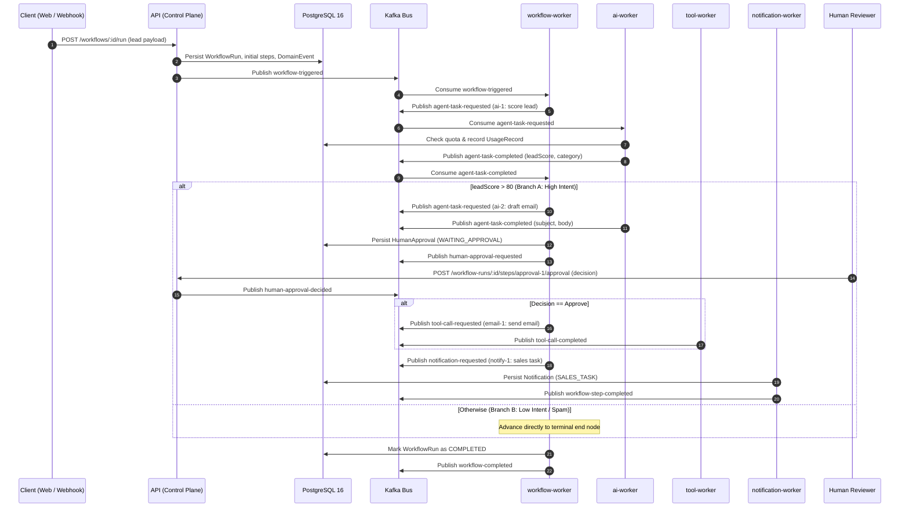
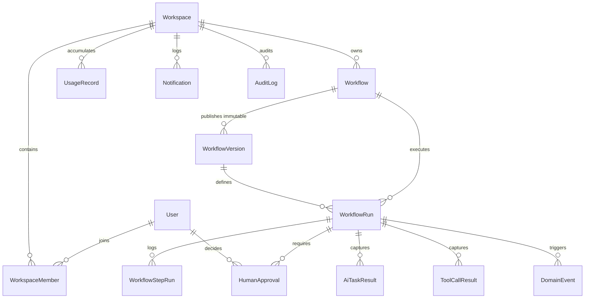
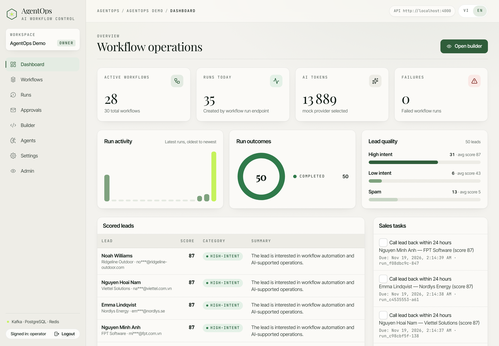
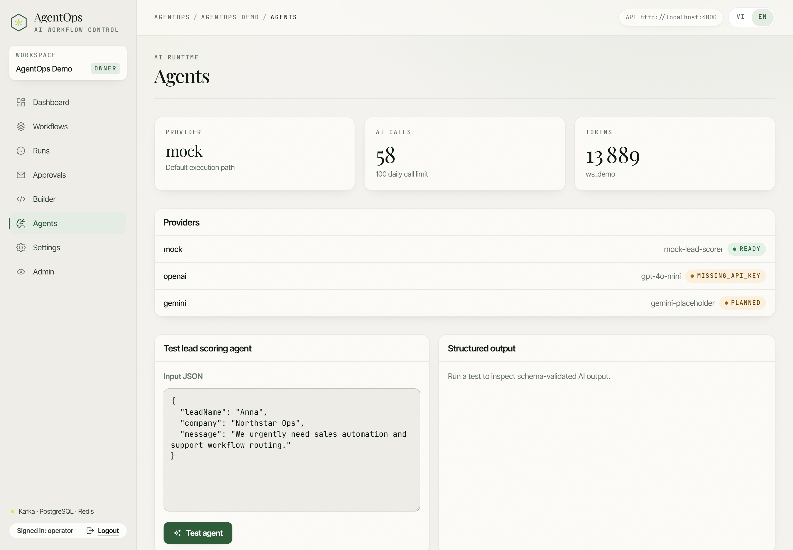
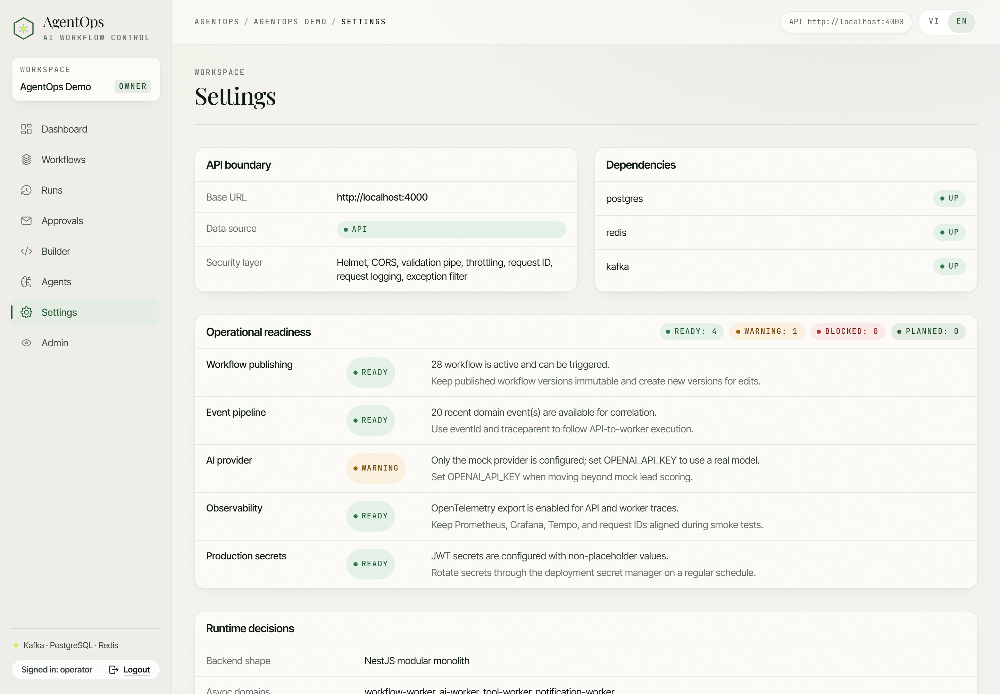
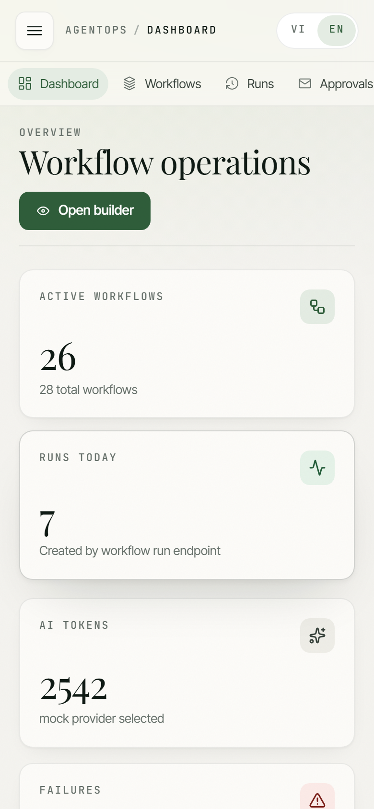
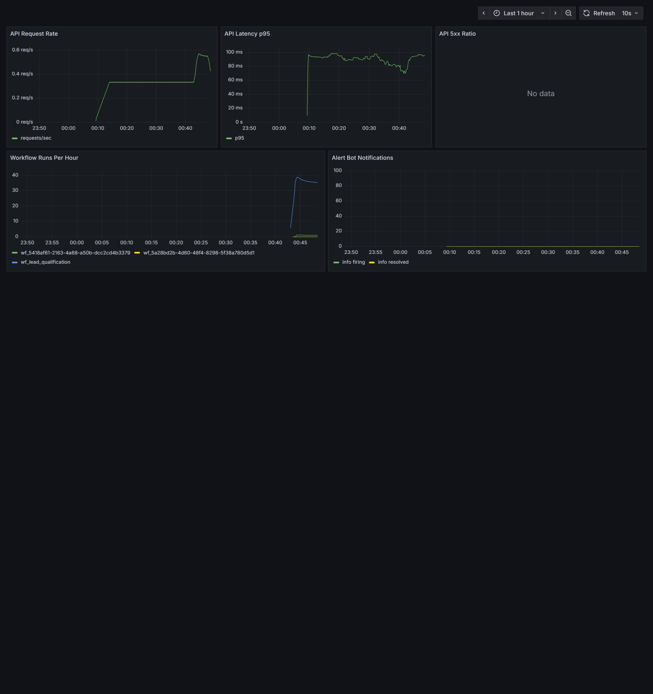
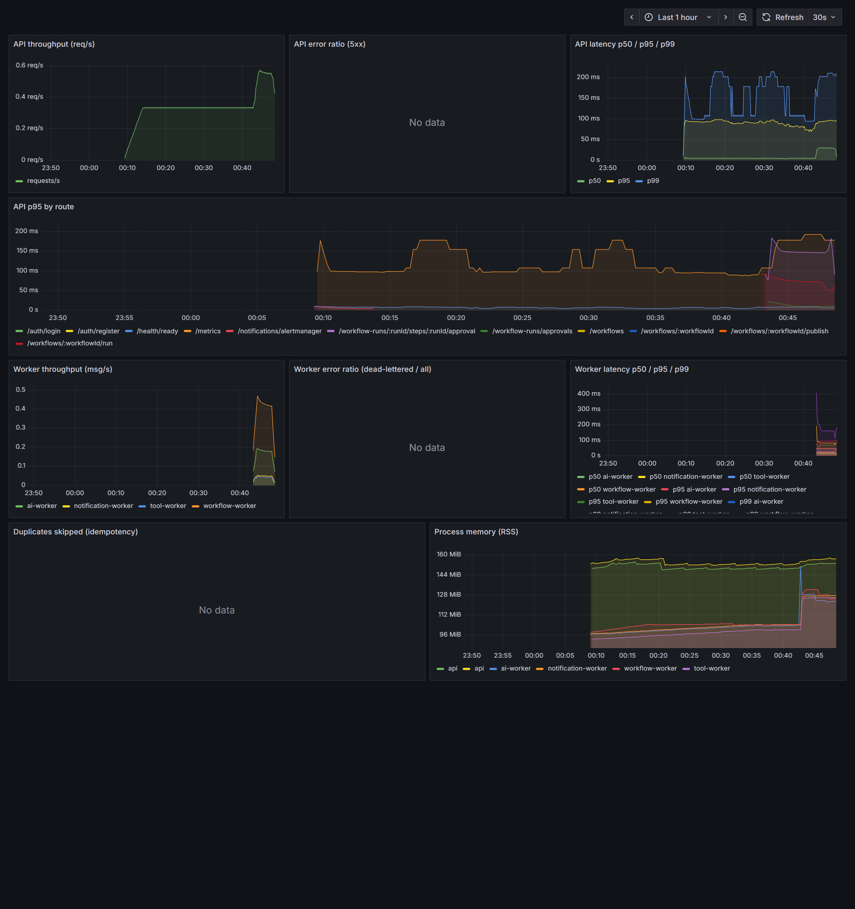
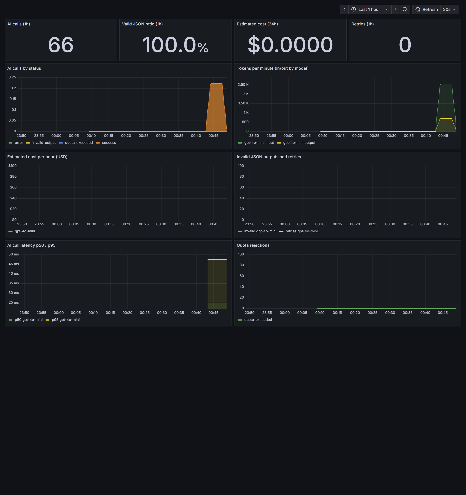

# AgentOps System Documentation

AgentOps is an enterprise-grade AI agent workflow automation platform. Workflows are modeled as directed graphs of modular nodes (triggers, AI intent classification, conditional branching, human approval gates, automated follow-up emails, and sales notifications). 

The platform pairs a synchronous NestJS control plane with an asynchronous Kafka execution plane. Runs are persisted durably in PostgreSQL 16 before events are published to Kafka; four specialized worker services execute graph steps asynchronously; and a Next.js 16 web application delivers the visual builder, execution timeline, review queue, and workspace analytics.

This document describes the complete architecture, verified against the live system locally on Docker Compose and in production on AWS EKS as of **2026-11-18**.

**Related Technical Documentation:**
- Architecture & Design: [architecture.md](architecture.md) · [technology-decisions.md](technology-decisions.md) · [PORTFOLIO.md](PORTFOLIO.md)
- Specifications: [api.md](api.md) · [database.md](database.md) · [kafka-topics.md](kafka-topics.md) · [workflow-engine.md](workflow-engine.md) · [ai-agent.md](ai-agent.md)
- Operations & Security: [security.md](security.md) · [observability.md](observability.md) · [production-runbook-aws.md](production-runbook-aws.md) · [test-scenarios.md](test-scenarios.md)

---

## 1. System at a Glance

| Subsystem | Technology | Current Version | Operational Role |
| --- | --- | --- | --- |
| **Web Frontend** | Next.js App Router, React, Tailwind CSS, Motion | Next 16.4.2, React 19.2.7, Tailwind 4.3.0, Motion 14.5.0 | SSR dashboard, React Flow canvas, SSE run streams, and responsive UI. |
| **3D Visuals** | Three.js, React Three Fiber, drei | Three 0.164.0, R3F 9.0.0, Drei 10.0.0 | Client-only interactive WebGL hero sculpture on landing page. |
| **Canvas Engine** | `@xyflow/react` | 12.11.0 | Drag-and-drop workflow builder with real-time edge and node validation. |
| **Backend API** | NestJS Modular Monolith | 11.2.7 | Synchronous control plane, RBAC enforcement, auth sessions, and admin APIs. |
| **ORM & DB** | Prisma ORM + `@prisma/adapter-pg` | 7.10.1, PostgreSQL 16 | Relational data persistence with strict driver adapter pooling. |
| **Cache & Bus** | Redis, Apache Kafka, KafkaJS | Redis 7, Kafka 3.9, KafkaJS 2.2.4 | In-memory session checks and asynchronous event-driven worker orchestration. |
| **Workers** | Node.js / TypeScript Services | 4 deployable consumers | `workflow-worker`, `ai-worker`, `tool-worker`, `notification-worker`. |
| **AI Inference** | OpenAI SDK + Deterministic Mock | OpenAI 6.42.0, AJV 8.20.0 | Structured output inference (`gpt-4o-mini`) with schema validation. |
| **Observability** | Prometheus, Alertmanager, Grafana, Tempo | OTel SDK 0.218.0 | 7 scrape targets, 17 alert rules, 5 dashboards, distributed OTLP traces. |
| **Infrastructure** | Terraform, Kubernetes, Helm/Kustomize | AWS EKS 1.31, RDS, ElastiCache, MSK | 54 managed AWS resources, KEDA lag autoscaling, zero-key OIDC CI/CD. |

### Monorepo Layout
```txt
apps/
  api/                  NestJS 11 API (auth, workspaces, workflows, runs, AI, dashboard, admin, webhooks)
  web/                  Next.js 16 web app (Moss Atelier UI, React Flow builder, WebGL sculpture)
  workflow-worker/      Graph orchestration worker: state machine evaluation, condition branching
  ai-worker/            AI node execution worker: OpenAI gpt-4o-mini, mock provider, AJV validation
  tool-worker/          External tool worker: webhook dispatches, HTTP calls, mock email integration
  notification-worker/  Notification worker: sales tasks creation and operational alerting
packages/
  shared/               Graph contracts, Zod schemas, AI prompts, view DTOs, and RBAC definitions
  database/             Prisma schema, migrations, seed data, and PostgreSQL client adapter
  events/               Kafka topic constants, event envelope schemas, consumer runtime, idempotency
  config/               Environment variable parsing and validation via Zod
  observability/        OpenTelemetry SDK setup, metric counters/gauges/histograms, trace propagation
  ui/                   Shared UI components and icons
infrastructure/
  docker/               Multi-stage Dockerfiles stripped of npm/corepack CLIs
  k8s/                  Kubernetes manifests (base, components, overlays, monitoring, migration job)
  terraform/            Terraform modules and environments for AWS deployment (bootstrap, prod)
  observability/        Alertmanager configs, Prometheus rules, and Grafana dashboard JSON models
```

---

## 2. Architecture & Execution Plane

### 2.1 Logical Architecture



### 2.2 Showcase Lead Qualification Sequence

The core showcase workflow (`wf_lead_qualification`) scores inbound leads, branches conditionally based on intent, drafts follow-up emails, holds execution for human review, sends the approved email, and logs sales follow-up tasks:



### 2.3 Kafka Topics & Event Envelopes

Every Kafka message adheres to the standardized `EventEnvelope` schema in `packages/events`:
- Carries `eventId`, `type`, `workspaceId`, `workflowId`, `workflowRunId`, `timestamp`, `payload`, and W3C `traceparent`.
- Consumer idempotency is guaranteed via the `ProcessedMessage` table (`consumerGroup` + `idempotencyKey`), preventing duplicate executions.

| Topic Name | Producer Service | Consumer Service | Purpose |
| --- | --- | --- | --- |
| `workflow-triggered` | API | `workflow-worker` | Initiates new workflow run execution. |
| `workflow-step-started` | Workers | `workflow-worker` | Signals that a worker started a step. |
| `workflow-step-completed` | Workers | `workflow-worker` | Confirms step execution success. |
| `workflow-step-failed` | Workers | `workflow-worker` | Reports step failure; triggers run termination. |
| `agent-task-requested` | `workflow-worker` | `ai-worker` | Requests AI intent scoring or email generation. |
| `agent-task-completed` | `ai-worker` | `workflow-worker` | Returns structured JSON AI output. |
| `tool-call-requested` | `workflow-worker` | `tool-worker` | Requests tool invocation (email, CRM, webhook). |
| `tool-call-completed` | `tool-worker` | `workflow-worker` | Reports tool execution result. |
| `human-approval-requested` | `workflow-worker` | API / UI | Enqueues task in human review queue. |
| `human-approval-decided` | API | `workflow-worker` | Transmits review decision (`approve` / `reject`). |
| `notification-requested` | `workflow-worker` | `notification-worker` | Dispatches sales follow-up task creation. |
| `workflow-completed` | `workflow-worker` | Telemetry / API | Signals successful workflow completion. |
| `workflow-failed` | `workflow-worker` | Telemetry / API | Signals unrecoverable workflow failure. |
| `dead-letter-events` | All Workers | Operations / Alerts | Retains exhausted failed messages for diagnosis. |

### 2.4 Data Model



---

## 3. Web Application & Screen Inventory

The frontend implements the **Moss Atelier** visual design system: a warm stone canvas (`#F4F3EF`), ink-green typography (`#0F1A14`), moss accent elements (`#2F5D3A`), and live lime highlights (`#C6F35C`). Display typography utilizes **Playfair Display** (supporting Vietnamese diacritics), body copy uses **Inter Tight**, and data fields use **JetBrains Mono**.

### 3.1 Landing Page & WebGL Sculpture
The landing view incorporates a client-only Three.js / React Three Fiber interactive 3D sculpture. The animation automatically pauses when scrolled off-screen and provides a static SVG fallback when `prefers-reduced-motion` is detected.


### 3.2 Authentication & Google Sign-In
Supports password authentication via argon2 and Google OAuth 2.0. Sessions rely on HttpOnly `agentops_access` (15m) and `agentops_refresh` (30d) cookies. A first-time Google login automatically creates a personal workspace (`OWNER`) and grants read access to the demo workspace (`VIEWER`).


### 3.3 Workspace-Isolated Dashboard
Displays headline operational metrics, scored leads with masked contact details, pending sales tasks, dependency health, and recent run history. Every endpoint is partitioned by `?workspaceId=` and accessible via the sidebar switcher (`agentops_ws` cookie).



### 3.4 Workflows & React Flow Canvas
Lists active and archived workflows. The canvas visualizer enables graph editing with custom node cards, branch condition labels, and publishing controls.


### 3.5 Run History & Live Step Timeline
Displays execution history with status filters. The run detail view streams live step progression over Server-Sent Events (`GET /workflow-runs/:id/stream`), showing masked inputs, node outputs, execution duration, and token counts.


### 3.6 Human Approval Queue
Centralized queue (`/approvals`) for human review of AI-drafted outreach. Reviewers can edit drafts and submit idempotent decisions (`approve` / `reject`).


### 3.7 AI Agent Sandbox & System Settings
Interactive sandbox to test prompt rendering and JSON Schema validation against model providers, alongside dependency readiness checklists.





### 3.8 Mobile Responsive Layout
Responsive layout with collapsable sheet navigation and horizontally scrolling data cards on mobile viewports.



---

## 4. Production Deployment (AWS EKS)

The production architecture is deployed in the AWS `ap-southeast-1` region using modular Terraform (54 managed resources):

```mermaid
flowchart TB
    internet([Public Internet]) -->|HTTPS 443| nlb[AWS Network Load Balancer]

    subgraph VPC["VPC 10.30.0.0/16 · ap-southeast-1"]
        subgraph PublicSubnets["Public Subnets (2 AZs)"]
            nlb
            nat[NAT Gateway]
        end

        subgraph PrivateSubnets["Private Subnets (2 AZs)"]
            subgraph EKS["EKS Cluster: agentops-prod (3x t3.medium)"]
                ingress[ingress-nginx<br/>cert-manager + Let's Encrypt]
                webp[agentops-web Pods (2 replicas)]
                apip[agentops-api Pods (HPA 2-6 replicas)]
                wk[Kafka Workers<br/>KEDA Scaled 1-6 replicas]
                eso[External Secrets Operator]
                mon[Monitoring Namespace<br/>Prometheus · Alertmanager · Grafana · Tempo]
            end

            rds[(RDS PostgreSQL 16<br/>db.t4g.micro)]
            redis[(ElastiCache Redis 7<br/>cache.t4g.micro · TLS)]
            msk{{Amazon MSK Kafka<br/>2x t3.small brokers}}
        end
    end

    nlb --> ingress
    ingress --> webp
    ingress --> apip
    webp --> apip
    apip --> rds
    apip --> redis
    apip --> msk
    wk --> msk
    wk --> rds
    eso -->|IRSA| sm[(AWS Secrets Manager<br/>agentops/prod/app)]
    ecr[(Amazon ECR · 7 Repositories)] -. Images .-> EKS
```

- **Autoscaling:** API pods scale between 2 and 6 replicas using Kubernetes HPA based on CPU/memory. Worker pods scale between 1 and 6 replicas using **KEDA** based on Kafka consumer group lag.
- **Secrets Management:** Zero credentials exist in Git or Terraform state. Values in AWS Secrets Manager (`agentops/prod/app`) sync into cluster Secrets via External Secrets Operator and AWS IAM IRSA.
- **CI/CD Pipeline:** GitHub Actions authenticates via AWS IAM OIDC (no static AWS keys). Deployment scripts execute database migrations via a Kubernetes Job before rolling out updated image digests with automatic rollback.
- **Verification Status:** Verified on 2026-11-18 via `scripts/verify-prod.mjs` with **27/27 automated checks passing** ([docs/evidence/prod-verification.md](evidence/prod-verification.md)).


---

## 5. Monitoring & Observability

The platform delivers end-to-end observability across metrics, alerts, dashboards, and distributed traces. For an exhaustive signal reference, consult [observability.md](observability.md).

### 5.1 Prometheus Scrape Targets
Prometheus discovers 7 scrape targets in steady state: 2-3 API replicas, 4 worker pods, and Prometheus itself:


### 5.2 Provisioned Grafana Dashboards
Five dashboards are provisioned directly from repository JSON definitions:
1. **Overview:** Request rate, p95 latency, 5xx error ratios, workflow runs per hour, active users, alert notifications.
2. **API & Workers (RED):** Throughput, error rates, p50/p95/p99 duration percentiles, idempotency deduplication counts.
3. **Kafka Pipeline:** Consumer lag by topic/group, partition assignment, outbox backlog, dead-letter message count.
4. **AI Governance:** Calls by status, schema validation accuracy, token velocity, retries, and estimated spend.
5. **Business Lead Flow:** Scored leads by category, branch conversion ratios, human approvals, and sales tasks.






### 5.3 Distributed Tracing (Tempo)
Distributed tracing propagates W3C `traceparent` headers across HTTP requests and Kafka event envelopes:
- **Root Span Correction:** Direct incoming API calls initialize an OpenTelemetry SERVER span with `root: true`, eliminating phantom parent IDs and providing clean trace waterfalls in Tempo.


### 5.4 Alerts & Alertmanager
Prometheus evaluates 17 alert rules across 5 groups (`agentops-api`, `agentops-alert-bot`, `agentops-workers`, `agentops-kafka`, `agentops-pipeline`). Firing alerts route to Alertmanager, which delivers webhook payloads to `POST /notifications/alertmanager` verified with constant-time token comparison.


---

## 6. Security Controls

For the detailed threat model, authentication lifecycle, and known architectural gaps, refer to [security.md](security.md).

| Control Area | Implementation Mechanism |
| --- | --- |
| **Authentication** | Password hashing via argon2; HttpOnly `agentops_access` (15m) and `agentops_refresh` (30d) cookies; Google OAuth 2.0 with HMAC-signed state. |
| **CSRF Defense** | Global `CsrfOriginGuard` rejecting state-changing cookie requests that do not originate from `WEB_APP_URL`. |
| **Immediate Revocation** | Per-request database check on `User.disabledAt` instantly invalidating access tokens; refresh tokens revoked on deactivation. |
| **Workspace RBAC** | `WorkspaceRoleGuard` enforcing `OWNER`, `ADMIN`, `MEMBER`, and `VIEWER` roles resolved directly from PostgreSQL. |
| **Workspace Isolation** | All `/dashboard/*` routes enforce mandatory `?workspaceId=` query parameters and role checks. |
| **Platform Admin** | `/admin/*` guarded by `PlatformAdminGuard`; bootstrapped via `PLATFORM_ADMIN_EMAILS`; self-modification blocked; audited in `AuditLog`. |
| **AI Data Protection** | Pre-execution regex PII masking; `applyLeadScoringGuardrail` injection defense; AJV JSON Schema validation; daily workspace quotas. |
| **Container Hardening** | Stripped bundled `npm`/`corepack` CLIs to eliminate CVEs; non-root user execution (`UID 10001`); read-only root filesystems. |
| **Supply Chain Security** | GitHub Actions OIDC federation with AWS; automated `pnpm audit --prod`, `gitleaks`, and `Trivy` CRITICAL/HIGH build gates. |

---

## 7. Testing & Quality Verification

AgentOps maintains comprehensive automated test coverage across all architectural tiers:

| Testing Tier | Tooling & Harness | Test Count | Scope |
| --- | --- | --- | --- |
| **Web Unit Tests** | Vitest 4.1.8 | 117 tests | Component rendering, state hooks, view schemas, design token helpers. |
| **API Unit Tests** | Vitest 4.1.8 | 208 tests | Admin service, RBAC guards, auth token rotation, disabled account checks, CSV generation, tracing middleware. |
| **Workers & Packages** | Vitest 4.1.8 | 116 tests | Workflow graph evaluation, idempotency store, AI executor, AJV validation. |
| **Integration Tests** | Vitest + Real Kafka & PostgreSQL | 10 scenarios | Real message consumption, database migrations, domain event relay outbox. |
| **End-to-End Tests** | Playwright 1.60.0 | 24 scenarios | Complete UI lead flow, auth redirects, admin console, CSRF guards, workspace isolation, disabled account rejection. |
| **AI Golden-Set Eval** | `pnpm eval:leads` | 24 labeled leads | Classification accuracy, hot-lead miss rate, token cost estimation. |
| **Infrastructure Lint** | hadolint, kubeconform, terraform validate | Automated | Dockerfile linting, Kubernetes schema validation, Terraform syntax. |
| **Production Verification** | `scripts/verify-prod.mjs` | 27 checks (27 passed) | Live cluster DNS, TLS, HPA, KEDA, Prometheus targets, alert rules, and webhook bot. |

Detailed test specifications and scenario walkthroughs are maintained in [test-scenarios.md](test-scenarios.md).

---

## 8. Operating the System

### Common Management Commands

```bash
# Start local multi-container stack
pnpm local:docker

# Reset local database and seed baseline data
pnpm compose:apps:reset

# Seed showcase workflow with 44 curated leads and approval flows
SEED_EMAIL=admin@agentops.local SEED_PASSWORD=password123 node scripts/seed-showcase.mjs

# Execute all unit test suites
pnpm test

# Run real Kafka and PostgreSQL integration tests
pnpm test:integration

# Run Playwright end-to-end browser tests
pnpm --filter @agentops/web test:e2e

# Run AI golden-set evaluation harness
pnpm eval:leads

# Validate infrastructure manifests
pnpm docker:lint && pnpm k8s:validate && pnpm tf:validate
```

For a comprehensive portfolio narrative and executive technical overview, refer to [PORTFOLIO.md](PORTFOLIO.md).
