# AgentOps System Documentation

AgentOps is an AI agent workflow automation platform. A workflow is a graph of nodes (trigger, AI agent, condition, human approval, email, notification). The API stores every run in PostgreSQL and publishes events to Kafka; four workers execute the nodes asynchronously; a Next.js web app shows the dashboard, the visual builder, the run timeline and the approval queue.

This document describes the system as it runs today, locally on Docker Compose and in production on AWS EKS. Screenshots were taken from the running system on 2026-11-17: application screens from the local stack, monitoring screens from the production cluster.

Related documents: [architecture.md](architecture.md) (design decisions), [api.md](api.md), [database.md](database.md), [kafka-topics.md](kafka-topics.md), [workflow-engine.md](workflow-engine.md), [security.md](security.md), [test-scenarios.md](test-scenarios.md), [production-runbook-aws.md](production-runbook-aws.md).

## 1. System at a glance

| Area | Technology |
| --- | --- |
| Web | Next.js 16 (App Router), React 19, Tailwind CSS 4, Motion, React Flow, TanStack Query |
| API | NestJS modular monolith, Prisma 7, argon2, JWT in HttpOnly cookies |
| Workers | 4 Node.js services using kafkajs: workflow, AI, tool, notification |
| Data | PostgreSQL 16, Redis 7, Kafka (14 topics) |
| Observability | Prometheus, Alertmanager, Grafana (5 dashboards), Tempo, OpenTelemetry |
| Infrastructure | Docker, Kubernetes (kustomize), Terraform, GitHub Actions |
| Production | AWS EKS, RDS PostgreSQL, ElastiCache Redis, MSK Kafka, ECR, Secrets Manager |

Monorepo layout:

```txt
apps/
  api/                  NestJS API (auth, workspaces, workflows, runs, AI, dashboard, webhooks)
  web/                  Next.js web app
  workflow-worker/      Orchestrates runs: walks the graph, evaluates conditions
  ai-worker/            Executes AI_AGENT nodes (mock, OpenAI, Gemini providers)
  tool-worker/          Executes tool nodes (webhook, HTTP request, mock email)
  notification-worker/  Creates sales tasks and notifications
packages/
  shared/               Workflow graph types, validation, AI helpers, view schemas
  database/             Prisma schema, migrations, seeds
  events/               Kafka topics, event envelope, consumer runtime
  config/               Environment schema
  ui/                   Shared UI primitives
infrastructure/
  docker/               Dockerfiles (api, web, worker)
  k8s/                  kustomize base, components, overlays, monitoring, migration job
  terraform/            Modules and environments (bootstrap, dev, prod)
  observability/        Prometheus rules, Grafana dashboards, Tempo and Alertmanager config
```

## 2. Architecture

### 2.1 Logical architecture

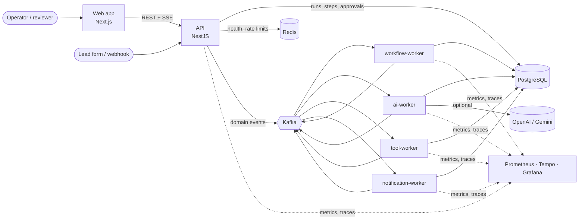

Why it is shaped this way:

- **Modular monolith API.** Users, workspaces, workflow versions, permissions, runs and audit logs share one set of rules, so they live in one NestJS application.
- **Durable first.** The API writes the run, its steps and the domain event to PostgreSQL before publishing to Kafka. A relay re-publishes events that did not reach Kafka.
- **Workers are stateless.** Each worker reads one or more topics, does one kind of work and publishes the result. Kafka delivery is at-least-once, so every handler is idempotent (`ProcessedMessage` records one row per consumer group and idempotency key).
- **Failure is explicit.** A failing handler is retried up to 3 times; then the message goes to `dead-letter-events` and `workflow-step-failed` is published so the run ends as `FAILED` instead of hanging.

### 2.2 Lead qualification flow

The sample workflow `wf_lead_qualification` scores an inbound lead, branches on intent, drafts an email, waits for a human to approve it, sends it and creates a sales task.

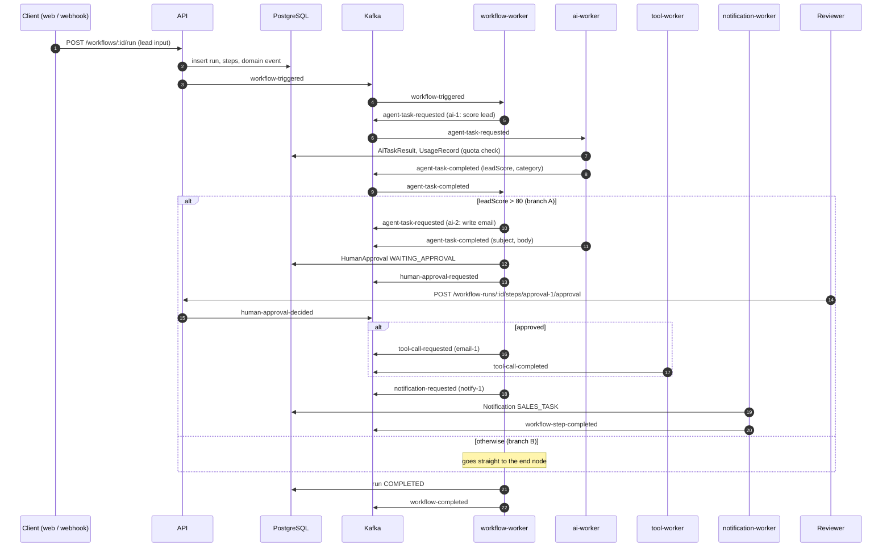

A rejected email is not sent, but the sales task is still created so a person follows up; the run then completes.

### 2.3 Kafka topics

| Topic | Producer | Consumer |
| --- | --- | --- |
| `workflow-triggered` | API | workflow-worker |
| `workflow-step-started` / `-completed` / `-failed` | workers | workflow-worker, listeners |
| `agent-task-requested` | workflow-worker | ai-worker |
| `agent-task-completed` | ai-worker | workflow-worker |
| `tool-call-requested` | workflow-worker | tool-worker |
| `tool-call-completed` | tool-worker | workflow-worker |
| `human-approval-requested` | workflow-worker | listeners |
| `human-approval-decided` | API | workflow-worker |
| `notification-requested` | API, workers | notification-worker |
| `workflow-completed` / `workflow-failed` | workflow-worker | listeners |
| `dead-letter-events` | any worker | operations tooling |

Every event carries `eventId`, `type`, `workspaceId`, `workflowRunId`, `timestamp`, and a W3C `traceparent`, so one trace follows a run across the API and all workers.

### 2.4 Data model

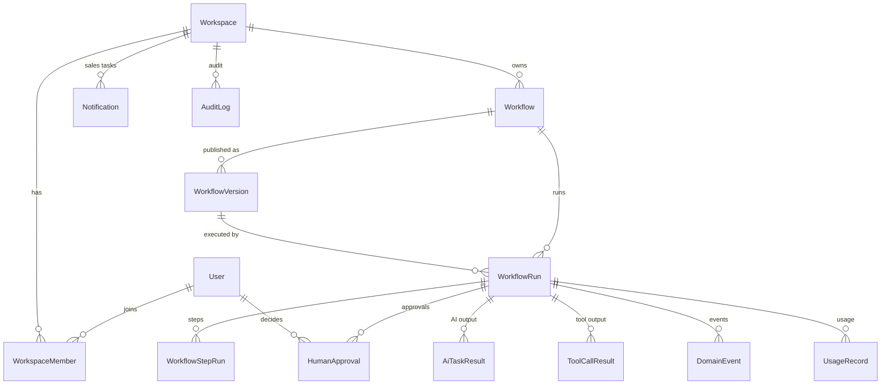

- A run always points at an immutable `WorkflowVersion`, so editing a workflow never changes the history of earlier runs.
- `WorkflowRun.contextJson` holds the trigger input and node outputs for the engine. It is never returned to clients unmasked; contact fields are masked in every view (`an***@shopabc.vn`).
- `UsageRecord` drives the daily AI quota (`AI_DAILY_CALL_LIMIT`, `AI_DAILY_TOKEN_LIMIT`). When the quota is reached the AI step fails with a clear message and is not retried.

## 3. Web application

The web app uses the **Lumen** design direction: a bright pearl canvas with a soft aurora wash, deep indigo ink, an iris gradient accent, 12-20 px radii and layered soft shadows. Body text is Be Vietnam Pro (Latin and Vietnamese); JetBrains Mono is kept for identifiers and code. Motion is short and purposeful (reveal on mount, count-up numbers, spring navigation indicator) and respects `prefers-reduced-motion`. The interface is available in English and Vietnamese.

### 3.1 Landing page

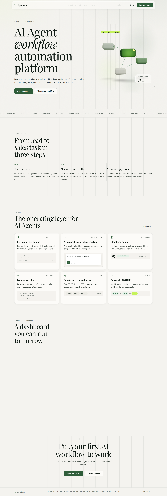

### 3.2 Login

Sessions use HttpOnly access and refresh cookies. Local demo accounts under `@agentops.local` are created on first login when `DEMO_LOGIN_ENABLED` allows it; production has it disabled.

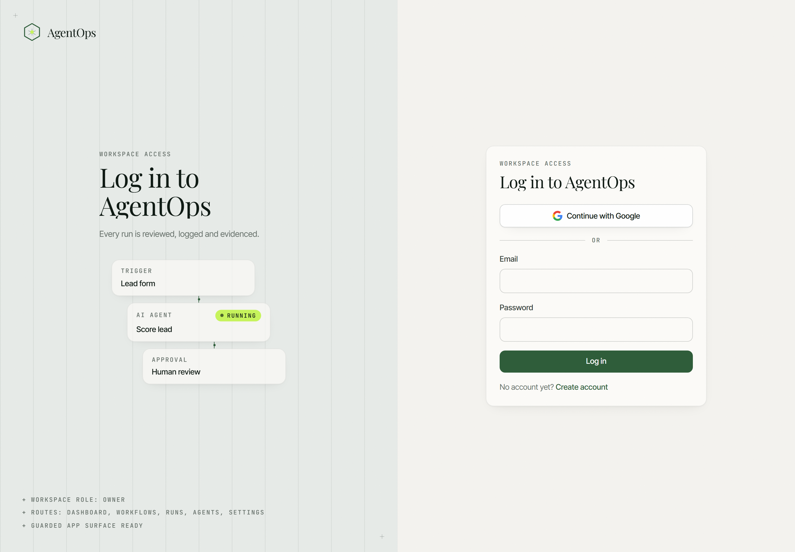

### 3.3 Dashboard

Four headline metrics, run activity, run outcomes and lead quality charts, the scored-lead table (contact fields masked), the sales task list, recent runs, dependency readiness, AI providers and the live event stream.


### 3.4 Workflows and the visual builder

Workflows are listed with their status, node and edge counts. The builder renders the graph with React Flow, validates it (trigger, end node, edge references, AI and tool configuration) and offers **Publish** and **Run**.

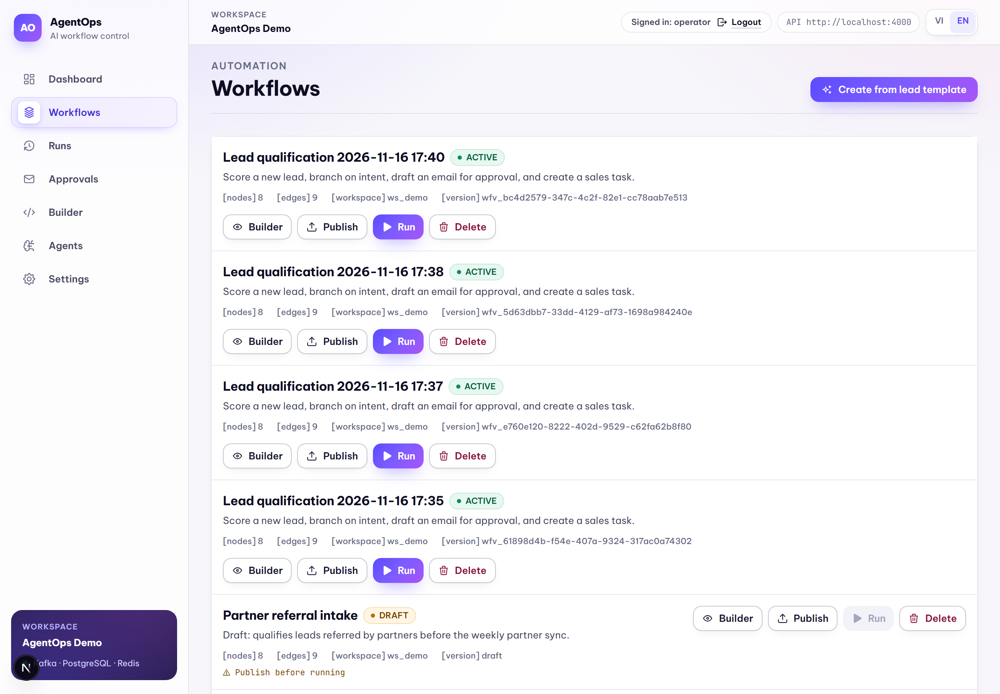

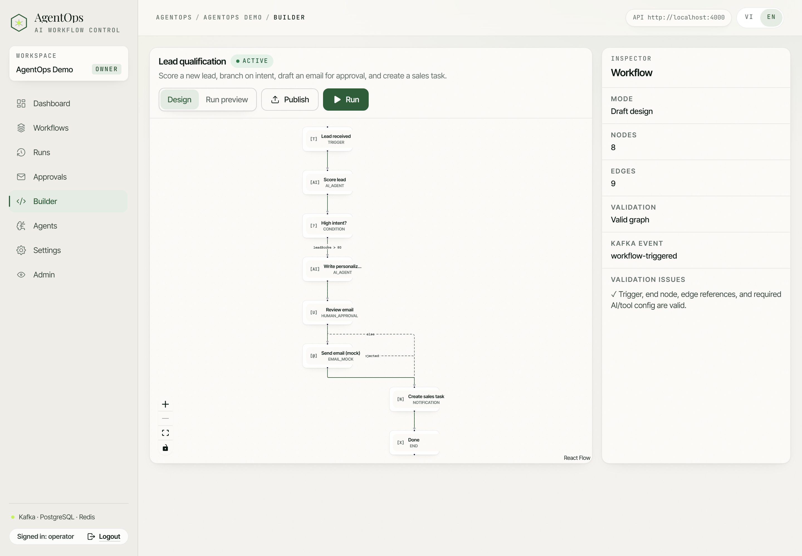

### 3.5 Runs and the run timeline

The run list filters by status and workflow. The run page streams status over Server-Sent Events and shows each step with its input, output, token usage and errors.

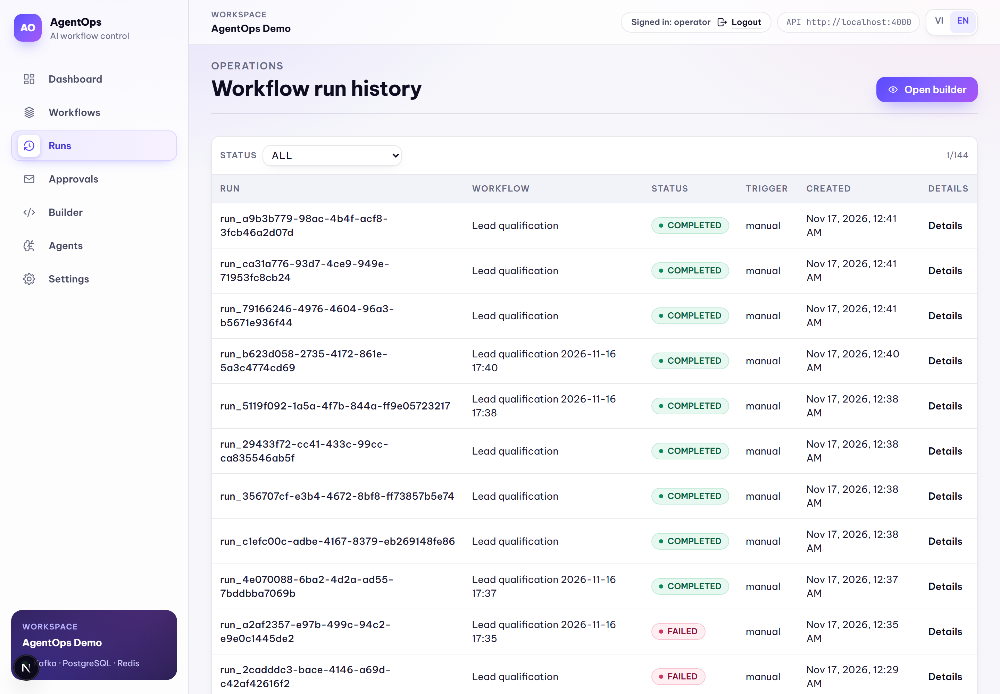

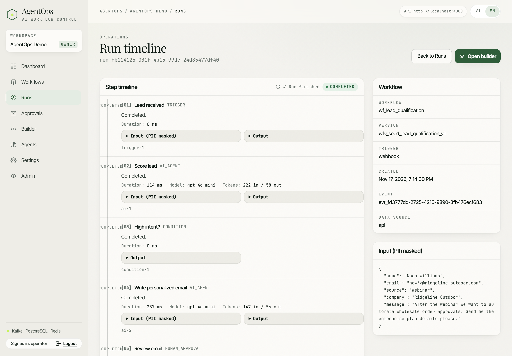

### 3.6 Approval queue

AI-drafted emails for hot leads wait here. A reviewer can edit the draft, add a note, then approve and send, or reject. The first decision wins; a second one gets HTTP 409.

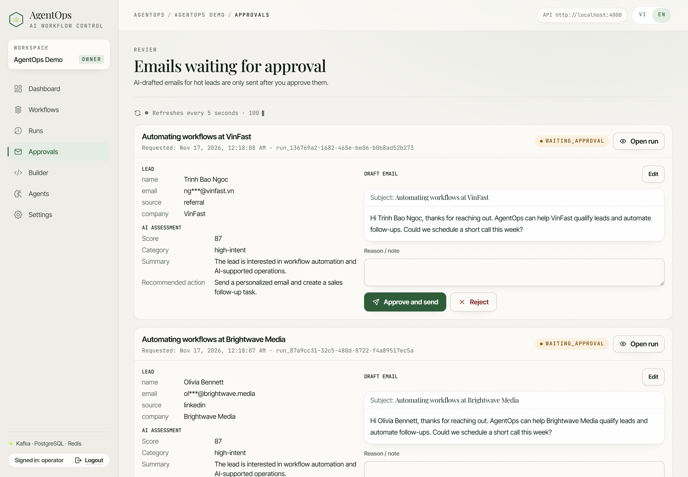

### 3.7 AI agents and settings

The agents screen shows providers, today's calls and tokens against the quota, and a console to test the scoring agent. Settings shows the API boundary, dependency health and the production readiness checklist.


### 3.8 Mobile

Below 1024 px the sidebar becomes a horizontal navigation bar and tables scroll inside their cards.


## 4. Deployment

### 4.1 Local (Docker Compose)

`pnpm local:docker` builds seven images and starts 14 containers: PostgreSQL, Redis, Kafka, Prometheus, Alertmanager, Grafana, Tempo, a one-shot `setup` container (migrations, seeds, Kafka topics), the API, the web app and four workers.

| Service | Address |
| --- | --- |
| Web | http://localhost:3000 |
| API | http://localhost:4000 |
| Grafana | http://localhost:3001 |
| Prometheus | http://localhost:9090 |
| Alertmanager | http://localhost:9093 |
| Tempo | http://localhost:3200 |
| Worker metrics | http://localhost:4101 to 4104 |

### 4.2 Production (AWS EKS)

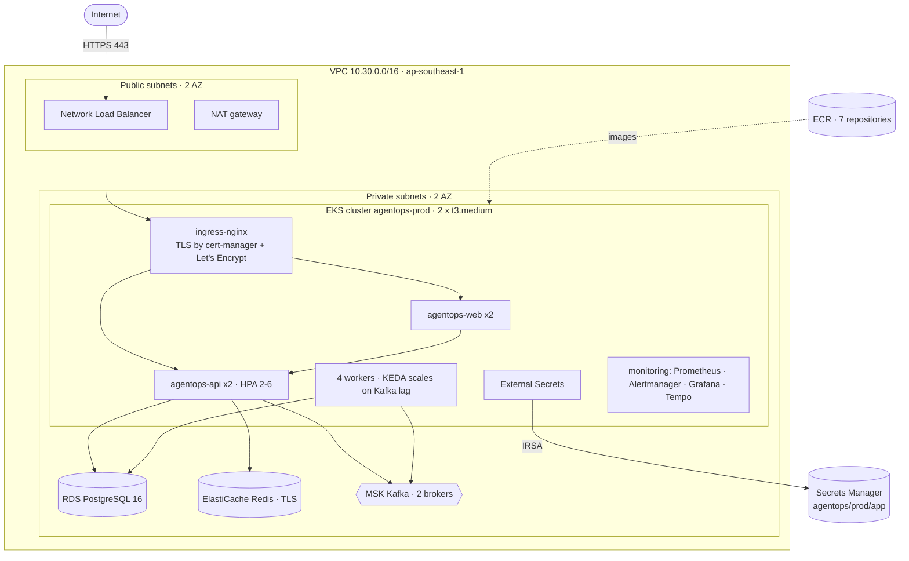

- **Terraform** (`infrastructure/terraform/environments/prod`) creates the VPC, EKS, RDS, ElastiCache, MSK, ECR, the Secrets Manager container and the GitHub OIDC role: 54 resources.
- **Kubernetes** (`infrastructure/k8s/overlays/prod`) deploys the six workloads with non-root, read-only-root-filesystem pods, probes, resource limits, PodDisruptionBudgets, zone spread, default-deny NetworkPolicies and an Ingress that never routes `/metrics`.
- **Secrets** never enter Terraform state or Git: External Secrets reads `agentops/prod/app` from Secrets Manager through an IRSA role and creates the `agentops-secrets` Secret.
- **Releases**: the migration Job (`infrastructure/k8s/jobs/db-migrate`) runs first, then the Deployments roll out; `scripts/k8s-deploy.sh` rolls back automatically if the rollout or the smoke test fails.

The exact commands, the problems found during the first production bring-up and the teardown procedure are in [production-runbook-aws.md](production-runbook-aws.md).

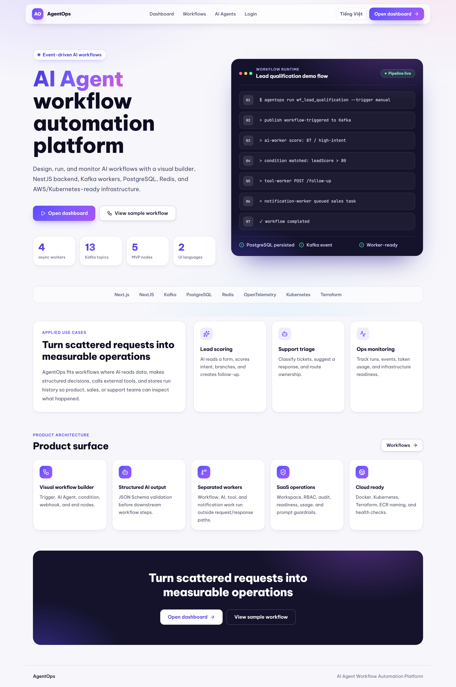

## 5. Monitoring and observability

Every service exposes Prometheus metrics (`/metrics` on the API, port 9100 on workers) and exports OpenTelemetry traces to Tempo. In Kubernetes the stack lives in the `monitoring` namespace (`infrastructure/k8s/monitoring`); Prometheus discovers the pods of the `agentops` namespace and labels them with the same `service` names as the local stack, so the same rules and dashboards work in both environments. The screenshots below come from the production cluster after the showcase seed (44 lead runs).

### 5.1 Scrape targets

All seven targets are up: two API replicas, four workers and Prometheus itself.

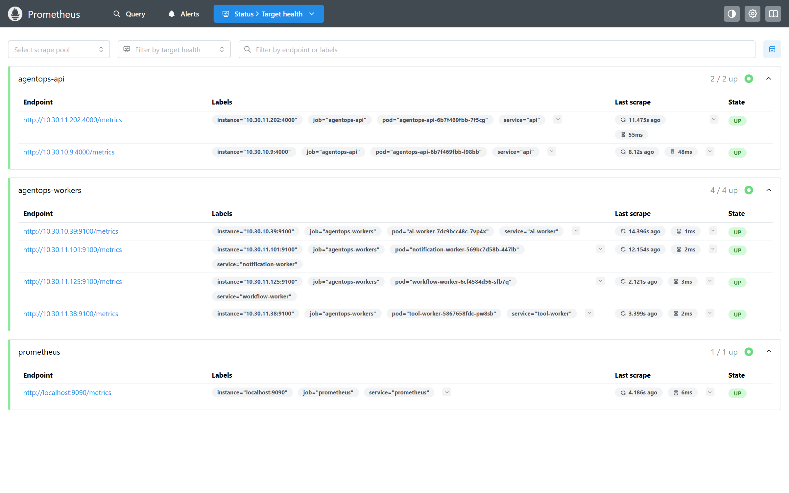

### 5.2 Dashboards

**Overview**: API request rate, p95 latency, 5xx ratio, workflow runs per hour, alert-bot notifications.


**API and workers (RED)**: API and worker throughput, error ratios, latency percentiles, p95 by route, duplicates skipped by idempotency, process memory.


**AI**: calls by status, valid-JSON ratio, tokens per minute by model, estimated cost, retries, call latency, quota rejections.


**Kafka**: consumer lag by group and topic, outbox backlog, dead letters, message outcomes.

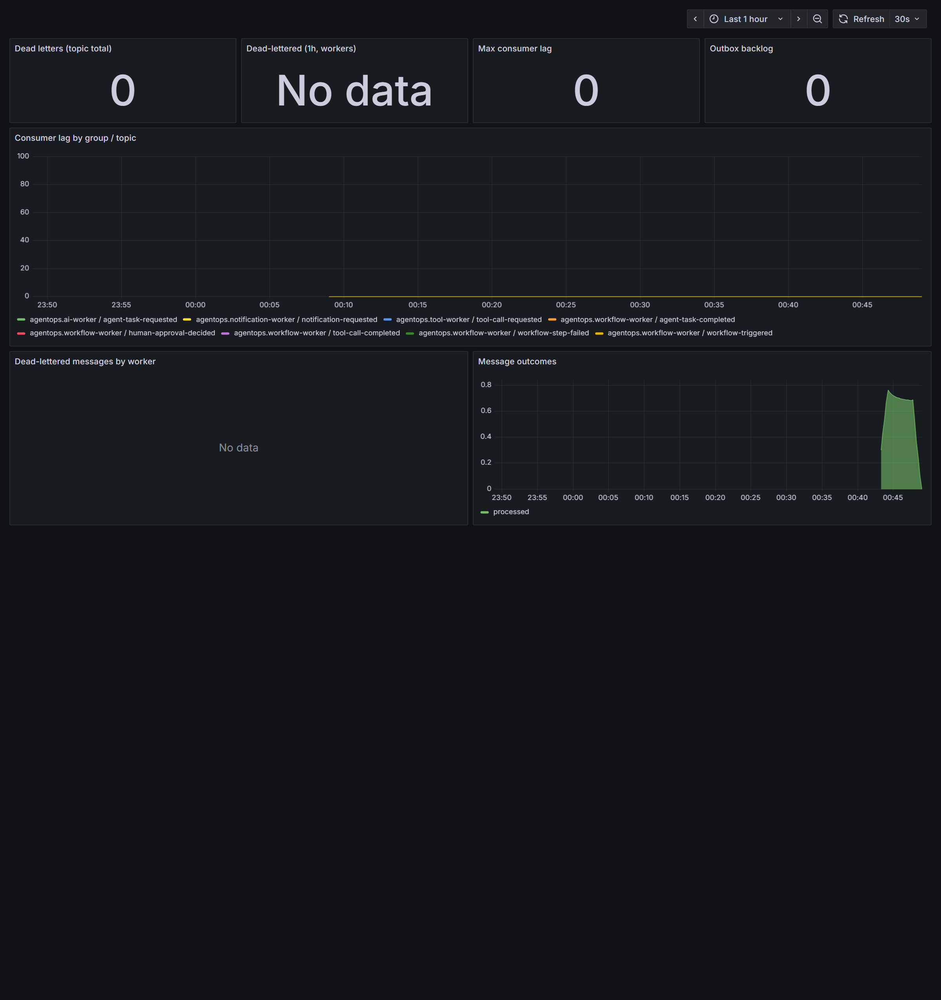

**Lead flow (business)**: leads scored, share of leads on the email path, approvals requested and decided, sales tasks, logins, cost per lead.

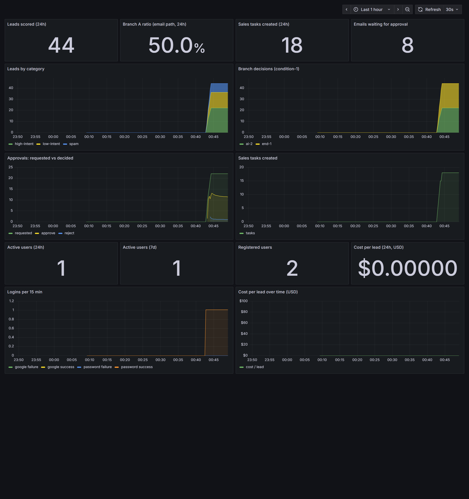

### 5.3 Traces

One trace covers a run from the HTTP request through every worker, because the `traceparent` travels in the event envelope.

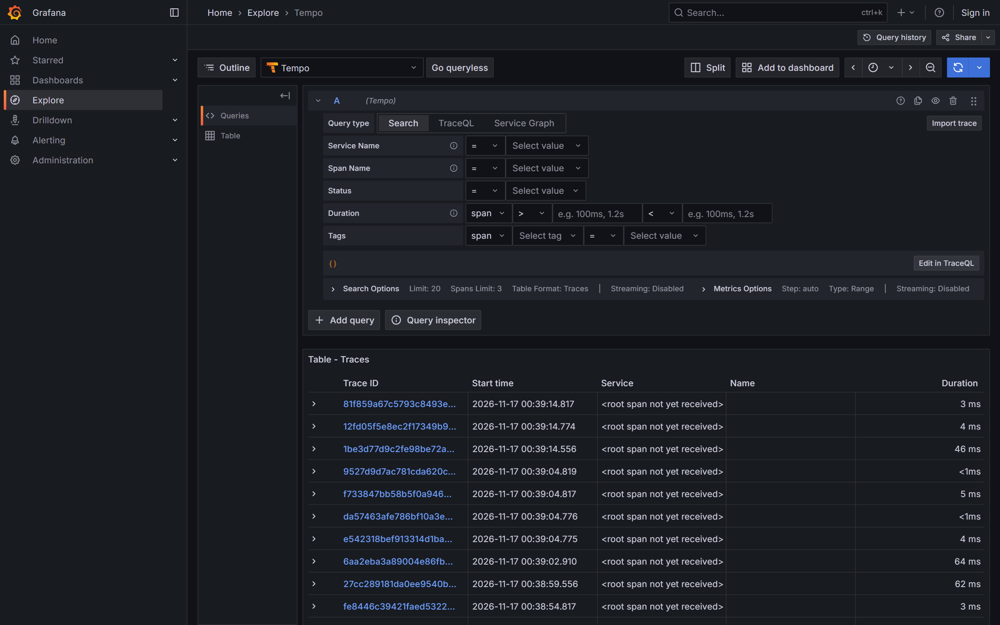

### 5.4 Alerts

Seventeen rules in five groups (`infrastructure/observability/prometheus/rules/agentops-alerts.yml`) (`agentops-api`, `agentops-alert-bot`, `agentops-workers`, `agentops-kafka`, `agentops-pipeline`) cover the API, the workers, Kafka, the event pipeline and the alert bot itself. Alertmanager groups alerts by name, service and severity and posts them to `POST /notifications/alertmanager` with a Bearer token (`ALERTMANAGER_WEBHOOK_TOKEN`).

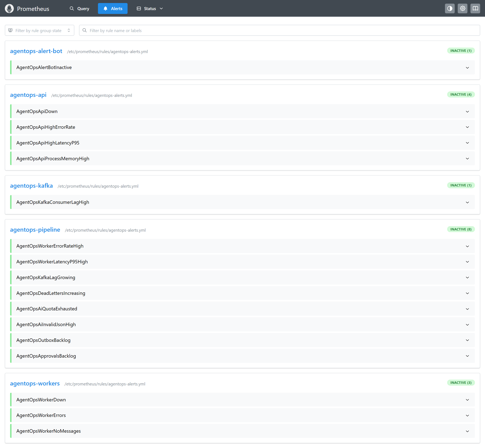

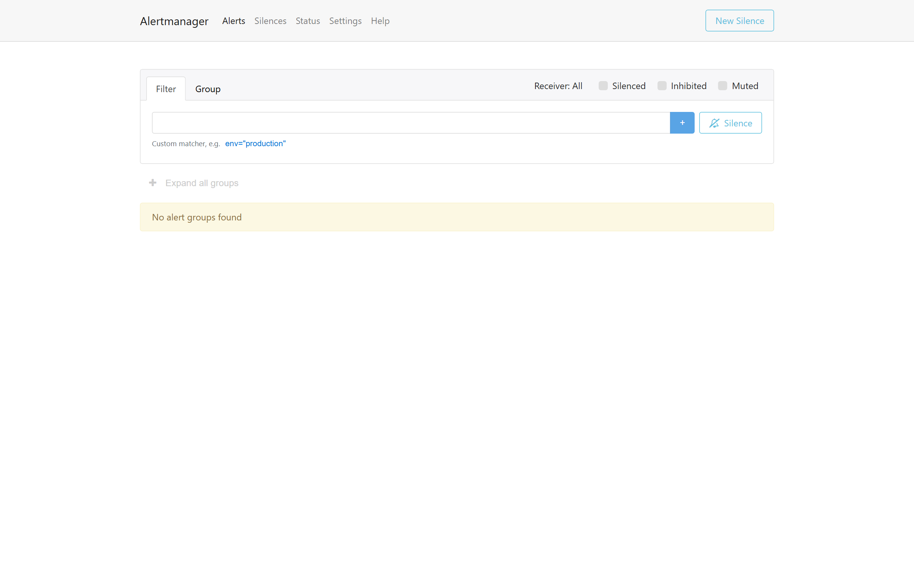

## 6. Security

| Control | Implementation |
| --- | --- |
| Authentication | argon2 password hashes; short-lived JWT access token and rotating refresh token in HttpOnly, `Secure`, `SameSite=Lax` cookies |
| Authorization | Workspace roles OWNER, ADMIN, MEMBER, VIEWER enforced by a guard on every workspace route |
| Rate limiting | 120 requests per minute per client, 10 per minute on auth endpoints |
| PII | Contact fields masked in every API view and in AI prompts |
| AI safety | Prompt-injection detection, JSON Schema validation of AI output, daily call and token quotas |
| Human in the loop | Emails are sent only after an approval; decisions are audited and final |
| Transport | HTTPS at the ingress; TLS to RDS and ElastiCache |
| Kubernetes | Non-root, read-only root filesystem, all capabilities dropped, default-deny ingress NetworkPolicies, no service account tokens mounted |
| Secrets | AWS Secrets Manager through External Secrets and IRSA; nothing in Git or Terraform state |
| CI/CD | GitHub OIDC (no static AWS keys); production promotion needs reviewer approval |

Details: [security.md](security.md).

## 7. Testing

| Layer | Tooling | Scope |
| --- | --- | --- |
| Unit | Vitest | Graph validation, AI helpers, views, React components (84 web tests) |
| Integration | Vitest + throwaway PostgreSQL and Kafka (`pnpm test:integration`) | API with real persistence and messaging |
| End to end | Playwright, 12 scenarios | UI lead flow, navigation and auth gate, pipeline through the public API |
| AI evaluation | Golden set (`pnpm eval:leads`) | Lead classification accuracy and hot-lead miss rate |
| Load | k6 (`tests/load`) | API throughput |
| Infrastructure | hadolint, kubeconform, `terraform validate`, tflint | Dockerfiles, manifests, Terraform |

The scenarios and their latest results are in [test-scenarios.md](test-scenarios.md).

## 8. Operating the system

| Task | Command |
| --- | --- |
| Start the local stack | `pnpm local:docker` |
| Reset local data | `pnpm compose:apps:reset` |
| Seed showcase data | `SEED_EMAIL=... SEED_PASSWORD=... node scripts/seed-showcase.mjs` |
| Run unit tests | `pnpm test` |
| Run end-to-end tests | `pnpm --filter @agentops/web test:e2e` |
| Capture app screenshots | `cd apps/web && node e2e/capture-screens.mjs` |
| Capture monitoring screenshots | `cd apps/web && node e2e/capture-monitoring.mjs` |
| Validate infrastructure | `pnpm docker:lint`, `pnpm k8s:validate`, `pnpm tf:validate` |

`scripts/seed-showcase.mjs` does not write to the database. It logs in, creates three extra workflows and sends 44 curated leads (22 high intent, 14 low intent, 8 spam, including a prompt-injection attempt) through the real pipeline, then approves about 65% of the drafted emails, rejects about 15% and leaves the rest in the queue.
