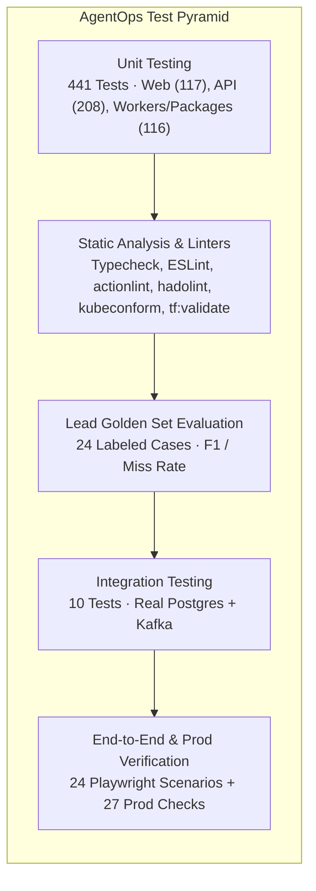
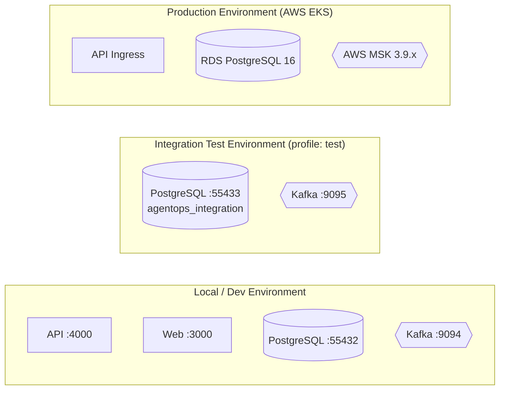

# Test Plan and Quality Assurance Strategy

This document outlines the testing strategy, test pyramid, test execution environments, dataset governance, and acceptance gates across all layers of the AgentOps platform.

Related documentation:
- [Test Scenarios Catalog](test-scenarios.md): Comprehensive catalog of all Playwright e2e scenarios and integration test cases.
- [Local Runbook](local-runbook.md): Local test execution commands and debugging.
- [Deployment and CI/CD](deployment.md): CI test automation pipelines.

---

## 1. Test Pyramid and Strategy

AgentOps employs a multi-tiered test pyramid designed for high execution speed, deterministic verification, and complete isolation:

### Architectural Principles of the Test Suite
1. **Deterministic Execution**: Automated unit, integration, and e2e suites run using the deterministic `mock` AI provider by default. AI output adheres to predefined JSON schemas without variance, eliminating network latency and external OpenAI API costs.
2. **Dedicated Test Containers**: Integration tests run against dedicated containers (`postgres-test` on port 55433 and `kafka-test` on port 9095) via Docker Compose profile `test`, ensuring integration suites never mutate developer data.
3. **Serialized Auth Execution**: Playwright E2E tests run with a single worker (`workers: 1`) to prevent rate-limiting collisions on authentication endpoints (throttled at 10 requests/minute).

---

## 2. Testing Levels and Tooling

| Level | Suite / Command | Scope & Coverage | Environment | Pass Criteria |
| --- | --- | --- | --- | --- |
| **Unit (Web)** | `pnpm test:web` | React components, UI hooks, client state stores, formatting utilities | In-memory (Vitest 4 + React 19) | 117 / 117 tests pass |
| **Unit (API)** | `pnpm test:api` | Controller routing, services, guards, JWT tokens, CSV generation, tracing middleware, rate limiters | In-memory (Vitest 4 + NestJS 11) | 208 / 208 tests pass |
| **Unit (Workers & Packages)** | `pnpm test:workers` | Workflow graph engine, condition evaluation, Kafka idempotency, dead-letter routing, token counting | In-memory (Vitest 4) | 116 / 116 tests pass |
| **Static Analysis** | `pnpm typecheck` `pnpm lint` | TypeScript type-safety across all 12 monorepo packages; ESLint rules | Static code analysis | 0 errors |
| **Golden Set Evaluation** | `pnpm eval:leads` | Intent scoring accuracy, spam filtering, prompt injection resilience on 24 labeled cases | In-memory evaluation | Accuracy $\ge 0.90$ Hot-lead miss $\le 0.10$ Schema valid $= 1.00$ |
| **Infrastructure Validation** | `pnpm ci:lint` `pnpm docker:lint` `pnpm k8s:validate` `pnpm tf:validate` | Actionlint, Shellcheck, Hadolint, Kubeconform (Kubernetes 1.31), Terraform offline plan | Container / CLI linters | 0 errors across all linters |
| **Integration** | `pnpm test:integration` | End-to-end lead flow, branching, human approvals, redelivery idempotency, provider outage simulation, CSRF Origin checks | Docker Compose profile `test` (PostgreSQL `:55433`, Kafka `:9095`) | 10 / 10 tests pass |
| **End-to-End (UI & API)** | `pnpm test:e2e` | Full user journeys, workspace isolation, admin console, authentication security | Local running stack (API `:4000`, Web `:3000`, 4 workers) | 24 / 24 scenarios pass |
| **Production Verification** | `scripts/verify-prod.mjs` | Live endpoints, TLS certs, K8s workloads, KEDA scaling, Prometheus rules, Alertmanager delivery, Tempo traces | AWS EKS production cluster | 27 / 27 checks pass |

---

## 3. Test Suites in Detail

### 3.1 Unit Testing
- **Web App (`apps/web`)**: 117 tests verifying React components (cards, forms, navigation headers, sidebar), translation hooks (`?lang=vi` / `?lang=en`), and workspace switcher behaviors.
- **Backend API (`apps/api`)**: 208 tests verifying authentication controllers, platform admin console services, user disabling logic, audit logging, rate limit throttling, and CSV report exports (with UTF-8 BOM and formula injection protection).
- **Workers and Shared Packages**: 116 tests verifying the workflow execution graph, JSON Schema validator, condition branch resolution (`leadScore > 80`), consumer retry limits (3 attempts), and dead-letter queue routing.

### 3.2 Lead Evaluation Golden Set (`pnpm eval:leads`)
The golden set dataset (`packages/shared/src/lead-eval-dataset.ts`) benchmarks prompt accuracy against 24 human-labeled leads:

| Metric | Business Justification | Target Threshold |
| --- | --- | --- |
| **Accuracy** | Overall proportion of correctly categorized leads | $\ge 0.90$ (90%) |
| **Macro F1** | Balances class performance, ensuring low-frequency `spam` leads are not obscured | $\ge 0.85$ (85%) |
| **Branch Accuracy** | Validates the binary business routing decision (`leadScore > 80` vs. expected branch) | $\ge 0.90$ (90%) |
| **Hot-Lead Miss Rate** | Identifies hot leads incorrectly categorized as low-intent/spam (costliest sales error) | $\le 0.10$ (10%) |
| **JSON Schema Valid Rate** | Measures structured output reliability and prevents downstream parser failures | $= 1.00$ (100%) |

*To run evaluation against OpenAI gpt-4o-mini instead of the mock provider: `pnpm eval:leads -- --provider openai` (requires `OPENAI_API_KEY`).*

### 3.3 Integration Testing (`pnpm test:integration`)
Executes real consumer groups and transactional PostgreSQL queries:
- **Full Lifecycle**: Inbound webhook lead trigger $\to$ AI intent scoring $\to$ conditional branch $\to$ human approval queue $\to$ mock email delivery $\to$ sales task creation.
- **Branch B Traversal**: Low-intent leads complete without creating human approvals.
- **Rejection Path**: Rejections require at least 3 characters of reviewer notes; skips email delivery while still creating a sales follow-up task detailing the rejection reason.
- **Outage Simulation**: Simulates an upstream provider outage using marker strings; verifies 3 retries, dead-letter routing to `dead-letter-events`, and run state transition to `FAILED`.
- **Idempotency**: Re-delivering Kafka events with identical keys (`ProcessedMessage`) is detected and ignored without producing duplicate emails or tasks.
- **Security & RBAC**: Rejects approval attempts by users with the `VIEWER` role with HTTP 403; verifies HttpOnly session cookies and CSRF Origin blocking.

### 3.4 Playwright End-to-End Suite (`pnpm test:e2e`)
Configured in `apps/web/playwright.config.ts`:
- **Single Worker**: Runs sequentially (`workers: 1`) to preserve auth rate-limiting quotas.
- **Coverage**: 24 scenarios across 6 test specifications:
  - `agentops-flow.e2e.ts` (1 scenario): Complete UI lead qualification workflow.
  - `navigation.e2e.ts` (5 scenarios): Bilingual rendering, unauthenticated redirects, responsive mobile layout (390x844).
  - `pipeline-api.e2e.ts` (6 scenarios): API pipeline execution, input validation, 409 conflict on duplicate approvals, prompt injection resistance.
  - `admin.e2e.ts` (5 scenarios): Admin overview charts, CSV downloads, user lock/unlock actions, audit log trail, 403 permission gating.
  - `workspace.e2e.ts` (3 scenarios): Registration personal workspace isolation, cross-tenant 403 enforcement, `/auth/me` roles.
  - `security.e2e.ts` (4 scenarios): Protected endpoint 401s, CSRF Origin checks on cookie writes, immediate token revocation upon account disablement, self-disablement refusal.

---

## 4. Test Environments and Data Governance

### Test Data Sanitization
- All test leads use synthetic email addresses ending in `@example.com`, `@example.org`, or `@agentops.local`.
- Sensitive personal identifiable information (PII) like phone numbers and email prefixes are masked in the UI and database (`an***@shopabc.vn`).

### Environment Matrix

---

## 5. Exclusions and Out-of-Scope Testing

- **Live Third-Party API Spend**: Automated CI/CD runs do not call live paid OpenAI endpoints; the deterministic mock provider validates all schema contracts.
- **Cross-Browser Matrix**: Automated e2e testing is standardized on Chromium (Desktop Chrome). Safari (WebKit) and Firefox are validated manually.
- **Production UI Testing**: Production environments disable automated demo login (`@agentops.local`); UI suites target local and dedicated test clusters.
