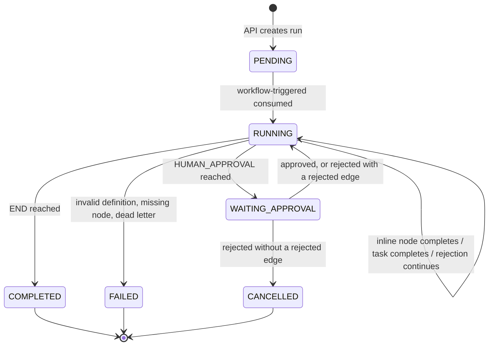
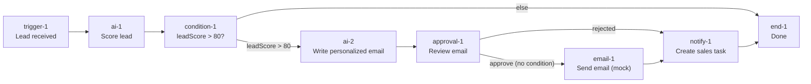

# Workflow Engine

A workflow is a directed graph of typed nodes. Users edit it in the builder, an `ADMIN` publishes an immutable version, and a `MEMBER` starts a run. The API writes the run to PostgreSQL and emits `workflow-triggered`; the workflow worker then advances the graph, pausing at task nodes until another worker reports completion and pausing at human approvals until a reviewer decides.

This document describes the graph contract and the execution lifecycle. The message envelope and topic list are in [kafka-topics.md](kafka-topics.md); persistence details are in [database.md](database.md).

## Definition schema

Stored in `Workflow.definitionJson` (draft) and copied into `WorkflowVersion.definitionJson` on publish. The schema is `workflowDefinitionSchema` in `packages/shared/src/workflow.ts`.

```ts
type WorkflowDefinition = {
  nodes: Array<{
    id: string;
    type:
      | "TRIGGER"
      | "AI_AGENT"
      | "CONDITION"
      | "WEBHOOK"
      | "HTTP_REQUEST"
      | "EMAIL_MOCK"
      | "DELAY"
      | "HUMAN_APPROVAL"
      | "NOTIFICATION"
      | "END";
    name: string;
    config: Record<string, unknown>;
  }>;
  edges: Array<{
    id: string;
    source: string;
    target: string;
    condition?: string;
  }>;
};
```

Node ids and edge ids must be non-empty strings. Edge `source` and `target` reference node ids. There is no separate "start" flag: every `TRIGGER` node is a start node.

## Node types

| Type | Execution | Required config | Behavior |
| --- | --- | --- | --- |
| `TRIGGER` | Inline | - | Entry point. The run input is the starting context. The API pre-creates this step as `COMPLETED`; the worker still emits started/completed events for it |
| `AI_AGENT` | Task | `outputSchema` | Emits `agent-task-requested`. The AI worker calls the provider, validates JSON, and returns `agent-task-completed`. The output is stored on the step and flattened into the run context |
| `CONDITION` | Inline | - | Selects outgoing edges by evaluating their `condition` against the current context. Completes immediately with `{ branch: [targetIds] }` |
| `WEBHOOK` | Task | `url` | Emits `tool-call-requested` with `toolType: "webhook"`. The tool worker returns a mock result |
| `HTTP_REQUEST` | Task | - | Emits `tool-call-requested` with `toolType: "http_request"`. The tool worker returns a mock result |
| `EMAIL_MOCK` | Task | - | Emits `tool-call-requested` with `toolType: "email_mock"`. Sends the reviewer-edited text when present, otherwise the drafted text |
| `DELAY` | Inline | - | Declared type, but executed immediately with no wait. It is a placeholder, not a scheduler |
| `HUMAN_APPROVAL` | Pause | - | Emits `workflow-step-started` with `status: "WAITING_APPROVAL"` and `human-approval-requested`; run becomes `WAITING_APPROVAL` |
| `NOTIFICATION` | Inline + task | - | Completes inline and emits `notification-requested`. `kind` defaults to `SALES_TASK`, `title` to the node name, `dueInHours` to 24 |
| `END` | Inline | - | Emits `workflow-completed`. Any remaining `PENDING` steps become `SKIPPED` |

`AI_AGENT` config recognized by the AI worker: `modelProvider` (`mock` or `openai`), `modelName`, `systemPrompt`, `userPromptTemplate`, `outputSchema`, `temperature`, `maxTokens`, `retryLimit` (0-3, default 1). `retryLimit` is the number of extra attempts inside the AI worker, separate from the Kafka consumer's 3 delivery attempts.

A `CONDITION` node's own `config.expression` is not evaluated. Conditions live on the outgoing edges. The seeded workflow stores both for readability, but the engine reads the edge condition. Put the comparison on the edge.

## Edge conditions

An edge condition is one of:

| Form | Meaning |
| --- | --- |
| missing, empty, or `true` | Always taken |
| `false` | Never taken |
| `rejected` | Reserved: taken only from a `HUMAN_APPROVAL` node when the decision was reject |
| `<path> <op> <literal>` | Comparison against the run context |

Supported operators are `>=`, `<=`, `==`, `!=`, `>`, `<`. The path is dot-separated (`leadScore`, `assessment.score`). Literals are trimmed; surrounding single or double quotes are stripped; `true`/`false` become booleans; numeric text becomes a number; everything else is a string.

Evaluation rules:

- A missing or null context value makes the comparison false.
- `==` and `!=` compare as strings after coercion.
- `>`, `>=`, `<`, `<=` require both sides to be numeric; otherwise false.
- Conditions are selected per source node. All non-fallback edges that evaluate true are taken, so a node can fan out to several targets.
- `else` and `default` are fallbacks. They are taken only when no non-fallback edge matched.
- The reserved `rejected` condition is never a comparison; it reads `context.approvalDecision === "rejected"`.

Approval decisions are special-cased rather than evaluated through the generic selector:

- Approve: normal outgoing edges are evaluated with `approvalDecision: "approved"`. `rejected` edges evaluate false.
- Reject with at least one `rejected` edge: only the `rejected` edges are followed. Normal edges are ignored.
- Reject with no `rejected` edge: the run is cancelled.

## Publish-time validation

`validateWorkflowDefinition` runs on publish (`POST /workflows/:id/publish`) and again in the workflow worker before executing a trigger event. It returns a list of issues; the API responds `400` with `{ message: "Workflow graph is invalid", issues }`.

| Code | Rule |
| --- | --- |
| `MISSING_TRIGGER` | At least one `TRIGGER` node is required |
| `MISSING_END` | At least one `END` node is required |
| `DUPLICATE_NODE_ID` | Node ids must be unique |
| `EDGE_SOURCE_MISSING` | Every edge source must exist |
| `EDGE_TARGET_MISSING` | Every edge target must exist |
| `UNREACHABLE_NODE` | Every node must be reachable from a trigger, following edges regardless of condition |
| `AI_SCHEMA_MISSING` | Every `AI_AGENT` node must define `config.outputSchema` |
| `WEBHOOK_URL_MISSING` | Every `WEBHOOK` node must define `config.url` |
| `REJECTED_EDGE_INVALID_SOURCE` | A `rejected` edge may only leave a `HUMAN_APPROVAL` node |

Validation does **not** check for cycles, require every path to reach an `END`, validate condition syntax, require a `CONDITION` node to have outgoing edges, check duplicate edge ids, or require the `TRIGGER` to be the first node in the array. Those gaps are current behavior. The executor's `visited` set prevents a node from running twice within one advance pass, but it is not a global cycle detector across events.

Publishing creates a new `WorkflowVersion` with the next `versionNumber`, copies the validated definition, sets `Workflow.currentVersionId`, and marks the workflow `ACTIVE`. A run always pins the version that was current when it started. Editing the draft or publishing again does not change an in-flight run.

## Starting a run

`POST /workflows/:id/run` requires `MEMBER` or higher.

```json
{
  "input": { "name": "Anna Nguyen", "email": "anna@shopabc.vn", "message": "..." },
  "triggerType": "manual"
}
```

- The workflow must have a published version. Otherwise the API returns `409 WORKFLOW_NOT_PUBLISHED`.
- Archived workflows cannot be run or published.
- If the definition is a lead workflow (the trigger declares `config.inputSchema = "lead"` or an AI node uses the lead-scoring prompt), the input is validated with `leadInputSchema`: `name`, `email`, and `message` required; `company` and `source` optional; unknown fields passed through. Failure is `400 INVALID_LEAD_INPUT` with per-field details.
- Other workflows accept any object as input.
- `triggerType` defaults to `manual`; the value is stored on the run and used as a metric label.

In one transaction the API creates:

1. `WorkflowRun` with status `PENDING`, the pinned `workflowVersionId`, `triggerType`, and `inputJson`.
2. One `WorkflowStepRun` per node, `PENDING` except the first node in the definition array, which is created `COMPLETED` with the input and an acknowledgement output.

The API then publishes `workflow-triggered` with `input`, `triggerType`, `workflowVersionId`, and the full `definition`. The message key is the run id.

## Execution lifecycle



The workflow worker's `advance` loop:

1. Start from the trigger node(s) and a queue.
2. Skip a node already `visited` in this pass.
3. If it is a task node, emit `workflow-step-started` and a task request, then stop this branch. The run stays `RUNNING` until the completion event arrives.
4. If it is a `HUMAN_APPROVAL` and auto-approve is off, emit started with `WAITING_APPROVAL` and a `human-approval-requested` request, then stop this branch.
5. Otherwise run the node inline, emit started and completed, apply its outgoing edge selection, and enqueue the targets.
6. At `END`, emit `workflow-completed` and stop that branch.

One consumed event produces a `WorkflowExecutionPlan`: ordered step events, task requests, terminal events, the accumulated context, and issues. `projectRunState` converts the plan into database changes; `PrismaRunStateStore.apply` writes them in one transaction before the resulting events are published. If the process dies after the transaction but before publishing, the consumed message is redelivered; the transaction is replay-safe and the events are published on the retry.

### Context

- The run context starts as the trigger input.
- A task completion merges `context[nodeId] = output`. For `AI_AGENT` only, the output is also flattened into the top level, so `leadScore`, `category`, `subject`, and `body` are readable directly by edge conditions.
- An approval decision merges `context[nodeId] = { decision, decidedBy, comment }`, sets `approvalDecision` to `approved` or `rejected`, and copies reviewer edits to `subject` and `body`.
- Inline outputs (`CONDITION` branch, `NOTIFICATION` acknowledgement, auto-approve decision) are stored on the step but are not merged into the run context. A `CONDITION` evaluates against the context produced by earlier task nodes, which is what makes `leadScore > 80` work.
- The context is persisted in `WorkflowRun.contextJson` and carried on every task request, so workers do not need to re-read run state to know the lead.

### Fan-out, joins, and skips

- Multiple outgoing edges may match, producing parallel branches in one plan.
- There is no join node. If branches converge on the same node, the first branch to reach it starts the node; the executor does not wait for every branch. The second task request for the same `(run, node)` is treated as a duplicate by the consumer. Keep convergent branches limited to `END`, or give each branch its own merge-free path.
- Steps that never run stay `PENDING` while the run is active. When the run reaches `COMPLETED`, `FAILED`, or `CANCELLED`, all remaining `PENDING` steps become `SKIPPED` in the same transaction.
- A terminal run is never moved back to an active status. `WorkflowRun.updateMany` only updates rows whose status is `PENDING`, `RUNNING`, or `WAITING_APPROVAL`.

## Human approval

### Request

When the worker reaches a `HUMAN_APPROVAL` node, it:

- Sets the step to `WAITING_APPROVAL` and the run to `WAITING_APPROVAL`.
- Creates a `HumanApproval` row, unique per `(workflowRunId, nodeId)`, with a masked review payload: lead name/company/email/source, assessment (`leadScore`, `category`, `summary`, `recommendedAction`), and drafted email (`subject`, `body`). Sensitive keys and contact strings are masked by `maskSensitivePromptInput`.
- Publishes `human-approval-requested` with `{ nodeId, title, review }`. There is no consumer for this topic; the approval is visible through the database-backed approvals API.

### Decision

`POST /workflow-runs/:id/steps/:stepId/approval` requires `MEMBER` or higher. `stepId` may be either the composite id `runId_nodeId` or the bare `nodeId`.

```json
{
  "decision": "approve",
  "comment": "Looks good",
  "editedEmail": { "subject": "Re: automation", "body": "..." }
}
```

| Field | Rule |
| --- | --- |
| `decision` | `approve` or `reject` |
| `comment` | Optional for approve, max 2000 characters. Mandatory for reject, at least 3 non-space characters |
| `editedEmail` | Optional for approve; `subject` 1-300 characters, `body` 1-10000 characters. Ignored on reject |

The API transaction:

1. Guarded update from `WAITING_APPROVAL` to `APPROVED` or `REJECTED`. A concurrent second decision loses the race and receives `409` with the current decision.
2. Writes an audit row: `workflow_run.approval.approved` or `workflow_run.approval.rejected`.
3. On approve: leaves the step and run for the worker to advance.
4. On reject with a `rejected` edge: marks the approval step `COMPLETED`, sets the run `RUNNING`, and leaves the email step `PENDING` (it becomes `SKIPPED` when the path finishes).
5. On reject without a `rejected` edge: marks the step `FAILED`, marks all other `PENDING` steps `SKIPPED`, and cancels the run with `errorMessage: "Email rejected by reviewer"`.

It then publishes `human-approval-decided` with the decision, comment, decider, definition, context, and optional `editedEmail`.

After the event, the workflow worker:

- Approve: merges the decision and edits, completes the approval step, evaluates normal outgoing edges, and continues. If no outgoing edge matches, it completes the run.
- Reject with `rejected` edges: completes the approval step and advances only through those edges. The normal email step is never started.
- Reject without `rejected` edges: emits a terminal `workflow-failed` with `status: CANCELLED`. The database already says `CANCELLED`, so the guarded update is a no-op.

`WORKFLOW_AUTO_APPROVE=true` skips the pause and auto-completes the approval, but only when `APP_ENV=local`. Every other environment ignores it. A production run always waits for a reviewer.

The approvals list (`GET /workflow-runs/approvals`) filters to approvals in workspaces the caller belongs to, optionally by `workspaceId` and `status` (`WAITING_APPROVAL`, `APPROVED`, `REJECTED`, `ALL`), newest first, up to 100.

## The seeded lead workflow

`sampleLeadWorkflowDefinition` in `packages/shared/src/workflow.ts`, seeded as `wf_lead_qualification` by `packages/database/scripts/seed-demo.ts`.



| Node | Type | Purpose |
| --- | --- | --- |
| `trigger-1` | `TRIGGER` | Accepts a lead |
| `ai-1` | `AI_AGENT` | Scores the lead, returns `leadScore`, `category`, `summary`, `recommendedAction`, `confidence` |
| `condition-1` | `CONDITION` | Takes `leadScore > 80` to the email path, otherwise `else` to `end-1` |
| `ai-2` | `AI_AGENT` | Drafts a personalized email (`subject`, `body`) |
| `approval-1` | `HUMAN_APPROVAL` | Waits for a reviewer; the review shows the masked lead, assessment, and draft |
| `email-1` | `EMAIL_MOCK` | Mock send, using reviewer edits when present |
| `notify-1` | `NOTIFICATION` | Creates a `SALES_TASK`: "Call lead back within 24 hours" |
| `end-1` | `END` | Completes the run |

Edges: `trigger-1 -> ai-1 -> condition-1`; `condition-1 -> ai-2` (`leadScore > 80`) and `condition-1 -> end-1` (`else`); `ai-2 -> approval-1`; `approval-1 -> email-1`; `email-1 -> notify-1`; `notify-1 -> end-1`; and `approval-1 -> notify-1` with `rejected`.

The last edge is why a rejection is not a dead lead: the email is skipped, but the sales task is still created. The notification body includes the reviewer's reason, for example `Email rejected by reviewer: wrong tone. Anna — Shop ABC (score 87)`.

## Failure behavior

| Failure | Result |
| --- | --- |
| Trigger or completion event has no definition | Run `FAILED`, message `workflow definition missing from ... event` |
| Definition fails validation inside the worker | Run `FAILED` with the joined issue messages |
| Completion references a node not in the definition | Run `FAILED`, `Node 'x' not found in workflow definition` |
| Task worker exhausts 3 attempts | `dead-letter-events` plus `workflow-step-failed`; run `FAILED`, error `Step 'x' failed: ...` |
| AI output fails schema after the node's internal retries | `AiOutputValidationError` (non-retryable) -> dead letter -> run `FAILED` |
| AI quota exhausted | `AiQuotaExceededError` (non-retryable) -> dead letter -> run `FAILED` |
| OpenAI selected without `OPENAI_API_KEY` | Non-retryable -> dead letter -> run `FAILED` |
| Reviewer rejects without a `rejected` edge | Run `CANCELLED`, email step `FAILED`, other pending steps `SKIPPED` |
| Reviewer rejects with a `rejected` edge | Run continues, email step `SKIPPED`, rejected branch executes |

A run failure does not roll back completed steps or AI results. The run is an append-only history of what happened; `errorMessage` explains the terminal failure and the failed step carries its own message.

## APIs and roles

| Action | Endpoint | Minimum role |
| --- | --- | --- |
| List workflows | `GET /workflows?workspaceId=` | membership (list is filtered) |
| Create workflow | `POST /workflows` | `MEMBER` |
| Read workflow | `GET /workflows/:id` | `VIEWER` |
| Edit draft | `PATCH /workflows/:id` | `MEMBER` |
| Delete | `DELETE /workflows/:id` | `ADMIN` |
| Publish version | `POST /workflows/:id/publish` | `ADMIN` |
| Start run | `POST /workflows/:id/run` | `MEMBER` |
| List runs for a workflow | `GET /workflows/:id/runs` | `VIEWER` |
| List approvals | `GET /workflow-runs/approvals` | membership (filtered) |
| Read run | `GET /workflow-runs/:id` | `VIEWER` |
| Read steps | `GET /workflow-runs/:id/steps` | `VIEWER` |
| Stream run | `GET /workflow-runs/:id/stream` (SSE) | `VIEWER` |
| Decide approval | `POST /workflow-runs/:id/steps/:stepId/approval` | `MEMBER` |

The role is always the caller's `WorkspaceMember.role`. The legacy `x-workspace-role` header has no effect.

## Live run view

The web app subscribes to `GET /workflow-runs/:id/stream`. The server:

- Polls `findRun` and `stepsForRun` every second.
- Emits `{ type: "snapshot", data: { run, steps } }` only when the status, timestamps, error, or a step's status/`finishedAt` changed.
- Emits `{ type: "ping" }` every 15 seconds.
- Emits `{ type: "end", data: { status } }` and completes when the run is no longer active.
- Completes after 30 minutes regardless.

Because the stream reads PostgreSQL, it works with any API replica and does not depend on Kafka consumer assignment.

## Current limitations

- No cycle detection at publish; only a per-pass `visited` set at runtime.
- No join semantics; convergent branches do not wait for each other.
- No real delay, HTTP, webhook, or email side effects. Those nodes are mocks.
- No retry UI or manual replay. A failed run is terminal; start a new run.
- No scheduled or webhook-triggered runs. The public webhook is a mock; runs start from the API.
- Approval is one step at a time; there is no bulk approval or delegation.
- Auto-approve is local-only by design.
